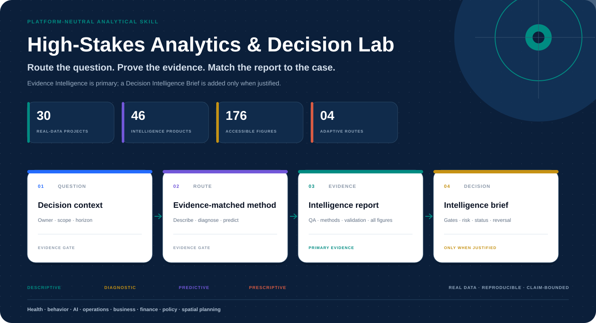
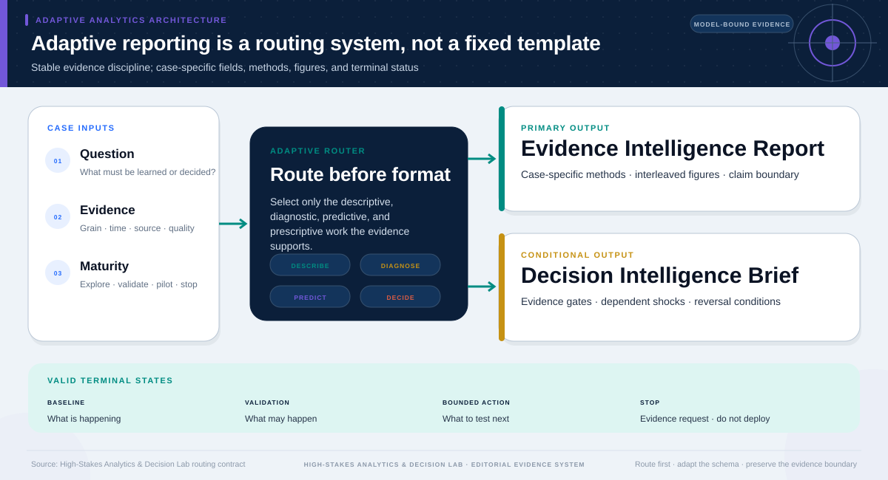
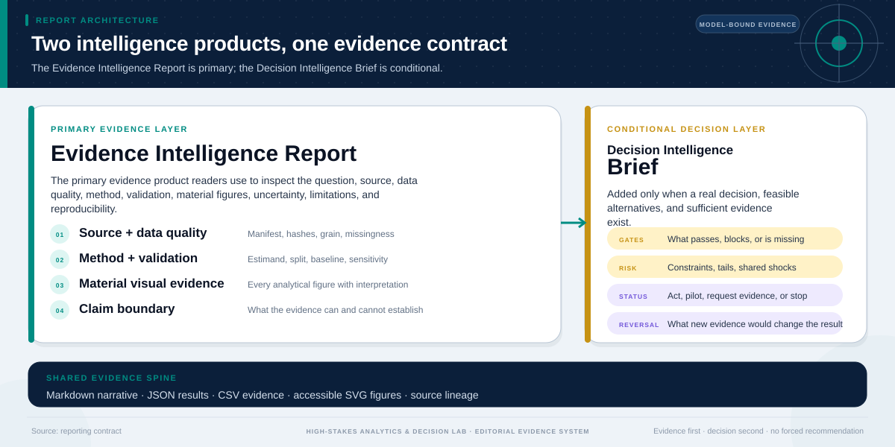
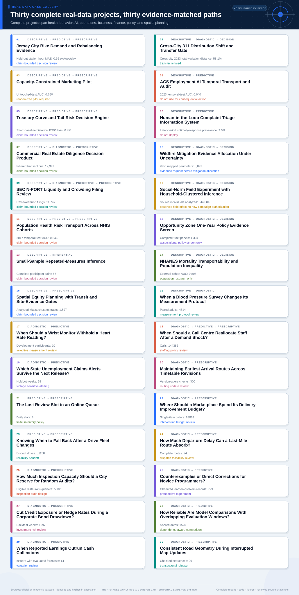

<p align="center">
  
</p>

<h1 align="center">High-Stakes Analytics & Decision Lab</h1>

<p align="center">
  Turn a decision about people or resources into an analysis another team can reproduce.
</p>

<p align="center">
  <a href="https://github.com/limingrui679-design/high-stakes-analytics-decision-lab/releases/tag/v1.1.2"></a>
  <a href="https://github.com/limingrui679-design/high-stakes-analytics-decision-lab/actions/workflows/verify.yml"></a>
  <a href="https://github.com/limingrui679-design/high-stakes-analytics-decision-lab/actions/workflows/codeql.yml"></a>
  <a href="LICENSE.txt"></a>
</p>

<p align="center">
  <a href="#start-in-three-steps"><strong>Quick start</strong></a> ·
  <a href="#how-it-works"><strong>Architecture</strong></a> ·
  <a href="https://limingrui679-design.github.io/high-stakes-analytics-decision-lab/demo/"><strong>Live explorer</strong></a> ·
  <a href="#fifteen-complete-evidence-paths"><strong>Portfolio</strong></a> ·
  <a href="docs/README.md"><strong>Documentation</strong></a> ·
  <a href="CONTRIBUTING.md"><strong>Contributing</strong></a>
</p>

## Why this exists

A transit planner choosing service locations and a review team prioritising complaints face a similar problem. An analysis has to answer a decision someone can actually make with the time, data and capacity available. This reusable analytics skill starts by defining that decision, the people affected and the unit of analysis. It then compares methods, tests how assumptions change the result, and links each finding to the data and code behind it.

The spatial equity case combines U.S. Census tract estimates with Massachusetts transit data to compare candidate service locations. Excluding tracts with missing rent-to-income data and filling those gaps with the observed median yielded the same five candidate sites. Treating the missing values as zero would have changed one selection. [Explore the spatial equity analysis](examples/real-data-cases/projects/spatial-equity-planning/PROJECT.md)

The same workflow runs across 15 public-data cases.

| Principle | System behavior |
|---|---|
| **Evidence before method** | Declare the question, population, grain, target quantity, horizon, lineage, and claim boundary first |
| **Readiness before analysis** | Preserve the source, profile quality and privacy, and pause on material transformations |
| **Adaptive routes** | Add descriptive, diagnostic, predictive, or prescriptive work only when justified |
| **Honest endpoints** | Accept an evidence request, negative validation, `do_not_deploy`, or no recommendation |
| **Dependent uncertainty** | Retain shared time, market, participant, campaign, operational, and spatial shocks |
| **Traceable communication** | Link claims and accessible figures to JSON, CSV, hashes, and rerunnable code |

The skill produces an evidence report. When the analysis supports an action, a separate decision brief records the alternatives, their trade-offs and the conditions for revisiting the choice.

## Start in three steps

### 1. Install the Skill

```bash
npx skills add limingrui679-design/high-stakes-analytics-decision-lab -g
```

The Agent Skills installer discovers the compact package under
[`skills/high-stakes-analytics-decision-lab/`](skills/high-stakes-analytics-decision-lab/):
39 files and about 472 KiB, rather than the full research portfolio. Its
machine-readable file and hash contract is in
[`bundle-manifest.json`](skills/high-stakes-analytics-decision-lab/bundle-manifest.json).

Use [`docs/getting-started.md`](docs/getting-started.md) for Codex-specific,
no-install, and direct repository options.

### 2. Ask for the evidence outcome

```text
$high-stakes-analytics-decision-lab
Run the data-readiness gate on this source, preserve the original file, and
select only the analytical routes the evidence supports. Produce an Evidence
Intelligence Report. Add a Decision Intelligence Brief only if the evidence
and decision context justify one.
```

Start with the decision or evidence question—not a preferred model. A valid
result may be a bounded action, a pilot requirement, targeted diligence, an
evidence request, negative validation, or `do_not_deploy`.

### 3. Review the evidence package

Every complete project keeps the narrative, machine result, visual evidence,
and source lineage together:

```text
report.md                    # primary Evidence Intelligence Report
results.json                 # machine-readable analytical result
chart-map.json               # figure-to-question and source contract
figures/*.svg                # accessible analytical visuals
```

A justified decision layer adds `decision-report.md`,
`decision-results.json`, and its own figure contract. It never replaces the
primary evidence product.

### Direct repository entry points

| Starting point | Command or guide | Outcome |
|---|---|---|
| Environment audit | `python3 scripts/hsadl.py doctor` | Python, runtime, template, write-access, and Skill-footprint checks |
| Safe 60-second walkthrough | `python3 scripts/hsadl.py demo --output-dir build/demo` | Synthetic source preservation, contract, quality gate, route, and accessible SVGs; no model or recommendation |
| Question only | `python3 scripts/hsadl.py route "<question>" --scope full --output-dir <path>` | Evidence and method blueprint; no invented result |
| Question plus data | `python3 scripts/hsadl.py start <data.csv> --question "<question>" --output-dir <path>` | Preserved source, draft contract, readiness profile, and unresolved decisions |
| Existing decision case | `python3 scripts/hsadl.py validate <case.json>` then `python3 scripts/hsadl.py run <case.json> --output-dir <path>` | Validated expected, tail, sensitivity, provenance, and group-impact outputs |
| Worked precedents | [Fifteen-project portfolio](examples/real-data-cases/README.md) | Complete source-to-report evidence paths |

## How it works

<p align="center">
  
</p>

The fixed evidence spine remains stable while the case-specific analytical
layer changes.

| Fixed evidence spine | Adaptive case layer |
|---|---|
| Question, population, unit, target quantity, and horizon | Route, fields, methods, and validation |
| Source lineage, quality status, and reproducibility | Figures, report sections, and decision criteria |
| Uncertainty, limitations, and claim boundary | Bounded action, evidence request, or stopping status |

### The data gate can stop the workflow

Uploaded row-level data do not go directly into a model. The system preserves
the original, establishes a contract, checks grain and keys, profiles quality
and privacy, and produces a dry-run remediation plan.

| Gate status | Meaning | Permitted next step |
|---|---|---|
| `ready` | No material failure under the declared contract | Continue |
| `ready_with_documented_limitations` | Localized issues remain | Continue with visible limits |
| `needs_user_confirmation` | A substantive transformation, privacy, or intended-use choice remains | Pause for a named approval or clarification |
| `blocked` | Grain, key, schema, leakage, or another critical failure invalidates the route | Stop and request corrected evidence |

Only safe normalization can run without approval. Deletion, imputation,
outlier treatment, category merging, unit conversion, target correction, and
grain changes require explicit action IDs. The processed copy never overwrites
the source.

### Four routes, no mandatory recommendation

| Route | Question | Required discipline | Valid endpoint |
|---|---|---|---|
| **Descriptive** | What is happening? | Denominators, coverage, trends, segments, and missingness | Baseline report or evidence request |
| **Diagnostic** | Why might it be happening? | Contributions, competing explanations, hypotheses, and a visible causal boundary | Prioritized explanations to test |
| **Predictive** | What is likely next? | Target, horizon, baseline, held-out validation, calibration, subgroup error, and drift | Validated prediction, negative validation, or `do_not_deploy` |
| **Prescriptive** | What should be done, if justified? | Owner, alternatives, constraints, dependence, tail risk, sensitivity, and reversal conditions | Bounded action or no decision-ready recommendation |

Routes may compose, but a later route cannot erase the quality and evidence
requirements of an earlier stage. Read the full system design in
[`docs/architecture.md`](docs/architecture.md).

## Two products, one evidence contract



| Product | Main question | Contents | Existence rule |
|---|---|---|---|
| **Evidence Intelligence Report** | What does the evidence establish? | Source and QA contract, methods, validation, figures, uncertainty, limitations, lineage, and reproducibility | Primary record for every complete project |
| **Decision Intelligence Brief** | What action, pilot, diligence, evidence request, or stop follows? | Decision status, alternatives, constraints, shared shocks, tail risk, sensitivity, and reversal conditions | Conditional; only when a separate decision layer is justified |

Every material figure is generated from the shared editorial evidence system,
includes a title and description, and is paired with its analytical question,
supported interpretation, and claim boundary. The visual system is part of the
evidence contract, not decorative reporting.

## Fifteen complete evidence paths

<p align="center">
  
</p>

The public portfolio contains 15 primary reports and 10 conditional briefs—25 intelligence products in total—plus 119 canonical accessible figures: 50 evidence figures and 69 decision figures.

The cases span operational demand, distribution shift, scarce-capacity pilots,
temporal model transport, tail-risk decisions, human-in-the-loop triage,
commercial diligence, mitigation allocation, filing review, clustered field
experiments, survival evidence, policy evaluation, repeated-measures inference,
population transportability, and spatial equity.

They intentionally end differently: some support a bounded decision, some
require a pilot or targeted review, and some stop at an evidence request or
`do_not_deploy`.

| Explore | Open |
|---|---|
| Searchable route and capability explorer | [Live case atlas](https://limingrui679-design.github.io/high-stakes-analytics-decision-lab/demo/) · [local source](demo/index.html) |
| Visual case gallery | [Portfolio overview](examples/real-data-cases/README.md) |
| Machine-readable catalog | [`cases.json`](examples/real-data-cases/cases.json) |
| School-neutral capability paths | [`capability-map.json`](examples/real-data-cases/capability-map.json) |
| Rebuild and comparison contract | [Verification guide](docs/verification.md) |
| Method and domain routing | [`method-domain-map.json`](references/method-domain-map.json) |

## Verification you can reproduce

The current stable release is
[`v1.1.2`](https://github.com/limingrui679-design/high-stakes-analytics-decision-lab/releases/tag/v1.1.2).
Its versioned source package and SHA-256 checksum are published together; the
release identity is also recorded in [`CITATION.cff`](CITATION.cff),
[`CHANGELOG.md`](CHANGELOG.md), and `RELEASE-MANIFEST.json`.

```bash
make verify
```

This runs the standalone regression suite and rebuilds all fifteen projects in
an isolated verified-file copy. Use `make quality` for the tracked-secret scan,
Ruff, mypy, and codespell; use [`docs/verification.md`](docs/verification.md)
for direct commands, static security gates, and no-Git release verification.

The 108 public tests cover data readiness, adaptive routing, numerical behavior,
source and artifact identity, package integrity, local links, accessible SVGs,
generator idempotence, compact installation, quickstart safety, interactive
explorer synchronization, no-Git releases, DNS and SSRF boundaries, and source
parser security. The complete 108-test standalone regression suite and the
fifteen-project rebuild are separate gates: successful reproduction establishes
the reviewed workflow and declared numerical tolerance, not empirical validity,
external adoption, or real-world impact.

CI exercises Python 3.11, 3.12, 3.13, and 3.14. Security checks include the
tracked-secret gate, Bandit, dependency auditing, hardened source-builder tests,
targeted branch coverage, and CodeQL.

## Repository design

```text
high-stakes-analytics-decision-lab/
├── skills/high-stakes-analytics-decision-lab/
│   └── SKILL.md                 # compact, installable Agent Skill package
├── demo/                        # dependency-free interactive case explorer
├── docs/                        # onboarding, architecture, layout, verification
├── references/                  # enforceable method and evidence contracts
├── assets/                      # templates and canonical README visuals
├── scripts/                     # profiling, routing, analysis, generation, checks
├── examples/real-data-cases/    # fifteen reproducible evidence projects
├── tests/                       # standalone contract and regression suite
└── .github/                     # CI, security, issue, and PR workflows
```

The nested Skill package prevents compatible installers from copying the full
portfolio. It is generated from the canonical root scripts, references, and
templates by `scripts/build_skill_bundle.py`; the full cases remain in
`examples/`. Human guides live in `docs/`; precise runtime rules live in
`references/`; generated evidence stays beside the project that produced it.
See [`docs/repository-layout.md`](docs/repository-layout.md) before moving or
regenerating files.

## Documentation

| Guide | Use it for |
|---|---|
| [Documentation home](docs/README.md) | Choose a user, reviewer, or maintainer path |
| [Getting started](docs/getting-started.md) | Install, route a question, profile data, and run a case |
| [Architecture](docs/architecture.md) | Understand gates, routes, products, the decision engine, and visual evidence |
| [Repository layout](docs/repository-layout.md) | Distinguish runtime contracts, human guides, canonical sources, and generated files |
| [Verification](docs/verification.md) | Reproduce tests, portfolio outputs, quality checks, and release gates |
| [Contributing](CONTRIBUTING.md) | Change code, documentation, sources, or cases without breaking evidence boundaries |
| [Security](SECURITY.md) | Report a vulnerability privately |

## Responsible-use boundary

This is a public, tested research and portfolio prototype. It does not establish
production readiness, institutional adoption, medical advice, investment
advice, a regulatory finding, an assurance opinion, or achieved real-world
impact. A reproducible result can still be decision-inappropriate; domain
review remains mandatory before operational use.

## Citation and license

Cite the version reviewed using [`CITATION.cff`](CITATION.cff). Public release
history is in [`CHANGELOG.md`](CHANGELOG.md), and component-version boundaries
are in [`VERSIONING.md`](VERSIONING.md).

Licensed under the [MIT License](LICENSE.txt).

### Evaluate a fixed review capacity

Pass `--review-budget 10 --review-budget 25` to `scripts/prediction_validation.py` to evaluate top-ranked records on a labeled holdout. The report compares expected positives with random review and gives the exact best and worst achievable counts when scores tie at the cutoff. Choose budgets from available capacity before viewing outcomes. This describes retrospective yield in the supplied sample.

For the [CFPB complaint holdout](examples/real-data-cases/projects/cfpb-fintech-complaint-operations/outputs/predictions.csv), reviewing the top 25 of 2,396 records finds zero late labels. At a budget of 100, cutoff ties give 3 to 5 late labels (3.48 expected under random tie ordering), compared with 2.50 under random review. These are retrospective labels; changing the review order has no demonstrated effect on complaint outcomes.

For a queue that closes daily, add `--batch-column date_received --batch-capacity 5`. Across 2,396 held-out CFPB complaints on 61 observed dates, 305 slots yielded 7.82 expected late responses under the score ranking (6–10 across tie orders), against 6.97 with uniform review on the same dates. Pooling all dates retrospectively yielded 8.52 using the same 305 slots. Scores were available for held-out records; review effects and deployment outcomes were not measured. Reproduce with the case's `outputs/predictions.csv`, `--label late_label` and `--score late_score`.
