# Thirty Complete Real-Data Projects

## Technical summary

The thirty projects share one evidence spine but do not share one report template.
Each route changes the methods, validation, figures, and valid endpoint.

| Fixed across projects | Adapted to the case | Valid endpoints |
|---|---|---|
| Source lineage, data quality, uncertainty, limitations, and reproducibility | Descriptive, inferential, diagnostic, predictive, or prescriptive modules | Bounded action, non-deployment, diligence request, evidence request, or no decision |

The **Evidence Intelligence Report** remains the primary product. A separate
Decision Intelligence Brief appears only when a decision layer is justified.

<p align="center">
  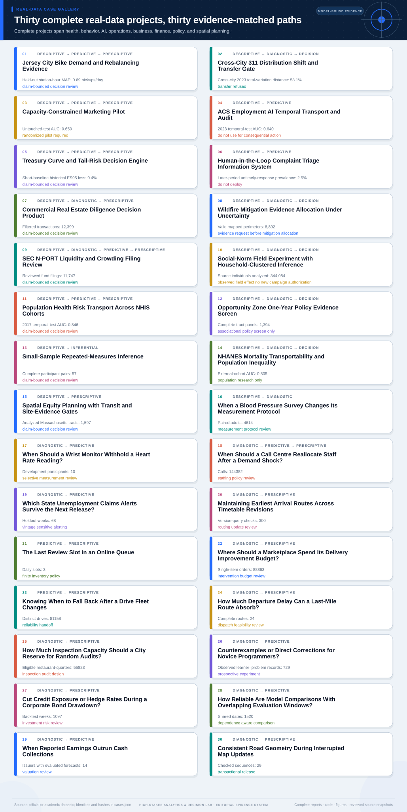
</p>

The overview should be read as a routing map. It shows why some cases end in a
bounded recommendation while others end in negative validation, a diligence
request, or an evidence request.

<details>
<summary><strong>What every complete project bundles</strong></summary>

```text
projects/
├── _shared/                 # shared standard-library analytical runtime
├── project-catalog.json     # thirty-project machine-readable index
└── <project-id>/
    ├── PROJECT.md
    ├── source-manifest.json
    ├── config.json
    ├── download_data.py
    ├── prepare_data.py
    ├── analyze.py
    ├── build_decision_case.py
    ├── data/                # reviewed raw snapshot, prepared data, dictionary, quality
    └── outputs/             # evidence report, decision brief, figures, results
```

</details>

## Explore by capability

These school-neutral paths expose what a reviewer can inspect in each case.
They are navigation aids, not claims that every case proves every listed
competency or that a public-data prototype had real-world impact.

| Capability path | What to inspect | Cases |
|---|---|---|
| **Analytics to action** | Connect prediction or diagnosis to capacity, workflow, implementation, communication, and a bounded next step. | [01](cases/01-bike-demand-operations.md) · [03](cases/03-bank-marketing-response.md) · [05](cases/05-treasury-risk-engineering.md) · [06](cases/06-cfpb-fintech-complaint-operations.md) · [07](cases/07-commercial-real-estate-risk.md) · [09](cases/09-sec-nport-filing-review.md) · [15](cases/15-spatial-equity-planning.md) · [18](cases/18-call-centre-flexible-dispatch.md) · [20](cases/20-transit-timetable-repair.md) · [21](cases/21-online-edit-review-capacity.md) · [22](cases/22-marketplace-delivery-intervention.md) · [24](cases/24-last-mile-departure-slack.md) · [25](cases/25-food-inspection-exploration.md) · [27](cases/27-credit-drawdown-rates-hedge.md) |
| **Statistical research** | Define the estimand, preserve the data-generating structure, quantify uncertainty, test robustness, and state the transport boundary. | [02](cases/02-cross-city-311-shift.md) · [04](cases/04-census-income-ai.md) · [05](cases/05-treasury-risk-engineering.md) · [10](cases/10-social-norm-field-experiment.md) · [12](cases/12-opportunity-zone-policy-evaluation.md) · [13](cases/13-behavioral-reading-experiment.md) · [14](cases/14-nhanes-population-transportability.md) · [16](cases/16-blood-pressure-protocol-bridge.md) · [17](cases/17-wearable-heart-rate-abstention.md) · [18](cases/18-call-centre-flexible-dispatch.md) · [19](cases/19-unemployment-claims-release-revisions.md) · [22](cases/22-marketplace-delivery-intervention.md) · [25](cases/25-food-inspection-exploration.md) · [26](cases/26-programming-hint-design.md) · [27](cases/27-credit-drawdown-rates-hedge.md) · [28](cases/28-overlapping-forecast-comparisons.md) · [29](cases/29-earnings-cash-collection.md) |
| **Data systems and governance** | Make data contracts, semantics, lineage, privacy, human review, failure states, and reproducibility part of the analytical system. | [02](cases/02-cross-city-311-shift.md) · [04](cases/04-census-income-ai.md) · [06](cases/06-cfpb-fintech-complaint-operations.md) · [09](cases/09-sec-nport-filing-review.md) · [11](cases/11-population-health-survival.md) · [19](cases/19-unemployment-claims-release-revisions.md) · [20](cases/20-transit-timetable-repair.md) · [23](cases/23-drive-failure-policy-fallback.md) · [29](cases/29-earnings-cash-collection.md) · [30](cases/30-versioned-road-geometry.md) |
| **AI and model validation** | Use leakage-safe validation, baselines, calibration, drift and subgroup checks, including a legitimate non-deployment result. | [01](cases/01-bike-demand-operations.md) · [03](cases/03-bank-marketing-response.md) · [04](cases/04-census-income-ai.md) · [06](cases/06-cfpb-fintech-complaint-operations.md) · [11](cases/11-population-health-survival.md) · [14](cases/14-nhanes-population-transportability.md) · [17](cases/17-wearable-heart-rate-abstention.md) · [19](cases/19-unemployment-claims-release-revisions.md) · [21](cases/21-online-edit-review-capacity.md) · [23](cases/23-drive-failure-policy-fallback.md) · [26](cases/26-programming-hint-design.md) · [28](cases/28-overlapping-forecast-comparisons.md) · [30](cases/30-versioned-road-geometry.md) |
| **Risk and decision analysis** | Compare feasible choices under dependent uncertainty, tail risk, scenario stress, value judgments, and reversal conditions. | [01](cases/01-bike-demand-operations.md) · [05](cases/05-treasury-risk-engineering.md) · [07](cases/07-commercial-real-estate-risk.md) · [08](cases/08-wildfire-mitigation-under-uncertainty.md) · [09](cases/09-sec-nport-filing-review.md) · [16](cases/16-blood-pressure-protocol-bridge.md) · [18](cases/18-call-centre-flexible-dispatch.md) · [21](cases/21-online-edit-review-capacity.md) · [22](cases/22-marketplace-delivery-intervention.md) · [23](cases/23-drive-failure-policy-fallback.md) · [24](cases/24-last-mile-departure-slack.md) · [27](cases/27-credit-drawdown-rates-hedge.md) · [28](cases/28-overlapping-forecast-comparisons.md) · [29](cases/29-earnings-cash-collection.md) |
| **Behavior and policy evidence** | Separate observed behavior, randomized or associational evidence, mechanisms, intervention claims, ethics, and implementation authority. | [03](cases/03-bank-marketing-response.md) · [08](cases/08-wildfire-mitigation-under-uncertainty.md) · [10](cases/10-social-norm-field-experiment.md) · [12](cases/12-opportunity-zone-policy-evaluation.md) · [13](cases/13-behavioral-reading-experiment.md) · [15](cases/15-spatial-equity-planning.md) · [25](cases/25-food-inspection-exploration.md) · [26](cases/26-programming-hint-design.md) |
| **Population health and informatics** | Respect population, cohort, measurement and information-system semantics while separating research validation from individual clinical use. | [11](cases/11-population-health-survival.md) · [14](cases/14-nhanes-population-transportability.md) · [16](cases/16-blood-pressure-protocol-bridge.md) · [17](cases/17-wearable-heart-rate-abstention.md) |
| **Spatial equity and planning** | Connect place-based evidence, access, distribution, uncertainty and feasibility without turning a screening model into a site or policy decision. | [02](cases/02-cross-city-311-shift.md) · [07](cases/07-commercial-real-estate-risk.md) · [08](cases/08-wildfire-mitigation-under-uncertainty.md) · [12](cases/12-opportunity-zone-policy-evaluation.md) · [15](cases/15-spatial-equity-planning.md) · [20](cases/20-transit-timetable-repair.md) · [24](cases/24-last-mile-departure-slack.md) · [30](cases/30-versioned-road-geometry.md) |

## Evidence Intelligence index

| Project | Domain and headline evidence | Adaptive route | Open artifacts |
|---|---|---|---|
| 01 · Jersey City Bike Demand and Rebalancing Evidence | Operations Research<br>Held-out station-hour MAE: 0.69 pickups/day | descriptive → predictive → prescriptive | [Evidence](projects/bike-demand-operations/outputs/report.md) · [Card](cases/01-bike-demand-operations.md) · [Decision](projects/bike-demand-operations/outputs/decision/report/decision-report.md) |
| 02 · Cross-City 311 Distribution Shift and Transfer Gate | Urban Analytics<br>Cross-city 2023 total-variation distance: 58.1% | descriptive → diagnostic → decision | [Evidence](projects/cross-city-311-shift/outputs/report.md) · [Card](cases/02-cross-city-311-shift.md) · [Terminal result](projects/cross-city-311-shift/outputs/results.json) |
| 03 · Capacity-Constrained Marketing Pilot | Business Analytics<br>Untouched-test AUC: 0.650 | descriptive → predictive → prescriptive | [Evidence](projects/bank-marketing-response/outputs/report.md) · [Card](cases/03-bank-marketing-response.md) · [Decision](projects/bank-marketing-response/outputs/decision/report/decision-report.md) |
| 04 · ACS Employment AI Temporal Transport and Audit | Artificial Intelligence<br>2023 temporal-test AUC: 0.640 | descriptive → predictive | [Evidence](projects/census-income-ai/outputs/report.md) · [Card](cases/04-census-income-ai.md) · [Decision](projects/census-income-ai/outputs/decision/report/decision-report.md) |
| 05 · Treasury Curve and Tail-Risk Decision Engine | Financial Risk Engineering<br>Short-baseline historical ES95 loss: 0.4% | descriptive → predictive → prescriptive | [Evidence](projects/treasury-risk-engineering/outputs/report.md) · [Card](cases/05-treasury-risk-engineering.md) · [Decision](projects/treasury-risk-engineering/outputs/decision/report/decision-report.md) |
| 06 · Human-in-the-Loop Complaint Triage Information System | Financial Technology<br>Later-period untimely-response prevalence: 2.5% | descriptive → predictive | [Evidence](projects/cfpb-fintech-complaint-operations/outputs/report.md) · [Card](cases/06-cfpb-fintech-complaint-operations.md) · [Decision](projects/cfpb-fintech-complaint-operations/outputs/decision/report/decision-report.md) |
| 07 · Commercial Real Estate Diligence Decision Product | Real-Estate Finance<br>Filtered transactions: 12,399 | descriptive → diagnostic → prescriptive | [Evidence](projects/commercial-real-estate-risk/outputs/report.md) · [Card](cases/07-commercial-real-estate-risk.md) · [Decision](projects/commercial-real-estate-risk/outputs/decision/report/decision-report.md) |
| 08 · Wildfire Mitigation Evidence Allocation Under Uncertainty | Decision Analysis<br>Valid mapped perimeters: 8,892 | descriptive → diagnostic → decision | [Evidence](projects/wildfire-mitigation-under-uncertainty/outputs/report.md) · [Card](cases/08-wildfire-mitigation-under-uncertainty.md) · [Terminal result](projects/wildfire-mitigation-under-uncertainty/outputs/results.json) |
| 09 · SEC N-PORT Liquidity and Crowding Filing Review | Regulatory Filings<br>Reviewed fund filings: 11,747 | descriptive → diagnostic → predictive → prescriptive | [Evidence](projects/sec-nport-filing-review/outputs/report.md) · [Card](cases/09-sec-nport-filing-review.md) · [Decision](projects/sec-nport-filing-review/outputs/decision/report/decision-report.md) |
| 10 · Social-Norm Field Experiment with Household-Clustered Inference | Field Experiments<br>Source individuals analyzed: 344,084 | descriptive → diagnostic → decision | [Evidence](projects/social-norm-field-experiment/outputs/report.md) · [Card](cases/10-social-norm-field-experiment.md) · [Terminal result](projects/social-norm-field-experiment/outputs/results.json) |
| 11 · Population Health Risk Transport Across NHIS Cohorts | Population Health<br>2017 temporal-test AUC: 0.846 | descriptive → predictive → prescriptive | [Evidence](projects/population-health-survival/outputs/report.md) · [Card](cases/11-population-health-survival.md) · [Decision](projects/population-health-survival/outputs/decision/report/decision-report.md) |
| 12 · Opportunity Zone One-Year Policy Evidence Screen | Public Policy<br>Complete tract panels: 1,394 | descriptive → diagnostic → decision | [Evidence](projects/opportunity-zone-policy-evaluation/outputs/report.md) · [Card](cases/12-opportunity-zone-policy-evaluation.md) · [Terminal result](projects/opportunity-zone-policy-evaluation/outputs/results.json) |
| 13 · Small-Sample Repeated-Measures Inference | Statistics<br>Complete participant pairs: 57 | descriptive → inferential | [Evidence](projects/behavioral-reading-experiment/outputs/report.md) · [Card](cases/13-behavioral-reading-experiment.md) · [Decision](projects/behavioral-reading-experiment/outputs/decision/report/decision-report.md) |
| 14 · NHANES Mortality Transportability and Population Inequality | Biostatistics<br>External-cohort AUC: 0.805 | descriptive → diagnostic → decision | [Evidence](projects/nhanes-population-transportability/outputs/report.md) · [Card](cases/14-nhanes-population-transportability.md) · [Terminal result](projects/nhanes-population-transportability/outputs/results.json) |
| 15 · Spatial Equity Planning with Transit and Site-Evidence Gates | Urban Planning<br>Analyzed Massachusetts tracts: 1,597 | descriptive → prescriptive | [Evidence](projects/spatial-equity-planning/outputs/report.md) · [Card](cases/15-spatial-equity-planning.md) · [Decision](projects/spatial-equity-planning/outputs/decision/report/decision-report.md) |
| 16 · When a Blood Pressure Survey Changes Its Measurement Protocol | Population Health Surveillance<br>Paired adults: 4614 | descriptive → diagnostic | [Evidence](projects/blood-pressure-protocol-bridge/outputs/report.md) · [Card](cases/16-blood-pressure-protocol-bridge.md) · [Terminal result](projects/blood-pressure-protocol-bridge/outputs/results.json) |
| 17 · When Should a Wrist Monitor Withhold a Heart Rate Reading? | Wearable Biomedical Informatics<br>Development participants: 10 | diagnostic → predictive | [Evidence](projects/wearable-heart-rate-abstention/outputs/report.md) · [Card](cases/17-wearable-heart-rate-abstention.md) · [Terminal result](projects/wearable-heart-rate-abstention/outputs/results.json) |
| 18 · When Should a Call Centre Reallocate Staff After a Demand Shock? | Systems Engineering<br>Calls: 144382 | diagnostic → predictive → prescriptive | [Evidence](projects/call-centre-flexible-dispatch/outputs/report.md) · [Card](cases/18-call-centre-flexible-dispatch.md) · [Decision](projects/call-centre-flexible-dispatch/outputs/decision/report/decision-report.md) |
| 19 · Which State Unemployment Claims Alerts Survive the Next Release? | Applied Machine Learning<br>Holdout weeks: 68 | diagnostic → predictive | [Evidence](projects/unemployment-claims-release-revisions/outputs/report.md) · [Card](cases/19-unemployment-claims-release-revisions.md) · [Terminal result](projects/unemployment-claims-release-revisions/outputs/results.json) |
| 20 · Maintaining Earliest Arrival Routes Across Timetable Revisions | Computer Science Algorithms<br>Version-query checks: 300 | diagnostic → prescriptive | [Evidence](projects/transit-timetable-repair/outputs/report.md) · [Card](cases/20-transit-timetable-repair.md) · [Terminal result](projects/transit-timetable-repair/outputs/results.json) |
| 21 · The Last Review Slot in an Online Queue | Operations Research<br>Daily slots: 3 | predictive → prescriptive | [Evidence](projects/online-edit-review-capacity/outputs/report.md) · [Card](cases/21-online-edit-review-capacity.md) · [Decision](projects/online-edit-review-capacity/outputs/decision/report/decision-report.md) |
| 22 · Where Should a Marketplace Spend Its Delivery Improvement Budget? | Business Analytics<br>Single-item orders: 88863 | diagnostic → prescriptive | [Evidence](projects/marketplace-delivery-intervention/outputs/report.md) · [Card](cases/22-marketplace-delivery-intervention.md) · [Decision](projects/marketplace-delivery-intervention/outputs/decision/report/decision-report.md) |
| 23 · Knowing When to Fall Back After a Drive Fleet Changes | Machine Learning Engineering<br>Distinct drives: 81158 | predictive → prescriptive | [Evidence](projects/drive-failure-policy-fallback/outputs/report.md) · [Card](cases/23-drive-failure-policy-fallback.md) · [Terminal result](projects/drive-failure-policy-fallback/outputs/results.json) |
| 24 · How Much Departure Delay Can a Last-Mile Route Absorb? | Freight Transportation<br>Complete routes: 24 | diagnostic → prescriptive | [Evidence](projects/last-mile-departure-slack/outputs/report.md) · [Card](cases/24-last-mile-departure-slack.md) · [Decision](projects/last-mile-departure-slack/outputs/decision/report/decision-report.md) |
| 25 · How Much Inspection Capacity Should a City Reserve for Random Audits? | Technology Policy<br>Eligible restaurant-quarters: 55823 | diagnostic → prescriptive | [Evidence](projects/food-inspection-exploration/outputs/report.md) · [Card](cases/25-food-inspection-exploration.md) · [Decision](projects/food-inspection-exploration/outputs/decision/report/decision-report.md) |
| 26 · Counterexamples or Direct Corrections for Novice Programmers? | Learning Design<br>Observed learner–problem records: 729 | diagnostic → predictive | [Evidence](projects/programming-hint-design/outputs/report.md) · [Card](cases/26-programming-hint-design.md) · [Terminal result](projects/programming-hint-design/outputs/results.json) |
| 27 · Cut Credit Exposure or Hedge Rates During a Corporate Bond Drawdown? | Investment Risk<br>Backtest weeks: 1097 | diagnostic → prescriptive | [Evidence](projects/credit-drawdown-rates-hedge/outputs/report.md) · [Card](cases/27-credit-drawdown-rates-hedge.md) · [Decision](projects/credit-drawdown-rates-hedge/outputs/decision/report/decision-report.md) |
| 28 · How Reliable Are Model Comparisons With Overlapping Evaluation Windows? | Applied Statistics<br>Shared dates: 1520 | diagnostic → predictive | [Evidence](projects/overlapping-forecast-comparisons/outputs/report.md) · [Card](cases/28-overlapping-forecast-comparisons.md) · [Terminal result](projects/overlapping-forecast-comparisons/outputs/results.json) |
| 29 · When Reported Earnings Outrun Cash Collections | Fundamental Analysis<br>Issuers with evaluated forecasts: 14 | diagnostic → predictive | [Evidence](projects/earnings-cash-collection/outputs/report.md) · [Card](cases/29-earnings-cash-collection.md) · [Terminal result](projects/earnings-cash-collection/outputs/results.json) |
| 30 · Consistent Road Geometry During Interrupted Map Updates | Computer Systems<br>Checked sequences: 29 | diagnostic → prescriptive | [Evidence](projects/versioned-road-geometry/outputs/report.md) · [Card](cases/30-versioned-road-geometry.md) · [Terminal result](projects/versioned-road-geometry/outputs/results.json) |

## Optional visual gallery

The index above is the default reading path. Open the gallery only when a
visual comparison across all thirty projects is useful.

<details>
<summary><strong>Open thirty representative visuals and claim boundaries</strong></summary>

<table>
<tr>
<td width="50%">
  <a href="projects/bike-demand-operations/outputs/report.md">
    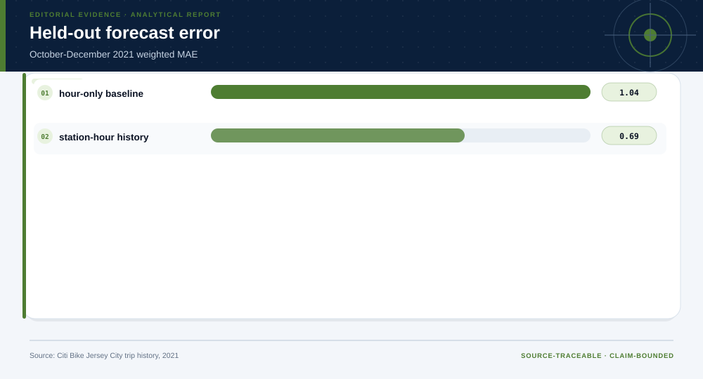
  </a>
  <br><strong>01 · Jersey City Bike Demand and Rebalancing Evidence</strong>
  <br>Held-out station-hour MAE is 0.69 pickups/day, a 33.1% improvement over the hour-only baseline.
  <br><em>Boundary:</em> Rebalancing outcomes are modeled; no stockout, routing, labor, or achieved-service claim.
  <br><a href="cases/01-bike-demand-operations.md">Case card</a> · <a href="projects/bike-demand-operations/outputs/report.md">Evidence Intelligence Report</a>
  · <a href="projects/bike-demand-operations/outputs/decision/report/decision-report.md">Decision Intelligence Brief</a>
</td>
<td width="50%">
  <a href="projects/cross-city-311-shift/outputs/report.md">
    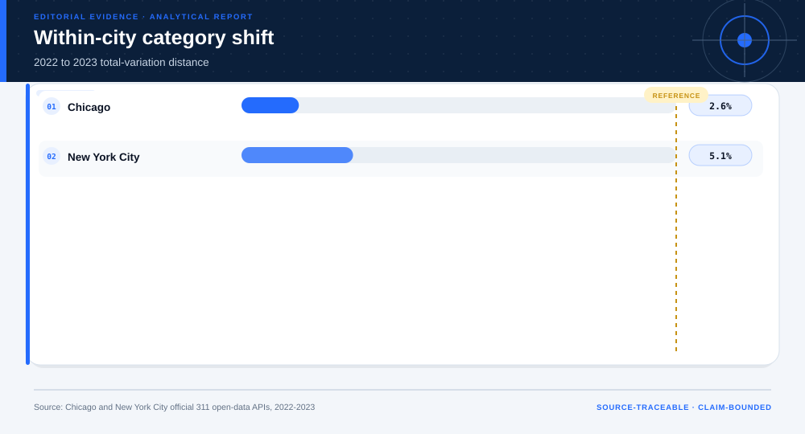
  </a>
  <br><strong>02 · Cross-City 311 Distribution Shift and Transfer Gate</strong>
  <br>The 2023 cross-city total-variation distance is 58.1%, and the transfer gate is refused.
  <br><em>Boundary:</em> Administrative shift audit only; requests are not latent need or service quality.
  <br><a href="cases/02-cross-city-311-shift.md">Case card</a> · <a href="projects/cross-city-311-shift/outputs/report.md">Evidence Intelligence Report</a>
  · <a href="projects/cross-city-311-shift/outputs/results.json">Terminal result</a>
</td>
</tr>
<tr>
<td width="50%">
  <a href="projects/bank-marketing-response/outputs/report.md">
    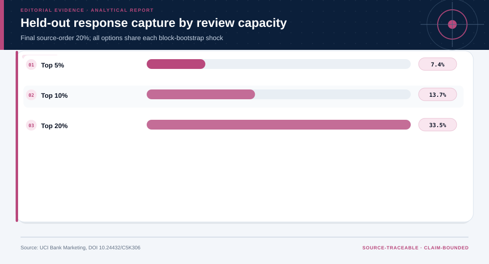
  </a>
  <br><strong>03 · Capacity-Constrained Marketing Pilot</strong>
  <br>The untouched test yields an AUC of 0.650 and a Brier score of 0.210; the top 5% captures 7.4% of observed responses.
  <br><em>Boundary:</em> Observed response concentration is not incremental lift, causal treatment effect, profit, or return on outreach.
  <br><a href="cases/03-bank-marketing-response.md">Case card</a> · <a href="projects/bank-marketing-response/outputs/report.md">Evidence Intelligence Report</a>
  · <a href="projects/bank-marketing-response/outputs/decision/report/decision-report.md">Decision Intelligence Brief</a>
</td>
<td width="50%">
  <a href="projects/census-income-ai/outputs/report.md">
    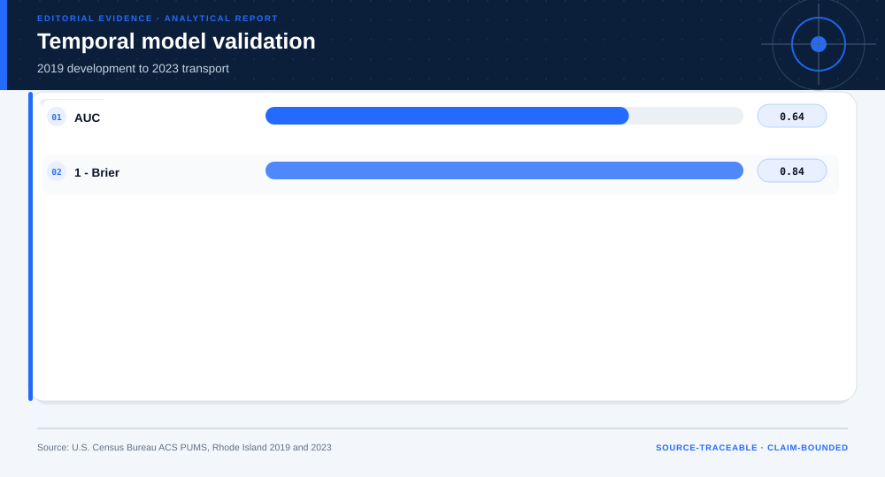
  </a>
  <br><strong>04 · ACS Employment AI Temporal Transport and Audit</strong>
  <br>The untouched 2023 temporal test yields an AUC of 0.640 and a weighted Brier score of 0.158.
  <br><em>Boundary:</em> No eligibility, hiring, credit, benefits, or other consequential action.
  <br><a href="cases/04-census-income-ai.md">Case card</a> · <a href="projects/census-income-ai/outputs/report.md">Evidence Intelligence Report</a>
  · <a href="projects/census-income-ai/outputs/decision/report/decision-report.md">Decision Intelligence Brief</a>
</td>
</tr>
<tr>
<td width="50%">
  <a href="projects/treasury-risk-engineering/outputs/report.md">
    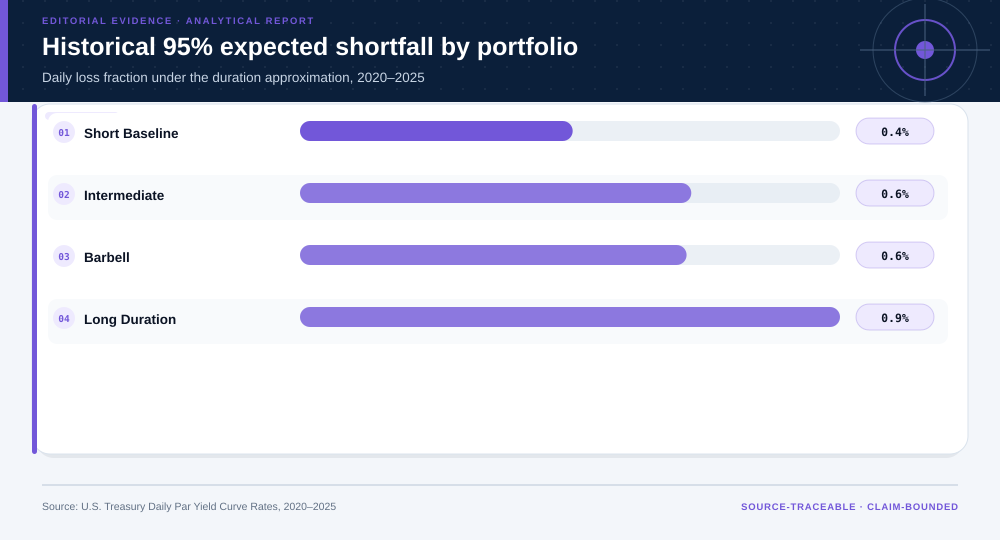
  </a>
  <br><strong>05 · Treasury Curve and Tail-Risk Decision Engine</strong>
  <br>Historical ES95 loss rises from 0.4% for the short baseline to 0.9% for the long-duration portfolio; the short-baseline rolling VaR exceedance rate is 6.0%.
  <br><em>Boundary:</em> First-order duration omits convexity, security selection, costs, financing, taxes, liquidity, and future-regime uncertainty.
  <br><a href="cases/05-treasury-risk-engineering.md">Case card</a> · <a href="projects/treasury-risk-engineering/outputs/report.md">Evidence Intelligence Report</a>
  · <a href="projects/treasury-risk-engineering/outputs/decision/report/decision-report.md">Decision Intelligence Brief</a>
</td>
<td width="50%">
  <a href="projects/cfpb-fintech-complaint-operations/outputs/report.md">
    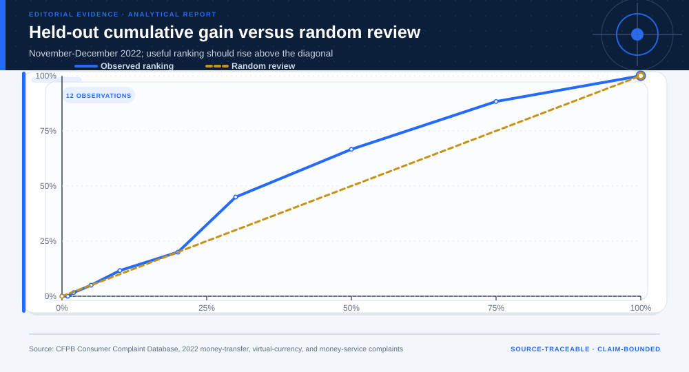
  </a>
  <br><strong>06 · Human-in-the-Loop Complaint Triage Information System</strong>
  <br>The later-period AUC is 0.611 (block-bootstrap 95% interval 0.539 to 0.697), while top-5% lift is 1.00 (95% interval 0.33 to 2.46); the ranking model fails the deployment gate.
  <br><em>Boundary:</em> The timely flag is not complaint merit, harm, resolution quality, company quality, or compliance; the 2022 model may not transport.
  <br><a href="cases/06-cfpb-fintech-complaint-operations.md">Case card</a> · <a href="projects/cfpb-fintech-complaint-operations/outputs/report.md">Evidence Intelligence Report</a>
  · <a href="projects/cfpb-fintech-complaint-operations/outputs/decision/report/decision-report.md">Decision Intelligence Brief</a>
</td>
</tr>
<tr>
<td width="50%">
  <a href="projects/commercial-real-estate-risk/outputs/report.md">
    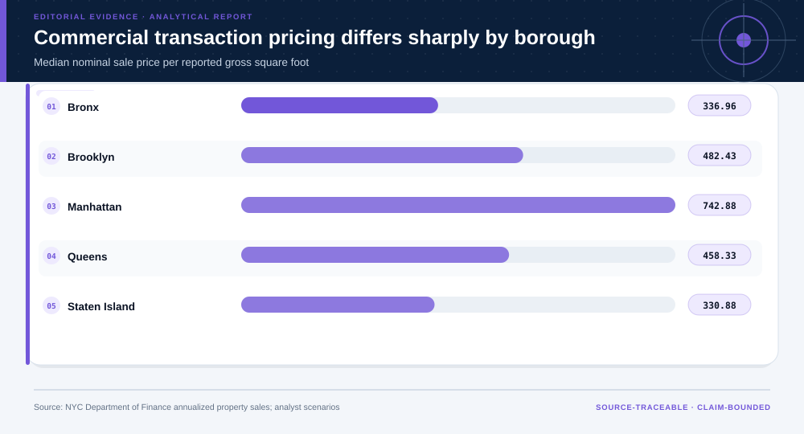
  </a>
  <br><strong>07 · Commercial Real Estate Diligence Decision Product</strong>
  <br>Across 12,399 filtered commercial transactions, Manhattan has the highest borough median price per square foot at $743; the break-even cap rate at 8.5% debt is 7.5%.
  <br><em>Boundary:</em> The source does not establish arm's-length status, NOI, expenses, occupancy, condition, appraisal value, debt terms, or causal regeneration effects.
  <br><a href="cases/07-commercial-real-estate-risk.md">Case card</a> · <a href="projects/commercial-real-estate-risk/outputs/report.md">Evidence Intelligence Report</a>
  · <a href="projects/commercial-real-estate-risk/outputs/decision/report/decision-report.md">Decision Intelligence Brief</a>
</td>
<td width="50%">
  <a href="projects/wildfire-mitigation-under-uncertainty/outputs/report.md">
    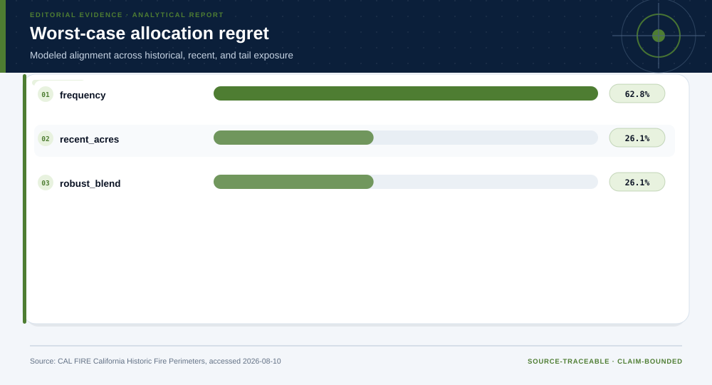
  </a>
  <br><strong>08 · Wildfire Mitigation Evidence Allocation Under Uncertainty</strong>
  <br>Across 8,892 valid mapped perimeters, recent observed acres is the lowest-regret proxy allocation under the tested scenarios.
  <br><em>Boundary:</em> No fires-prevented or acres-prevented estimate; mitigation action blocked pending effectiveness and feasibility evidence.
  <br><a href="cases/08-wildfire-mitigation-under-uncertainty.md">Case card</a> · <a href="projects/wildfire-mitigation-under-uncertainty/outputs/report.md">Evidence Intelligence Report</a>
  · <a href="projects/wildfire-mitigation-under-uncertainty/outputs/results.json">Terminal result</a>
</td>
</tr>
<tr>
<td width="50%">
  <a href="projects/sec-nport-filing-review/outputs/report.md">
    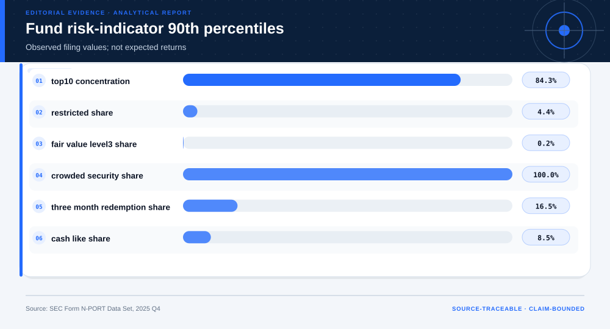
  </a>
  <br><strong>09 · SEC N-PORT Liquidity and Crowding Filing Review</strong>
  <br>Across 11,747 reviewed filings, median top-10 holding concentration is 34.5% and the 90th-percentile Level-3 share is 0.2%.
  <br><em>Boundary:</em> Filing review only; no expected-return, suitability, fund-quality, or investment recommendation.
  <br><a href="cases/09-sec-nport-filing-review.md">Case card</a> · <a href="projects/sec-nport-filing-review/outputs/report.md">Evidence Intelligence Report</a>
  · <a href="projects/sec-nport-filing-review/outputs/decision/report/decision-report.md">Decision Intelligence Brief</a>
</td>
<td width="50%">
  <a href="projects/social-norm-field-experiment/outputs/report.md">
    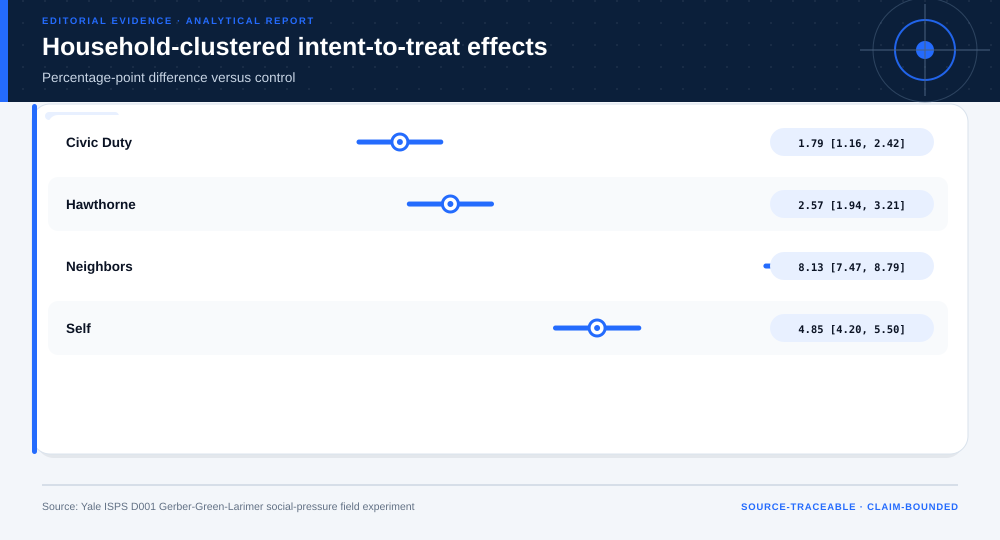
  </a>
  <br><strong>10 · Social-Norm Field Experiment with Household-Clustered Inference</strong>
  <br>The Neighbors arm has the largest observed intent-to-treat effect at 8.1%, with a household-clustered 95% interval of 7.5% to 8.8%.
  <br><em>Boundary:</em> Causal scope is the historical randomized experiment; no new campaign authorization.
  <br><a href="cases/10-social-norm-field-experiment.md">Case card</a> · <a href="projects/social-norm-field-experiment/outputs/report.md">Evidence Intelligence Report</a>
  · <a href="projects/social-norm-field-experiment/outputs/results.json">Terminal result</a>
</td>
</tr>
<tr>
<td width="50%">
  <a href="projects/population-health-survival/outputs/report.md">
    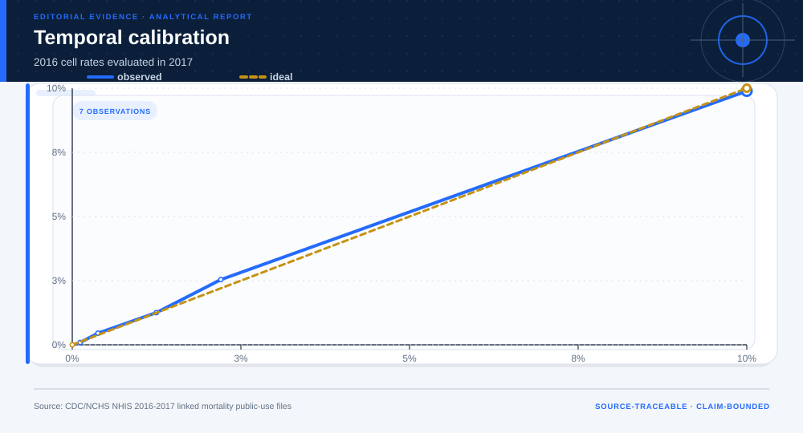
  </a>
  <br><strong>11 · Population Health Risk Transport Across NHIS Cohorts</strong>
  <br>The 2017 temporal test yields an AUC of 0.846 and weighted two-year mortality of 2.32% across 58,754 linked adults.
  <br><em>Boundary:</em> Population-risk validation only; no individual diagnosis, treatment, or clinical deployment.
  <br><a href="cases/11-population-health-survival.md">Case card</a> · <a href="projects/population-health-survival/outputs/report.md">Evidence Intelligence Report</a>
  · <a href="projects/population-health-survival/outputs/decision/report/decision-report.md">Decision Intelligence Brief</a>
</td>
<td width="50%">
  <a href="projects/opportunity-zone-policy-evaluation/outputs/report.md">
    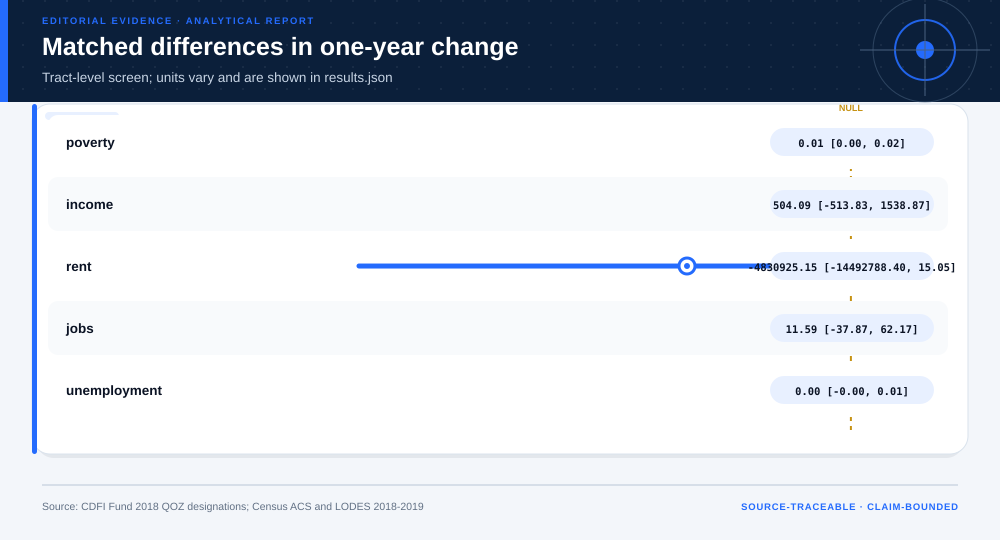
  </a>
  <br><strong>12 · Opportunity Zone One-Year Policy Evidence Screen</strong>
  <br>The matched one-year screen contains 1,460 complete tract panels, including 138 designated QOZ tracts and 121 unique matched controls.
  <br><em>Boundary:</em> Associational one-year screen; no causal effect because parallel trends are unavailable.
  <br><a href="cases/12-opportunity-zone-policy-evaluation.md">Case card</a> · <a href="projects/opportunity-zone-policy-evaluation/outputs/report.md">Evidence Intelligence Report</a>
  · <a href="projects/opportunity-zone-policy-evaluation/outputs/results.json">Terminal result</a>
</td>
</tr>
<tr>
<td width="50%">
  <a href="projects/behavioral-reading-experiment/outputs/report.md">
    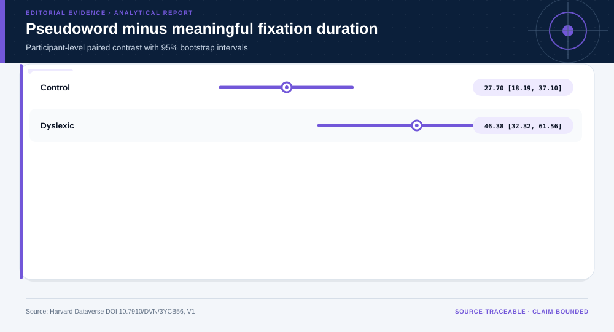
  </a>
  <br><strong>13 · Small-Sample Repeated-Measures Inference</strong>
  <br>Across 57 complete participant pairs, the mean pseudoword-minus-meaningful fixation-duration difference is 34.25 (bootstrap 95% interval 25.87 to 43.35), with a Holm-adjusted sign-flip p-value of 0.0003.
  <br><em>Boundary:</em> The public sample is small and does not establish downstream educational outcomes or an intervention effect.
  <br><a href="cases/13-behavioral-reading-experiment.md">Case card</a> · <a href="projects/behavioral-reading-experiment/outputs/report.md">Evidence Intelligence Report</a>
  · <a href="projects/behavioral-reading-experiment/outputs/decision/report/decision-report.md">Decision Intelligence Brief</a>
</td>
<td width="50%">
  <a href="projects/nhanes-population-transportability/outputs/report.md">
    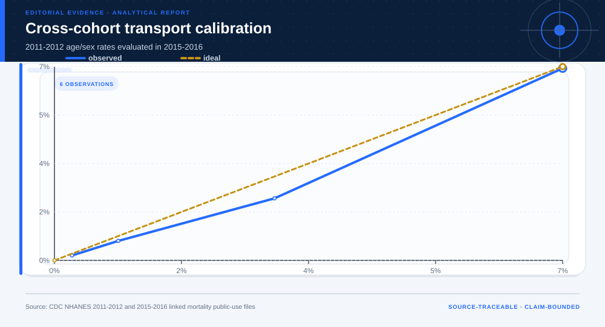
  </a>
  <br><strong>14 · NHANES Mortality Transportability and Population Inequality</strong>
  <br>The external-cohort check yields an AUC of 0.804 and a Brier score of 0.022 across 11,820 linked adults.
  <br><em>Boundary:</em> Population research only; no individual diagnosis or treatment.
  <br><a href="cases/14-nhanes-population-transportability.md">Case card</a> · <a href="projects/nhanes-population-transportability/outputs/report.md">Evidence Intelligence Report</a>
  · <a href="projects/nhanes-population-transportability/outputs/results.json">Terminal result</a>
</td>
</tr>
<tr>
<td width="50%">
  <a href="projects/spatial-equity-planning/outputs/report.md">
    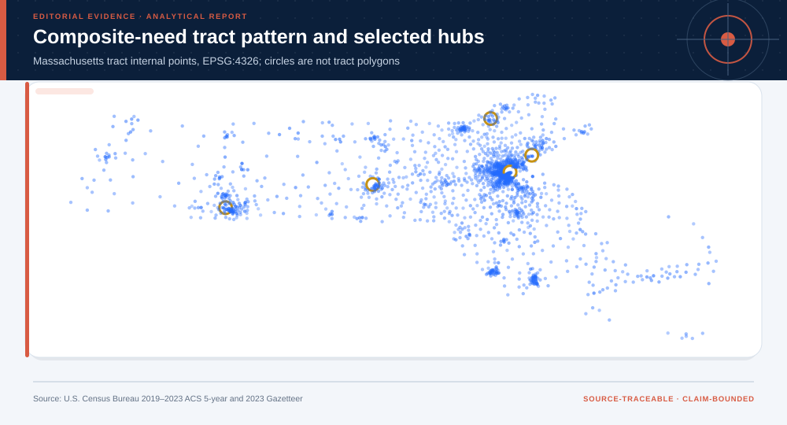
  </a>
  <br><strong>15 · Spatial Equity Planning with Transit and Site-Evidence Gates</strong>
  <br>Across 1,597 analyzed tracts and 265 rapid-transit stop records, the high-poverty weighted nearest-stop distance is 40.65 km.
  <br><em>Boundary:</em> No site recommendation until parcel, zoning, network, cost, and community evidence is supplied.
  <br><a href="cases/15-spatial-equity-planning.md">Case card</a> · <a href="projects/spatial-equity-planning/outputs/report.md">Evidence Intelligence Report</a>
  · <a href="projects/spatial-equity-planning/outputs/decision/report/decision-report.md">Decision Intelligence Brief</a>
</td>
<td width="50%">
  <a href="projects/blood-pressure-protocol-bridge/outputs/report.md">
    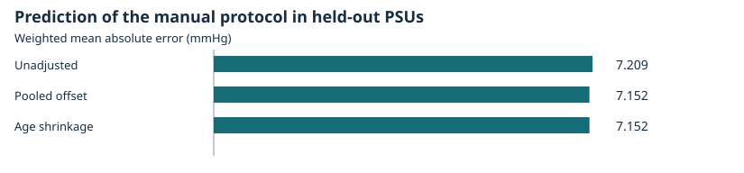
  </a>
  <br><strong>16 · When a Blood Pressure Survey Changes Its Measurement Protocol</strong>
  <br>Across 4,614 paired adults, the survey-weighted automatic-minus-manual mean was -1.50 mmHg. At 130 mmHg, 5.32% moved above and 8.15% moved below the cutoff.
  <br><em>Boundary:</em> The device and examiner change together. Weighted results describe adults with paired examination records; threshold crossings are survey classifications, not new clinical diagnoses.
  <br><a href="cases/16-blood-pressure-protocol-bridge.md">Case card</a> · <a href="projects/blood-pressure-protocol-bridge/outputs/report.md">Evidence Intelligence Report</a>
  · <a href="projects/blood-pressure-protocol-bridge/outputs/results.json">Terminal result</a>
</td>
</tr>
<tr>
<td width="50%">
  <a href="projects/wearable-heart-rate-abstention/outputs/report.md">
    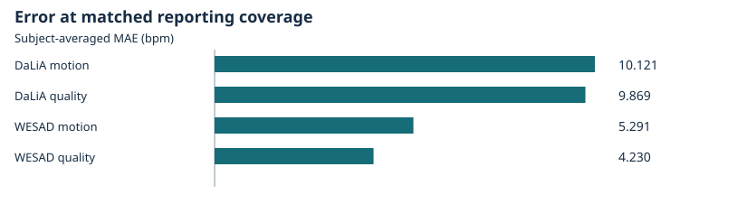
  </a>
  <br><strong>17 · When Should a Wrist Monitor Withhold a Heart Rate Reading?</strong>
  <br>With the DaLiA threshold frozen, WESAD retained 85.2% of 5,544 eligible windows. Subject-averaged absolute error among reported ECG-readable windows was 6.83 bpm.
  <br><em>Boundary:</em> The ECG reference is algorithm-derived. The external cohort changes the activity setting; both studies use Empatica wrist hardware. Reported accuracy applies only to the activity and ECG eligibility definitions.
  <br><a href="cases/17-wearable-heart-rate-abstention.md">Case card</a> · <a href="projects/wearable-heart-rate-abstention/outputs/report.md">Evidence Intelligence Report</a>
  · <a href="projects/wearable-heart-rate-abstention/outputs/results.json">Terminal result</a>
</td>
<td width="50%">
  <a href="projects/call-centre-flexible-dispatch/outputs/report.md">
    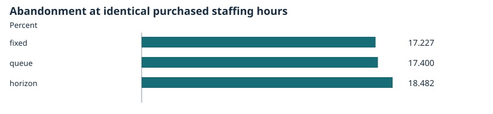
  </a>
  <br><strong>18 · When Should a Call Centre Reallocate Staff After a Demand Shock?</strong>
  <br>Across 65 held-out mornings, mean simulated abandonment was 17.23% with a fixed reserve and 18.48% under receding-horizon dispatch. Observed abandonment averaged 13.91%.
  <br><em>Boundary:</em> Historical outcomes describe observed calls. Staffing schedules, patience past the censoring point, operator flexibility and policy-dependent waits are simulated. The five-hour morning replay begins with an empty queue.
  <br><a href="cases/18-call-centre-flexible-dispatch.md">Case card</a> · <a href="projects/call-centre-flexible-dispatch/outputs/report.md">Evidence Intelligence Report</a>
  · <a href="projects/call-centre-flexible-dispatch/outputs/decision/report/decision-report.md">Decision Intelligence Brief</a>
</td>
</tr>
<tr>
<td width="50%">
  <a href="projects/unemployment-claims-release-revisions/outputs/report.md">
    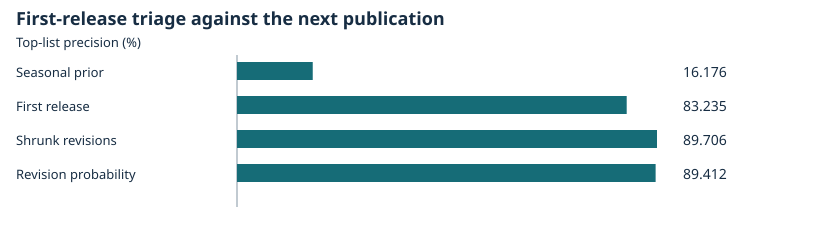
  </a>
  <br><strong>19 · Which State Unemployment Claims Alerts Survive the Next Release?</strong>
  <br>Across 68 held-out weekly releases at 5 review slots, 83.2% of first-release alerts and 89.7% of revision-adjusted alerts appeared in the next release's residence-based list.
  <br><em>Boundary:</em> The advance column is reported by liable state and includes a workshare proxy. The next release uses state of residence. The ranked target is a later published measure, not a directly observed employment shock.
  <br><a href="cases/19-unemployment-claims-release-revisions.md">Case card</a> · <a href="projects/unemployment-claims-release-revisions/outputs/report.md">Evidence Intelligence Report</a>
  · <a href="projects/unemployment-claims-release-revisions/outputs/results.json">Terminal result</a>
</td>
<td width="50%">
  <a href="projects/transit-timetable-repair/outputs/report.md">
    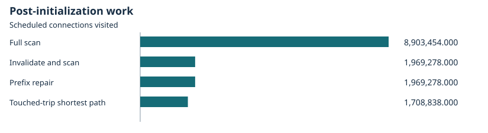
  </a>
  <br><strong>20 · Maintaining Earliest Arrival Routes Across Timetable Revisions</strong>
  <br>Across 10 timetable versions, all 300 route-query results matched a full scan. Revisions changed 4,223 destination arrival labels; checkpoint repair visited 1,969,278 connections versus 8,903,454 for full recomputation.
  <br><em>Boundary:</em> The archive assigns each download a non-overlapping archive interval. This is a comparison of overlapping planned calendar service inside those files. Results concern scheduled travel in a selected network, with a stated same-station transfer buffer and no street-walking links.
  <br><a href="cases/20-transit-timetable-repair.md">Case card</a> · <a href="projects/transit-timetable-repair/outputs/report.md">Evidence Intelligence Report</a>
  · <a href="projects/transit-timetable-repair/outputs/results.json">Terminal result</a>
</td>
</tr>
<tr>
<td width="50%">
  <a href="projects/online-edit-review-capacity/outputs/report.md">
    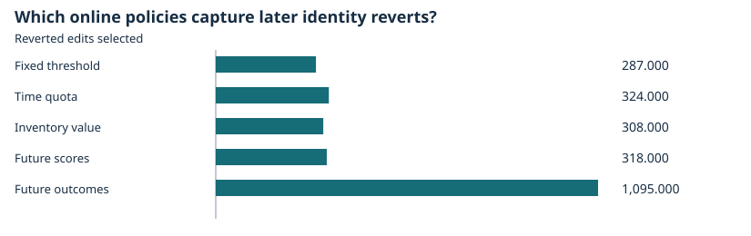
  </a>
  <br><strong>21 · The Last Review Slot in an Online Queue</strong>
  <br>Across 366 held-out publication days, the inventory-value policy captured 308 seven-day identity reverts, versus 287 with a fixed threshold and 1095 for an outcome-aware upper bound.
  <br><em>Boundary:</em> An identity revert indicates that previously observed page content returned within seven days. It is a behavioral proxy. The replay assumes no effect of the simulated review on subsequent edits.
  <br><a href="cases/21-online-edit-review-capacity.md">Case card</a> · <a href="projects/online-edit-review-capacity/outputs/report.md">Evidence Intelligence Report</a>
  · <a href="projects/online-edit-review-capacity/outputs/decision/report/decision-report.md">Decision Intelligence Brief</a>
</td>
<td width="50%">
  <a href="projects/marketplace-delivery-intervention/outputs/report.md">
    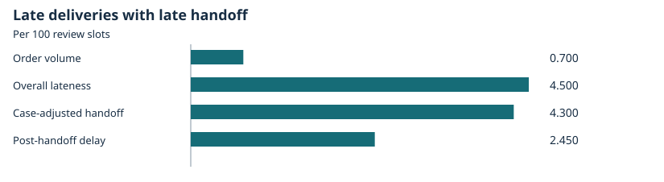
  </a>
  <br><strong>22 · Where Should a Marketplace Spend Its Delivery Improvement Budget?</strong>
  <br>Across 4 future quarters and 2,000 equal review slots per policy, adjusted seller targeting found 86 late deliveries following a missed handoff deadline. Carrier-focused targeting found 225 late deliveries after on-time handoff.
  <br><em>Boundary:</em> An on-time handoff followed by a late delivery locates delay in the observed sequence. It does not establish fault or show that an intervention prevented lateness.
  <br><a href="cases/22-marketplace-delivery-intervention.md">Case card</a> · <a href="projects/marketplace-delivery-intervention/outputs/report.md">Evidence Intelligence Report</a>
  · <a href="projects/marketplace-delivery-intervention/outputs/decision/report/decision-report.md">Decision Intelligence Brief</a>
</td>
</tr>
<tr>
<td width="50%">
  <a href="projects/drive-failure-policy-fallback/outputs/report.md">
    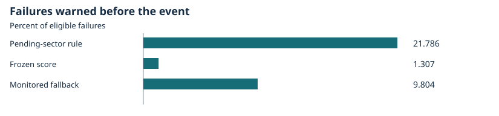
  </a>
  <br><strong>23 · Knowing When to Fall Back After a Drive Fleet Changes</strong>
  <br>With 15 daily review slots across 139 held-out dates, event recall was 21.8% for the pending-sector rule and 9.8% for monitored fallback across 459 observable failures.
  <br><em>Boundary:</em> A recorded hardware failure is a proxy for replacement need. A late and an absent failure are distinguishable only while the drive remains observed. Alternative dispatch rules are replayed on logged outcomes.
  <br><a href="cases/23-drive-failure-policy-fallback.md">Case card</a> · <a href="projects/drive-failure-policy-fallback/outputs/report.md">Evidence Intelligence Report</a>
  · <a href="projects/drive-failure-policy-fallback/outputs/results.json">Terminal result</a>
</td>
<td width="50%">
  <a href="projects/last-mile-departure-slack/outputs/report.md">
    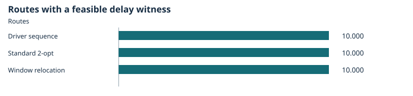
  </a>
  <br><strong>24 · How Much Departure Delay Can a Last-Mile Route Absorb?</strong>
  <br>On 24 complete published routes, window-focused relocation produced 10 nonnegative departure-delay witnesses; the recorded sequences produced 10. 14 routes remained inconclusive under the search budget.
  <br><em>Boundary:</em> Package time windows and driver sequences are observed. Travel times are a provided static matrix, service durations are planned, and the depot-return deadline is an eight-hour scenario. Unsolved routes remain undetermined.
  <br><a href="cases/24-last-mile-departure-slack.md">Case card</a> · <a href="projects/last-mile-departure-slack/outputs/report.md">Evidence Intelligence Report</a>
  · <a href="projects/last-mile-departure-slack/outputs/decision/report/decision-report.md">Decision Intelligence Brief</a>
</td>
</tr>
<tr>
<td width="50%">
  <a href="projects/food-inspection-exploration/outputs/report.md">
    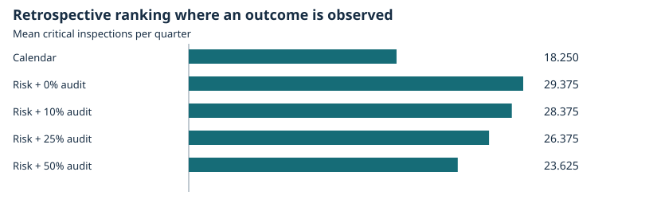
  </a>
  <br><strong>25 · How Much Inspection Capacity Should a City Reserve for Random Audits?</strong>
  <br>The 25% exploration policy allocated 960 slots over 8 quarters. Historical results were observable for 197 selections, giving full-roster critical-finding bounds of 4.9% to 84.4%.
  <br><em>Boundary:</em> In the archival data only inspected restaurants reveal violations. The roster requires a known prior restaurant classification; never-classified premises are outside the target. Later inspections do not identify the causal effect of scheduling earlier.
  <br><a href="cases/25-food-inspection-exploration.md">Case card</a> · <a href="projects/food-inspection-exploration/outputs/report.md">Evidence Intelligence Report</a>
  · <a href="projects/food-inspection-exploration/outputs/decision/report/decision-report.md">Decision Intelligence Brief</a>
</td>
<td width="50%">
  <a href="projects/programming-hint-design/outputs/report.md">
    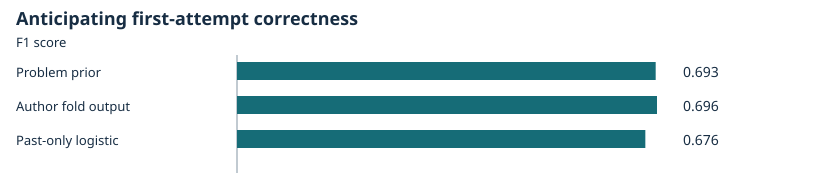
  </a>
  <br><strong>26 · Counterexamples or Direct Corrections for Novice Programmers?</strong>
  <br>The authors' public file contained 729 learner–problem records. On 584 matched out-of-time learner-held-out observations, first-correct F1 was 0.676 for the past-only model. In the independent code archive, 27 incorrect programs removed from the list being traversed.
  <br><em>Boundary:</em> The public CSEDM example describes a subset of the 89-learner, 38-task source cohort. It contains aggregated learner/problem outcomes. Actual code examples are from the independent Refactory study. No newly delivered hint or transfer improvement is attributed to either cohort.
  <br><a href="cases/26-programming-hint-design.md">Case card</a> · <a href="projects/programming-hint-design/outputs/report.md">Evidence Intelligence Report</a>
  · <a href="projects/programming-hint-design/outputs/results.json">Terminal result</a>
</td>
</tr>
<tr>
<td width="50%">
  <a href="projects/credit-drawdown-rates-hedge/outputs/report.md">
    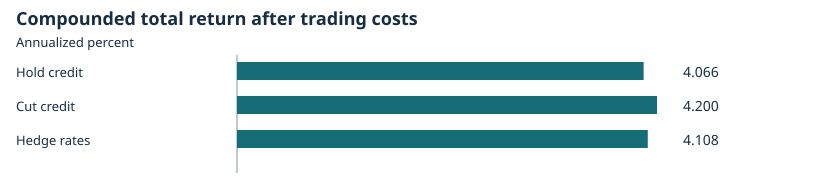
  </a>
  <br><strong>27 · Cut Credit Exposure or Hedge Rates During a Corporate Bond Drawdown?</strong>
  <br>Over 1097 held-out weeks, the rule triggered 143 times. The modeled net maximum drawdown was -17.02% after cutting credit and -19.21% under the matched-rate hedge.
  <br><em>Boundary:</em> A backtest using fund NAVs is a modeled portfolio. Shorting and funding spreads beyond the stated transaction cost can change the comparison. The non-rate residual includes liquidity and issuer-specific risk.
  <br><a href="cases/27-credit-drawdown-rates-hedge.md">Case card</a> · <a href="projects/credit-drawdown-rates-hedge/outputs/report.md">Evidence Intelligence Report</a>
  · <a href="projects/credit-drawdown-rates-hedge/outputs/decision/report/decision-report.md">Decision Intelligence Brief</a>
</td>
<td width="50%">
  <a href="projects/overlapping-forecast-comparisons/outputs/report.md">
    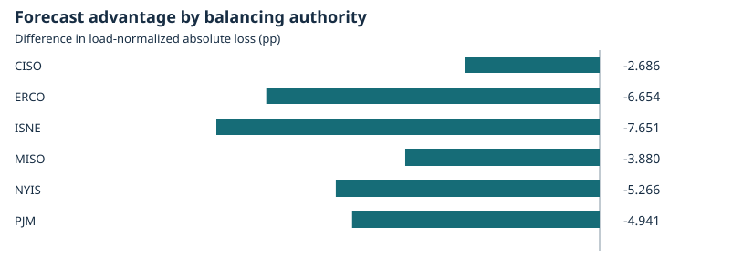
  </a>
  <br><strong>28 · How Reliable Are Model Comparisons With Overlapping Evaluation Windows?</strong>
  <br>Across 1,520 shared dates after the source-quality screen and 6 balancing authorities, the day-ahead minus seasonal-naive score averaged -5.14 percentage points. The 95% HAC interval spanned 0.943 points versus 0.304 under independence.
  <br><em>Boundary:</em> The public extract contains historical reported observations, including revisions. Known-truth coverage is a simulation estimate with Monte Carlo uncertainty. Estimates concern the six reported balancing areas.
  <br><a href="cases/28-overlapping-forecast-comparisons.md">Case card</a> · <a href="projects/overlapping-forecast-comparisons/outputs/report.md">Evidence Intelligence Report</a>
  · <a href="projects/overlapping-forecast-comparisons/outputs/results.json">Terminal result</a>
</td>
</tr>
<tr>
<td width="50%">
  <a href="projects/earnings-cash-collection/outputs/report.md">
    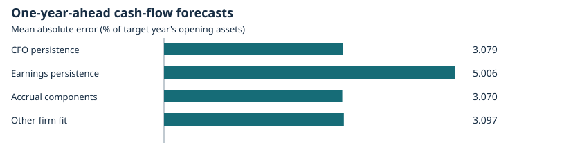
  </a>
  <br><strong>29 · When Reported Earnings Outrun Cash Collections</strong>
  <br>Across 89 out-of-time company-year forecasts, next-year operating-cash-flow MAE was 3.08% of opening assets for cash persistence and 3.07% for the accrual model.
  <br><em>Boundary:</em> Predictive associations in a selected panel do not establish manipulation or causality. Vendor non-trade receivables are distinct from customer trade balances. Scenario valuations depend on payout, opening book, abnormal-return persistence and cost of equity.
  <br><a href="cases/29-earnings-cash-collection.md">Case card</a> · <a href="projects/earnings-cash-collection/outputs/report.md">Evidence Intelligence Report</a>
  · <a href="projects/earnings-cash-collection/outputs/results.json">Terminal result</a>
</td>
<td width="50%">
  <a href="projects/versioned-road-geometry/outputs/report.md">
    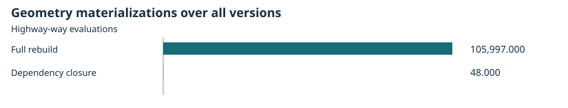
  </a>
  <br><strong>30 · Consistent Road Geometry During Interrupted Map Updates</strong>
  <br>Across 29 consecutive real map releases, dependency-aware repair matched every full rebuild and the next independent snapshot (3,655 highway geometries). Updating only revised ways missed 1 geometry-version discrepancy.
  <br><em>Boundary:</em> This is a reproducible experiment on a single regional OSM extract and a local SQLite store. Work counts measure recomputation. System latency and production availability require separate measurement.
  <br><a href="cases/30-versioned-road-geometry.md">Case card</a> · <a href="projects/versioned-road-geometry/outputs/report.md">Evidence Intelligence Report</a>
  · <a href="projects/versioned-road-geometry/outputs/results.json">Terminal result</a>
</td>
</tr>
</table>

</details>

## Machine-readable evidence

[`cases.json`](cases.json) is the canonical empirical case index. It records the sources,
reviewed snapshot hashes, data grain, methods, metrics, result, terminal
output, interpretation boundary, and representative figure for every case.
[`capability-map.json`](capability-map.json) is the separate school-neutral
navigation contract; it maps each case to a primary capability, supporting
capabilities, and concrete reviewer-visible signals without changing the case
result or claim boundary.
The generator checks the bundled raw files against those hashes and each
project's source manifest before rebuilding the navigation layer.

<details>
<summary><strong>Regenerate the cards, landscape, and index</strong></summary>

Regenerate the individual cards and overview:

```bash
python3 ../../scripts/build_case_examples.py
```

</details>

## Reuse rule

Reuse the method contract, not a saved result. A different source, population,
time window, objective, constraint, or decision owner requires new evidence
and a new validation path.
