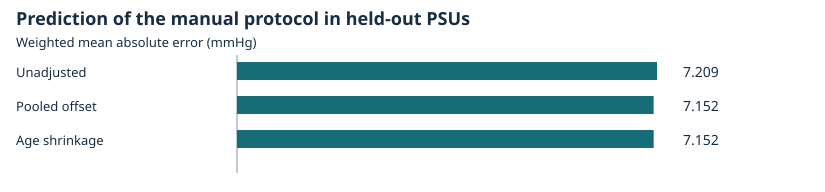

# 16 · When a Blood Pressure Survey Changes Its Measurement Protocol

**Technical summary.** Across 4,614 paired adults, the survey-weighted automatic-minus-manual mean was -1.50 mmHg. At 130 mmHg, 5.32% moved above and 8.15% moved below the cutoff.

## Evidence products

- [Open the Evidence Intelligence Report](../projects/blood-pressure-protocol-bridge/outputs/report.md)
- [Review the project design](../projects/blood-pressure-protocol-bridge/PROJECT.md)
- [Inspect the source manifest](../projects/blood-pressure-protocol-bridge/source-manifest.json)
- [Inspect the machine-readable results](../projects/blood-pressure-protocol-bridge/outputs/results.json)

The figure is the representative visual for this case. Its interpretation is
limited by the evidence boundary stated below.

## Case route

| Field | Case-specific value |
|---|---|
| Domain | Population Health Surveillance |
| Adaptive route | descriptive → diagnostic |
| Analytical question | How much does replacing a blood-pressure measurement protocol change a survey threshold count? |
| Prepared rows | 4,614 |
| Valid terminal output | measurement protocol review |

## Capability path

| Role | Capability |
|---|---|
| Primary | **Population health and informatics** — Respect population, cohort, measurement and information-system semantics while separating research validation from individual clinical use. |
| Supporting | Statistical research, Risk and decision analysis |

### Reviewer-visible signals

- paired protocol crossover
- stratified PSU linearization
- directional threshold crossings
- leave-PSU-out agreement

Capability labels help readers find a relevant precedent. They do not upgrade
the evidence, permitted use, or empirical result of this case.

## Evidence-backed findings

- **Paired adults:** 4614
- **Held-out PSUs:** 30
- **Weighted paired difference:** -1.50 mmHg

## Methods selected for this case

- paired protocol crossover
- stratified PSU linearization
- directional threshold crossings
- leave-PSU-out agreement

These methods were selected from the question, data grain, and evidence
maturity. Other cases in this gallery use different fields, checks, figures,
and endpoints.

## Interpretation boundary

The device and examiner change together. Weighted results describe adults with paired examination records; threshold crossings are survey classifications, not new clinical diagnoses.

## Source identity

- **Dataset:** [NHANES 2017–2018 blood pressure methodology study and demographics](https://wwwn.cdc.gov/Nchs/Data/Nhanes/Public/2017/DataFiles/BPXO_J.htm)
- **Publisher:** CDC NCHS
- **Version:** NHANES 2017–2018
- **Accessed:** 2026-11-28
- **License:** US government public-use data
- **Analytical grain:** One examined adult with at least two valid systolic readings in each protocol

### Reviewed source-snapshot hashes

- `observations.csv.gz` — `77d9302589452ee4dcd3c2395a61fc6d9d6bbf0b7f315ee6aaab73f4b98a927b`

The reviewed raw source files are bundled inside the complete project directory.
The build script verifies each file against both this case index and the
project source manifest.

## Reuse boundary

Reuse the analytical pattern, not the empirical conclusion. A new population,
time window, source version, objective, or decision owner requires a new
evidence contract and validation path.
