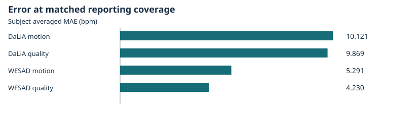

# 17 · When Should a Wrist Monitor Withhold a Heart Rate Reading?

**Technical summary.** With the DaLiA threshold frozen, WESAD retained 85.2% of 5,544 eligible windows. Subject-averaged absolute error among reported ECG-readable windows was 6.83 bpm.

## Evidence products

- [Open the Evidence Intelligence Report](../projects/wearable-heart-rate-abstention/outputs/report.md)
- [Review the project design](../projects/wearable-heart-rate-abstention/PROJECT.md)
- [Inspect the source manifest](../projects/wearable-heart-rate-abstention/source-manifest.json)
- [Inspect the machine-readable results](../projects/wearable-heart-rate-abstention/outputs/results.json)

The figure is the representative visual for this case. Its interpretation is
limited by the evidence boundary stated below.

## Case route

| Field | Case-specific value |
|---|---|
| Domain | Wearable Biomedical Informatics |
| Adaptive route | diagnostic → predictive |
| Analytical question | When can a wrist monitor's quality gate reduce error without leaving users without readings for too long? |
| Prepared rows | 17,237 |
| Valid terminal output | selective measurement review |

## Capability path

| Role | Capability |
|---|---|
| Primary | **Population health and informatics** — Respect population, cohort, measurement and information-system semantics while separating research validation from individual clinical use. |
| Supporting | AI and model validation, Statistical research |

### Reviewer-visible signals

- frozen external acceptance rule
- paired ECG reference
- risk by activity
- uninterrupted readout gaps

Capability labels help readers find a relevant precedent. They do not upgrade
the evidence, permitted use, or empirical result of this case.

## Evidence-backed findings

- **Development participants:** 10
- **External participants:** 15
- **Longest external silence:** 152 s

## Methods selected for this case

- frozen external acceptance rule
- paired ECG reference
- risk by activity
- uninterrupted readout gaps

These methods were selected from the question, data grain, and evidence
maturity. Other cases in this gallery use different fields, checks, figures,
and endpoints.

## Interpretation boundary

The ECG reference is algorithm-derived. The external cohort changes the activity setting; both studies use Empatica wrist hardware. Reported accuracy applies only to the activity and ECG eligibility definitions.

## Source identity

- **Dataset:** [PPG-DaLiA daily activities and WESAD laboratory sessions](https://archive.ics.uci.edu/dataset/495/ppg+dalia)
- **Publisher:** Attila Reiss et al. / UCI and Philip Schmidt et al. / Universität Siegen
- **Version:** PPG-DaLiA field study / WESAD ICMI 2018
- **Accessed:** 2026-11-28
- **License:** CC BY 4.0, see UCI record
- **Analytical grain:** One non-overlapping eight-second activity window from an anonymized participant

### Reviewed source-snapshot hashes

- `observations.csv.gz` — `95047a43c3620eb337d79c3ecb88777c76dcbfebfa7f30dba3d4304d43e3168f`

The reviewed raw source files are bundled inside the complete project directory.
The build script verifies each file against both this case index and the
project source manifest.

## Reuse boundary

Reuse the analytical pattern, not the empirical conclusion. A new population,
time window, source version, objective, or decision owner requires a new
evidence contract and validation path.
