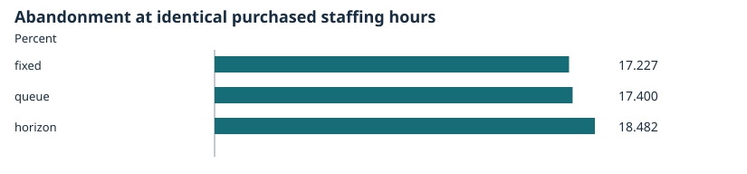

# 18 · When Should a Call Centre Reallocate Staff After a Demand Shock?

**Technical summary.** Across 65 held-out mornings, mean simulated abandonment was 17.23% with a fixed reserve and 18.48% under receding-horizon dispatch. Observed abandonment averaged 13.91%.

## Evidence products

- [Open the Evidence Intelligence Report](../projects/call-centre-flexible-dispatch/outputs/report.md)
- [Review the project design](../projects/call-centre-flexible-dispatch/PROJECT.md)
- [Inspect the source manifest](../projects/call-centre-flexible-dispatch/source-manifest.json)
- [Inspect the machine-readable results](../projects/call-centre-flexible-dispatch/outputs/results.json)
- [Open the Decision Intelligence Brief](../projects/call-centre-flexible-dispatch/outputs/decision/report/decision-report.md)

The figure is the representative visual for this case. Its interpretation is
limited by the evidence boundary stated below.

## Case route

| Field | Case-specific value |
|---|---|
| Domain | Systems Engineering |
| Adaptive route | diagnostic → predictive → prescriptive |
| Analytical question | When, within a fixed staffing budget, should a manager release temporary service capacity? |
| Prepared rows | 144,382 |
| Valid terminal output | staffing policy review |

## Capability path

| Role | Capability |
|---|---|
| Primary | **Analytics to action** — Connect prediction or diagnosis to capacity, workflow, implementation, communication, and a bounded next step. |
| Supporting | Risk and decision analysis, Statistical research |

### Reviewer-visible signals

- censored patience distribution
- held-out staffing calibration
- matched reserve hours
- switching cost

Capability labels help readers find a relevant precedent. They do not upgrade
the evidence, permitted use, or empirical result of this case.

## Evidence-backed findings

- **Calls:** 144382
- **Test days:** 65
- **Flex hours per morning:** 2.0

## Methods selected for this case

- censored patience distribution
- held-out staffing calibration
- matched reserve hours
- switching cost

These methods were selected from the question, data grain, and evidence
maturity. Other cases in this gallery use different fields, checks, figures,
and endpoints.

## Interpretation boundary

Historical outcomes describe observed calls. Staffing schedules, patience past the censoring point, operator flexibility and policy-dependent waits are simulated. The five-hour morning replay begins with an empty queue.

## Source identity

- **Dataset:** [Technion Service Engineering Israeli bank call-centre logs](https://ie.technion.ac.il/serveng/callcenterdata/)
- **Publisher:** Technion Service Enterprise Engineering
- **Version:** 1999 bank call records
- **Accessed:** 2026-11-28
- **License:** Public academic research data; publisher terms apply
- **Analytical grain:** One queued telephone call between 08:00 and 13:00 on a Sunday–Thursday business day

### Reviewed source-snapshot hashes

- `observations.csv.gz` — `11cf87b8bae7beca13ec7d03c5e7693447aecd71097e5c2a6aa71c08001bb0b9`

The reviewed raw source files are bundled inside the complete project directory.
The build script verifies each file against both this case index and the
project source manifest.

## Reuse boundary

Reuse the analytical pattern, not the empirical conclusion. A new population,
time window, source version, objective, or decision owner requires a new
evidence contract and validation path.
