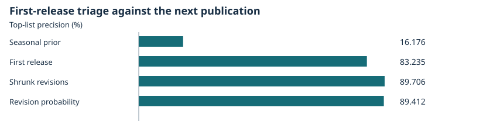

# 19 · Which State Unemployment Claims Alerts Survive the Next Release?

**Technical summary.** Across 68 held-out weekly releases at 5 review slots, 83.2% of first-release alerts and 89.7% of revision-adjusted alerts appeared in the next release's residence-based list.

## Evidence products

- [Open the Evidence Intelligence Report](../projects/unemployment-claims-release-revisions/outputs/report.md)
- [Review the project design](../projects/unemployment-claims-release-revisions/PROJECT.md)
- [Inspect the source manifest](../projects/unemployment-claims-release-revisions/source-manifest.json)
- [Inspect the machine-readable results](../projects/unemployment-claims-release-revisions/outputs/results.json)

The figure is the representative visual for this case. Its interpretation is
limited by the evidence boundary stated below.

## Case route

| Field | Case-specific value |
|---|---|
| Domain | Applied Machine Learning |
| Adaptive route | diagnostic → predictive |
| Analytical question | Which state-level claims alerts survive the switch from first publication to claimant-residence reporting? |
| Prepared rows | 7,579 |
| Valid terminal output | vintage sensitive alerting |

## Capability path

| Role | Capability |
|---|---|
| Primary | **AI and model validation** — Use leakage-safe validation, baselines, calibration, drift and subgroup checks, including a legitimate non-deployment result. |
| Supporting | Data systems and governance, Statistical research |

### Reviewer-visible signals

- advance and residence-based vintages
- publication as-of join
- statewise partial pooling
- fixed alert capacity

Capability labels help readers find a relevant precedent. They do not upgrade
the evidence, permitted use, or empirical result of this case.

## Evidence-backed findings

- **Holdout weeks:** 68
- **State-weeks evaluated:** 3604
- **Weekly slots:** 5

## Methods selected for this case

- advance and residence-based vintages
- publication as-of join
- statewise partial pooling
- fixed alert capacity

These methods were selected from the question, data grain, and evidence
maturity. Other cases in this gallery use different fields, checks, figures,
and endpoints.

## Interpretation boundary

The advance column is reported by liable state and includes a workshare proxy. The next release uses state of residence. The ranked target is a later published measure, not a directly observed employment shock.

## Source identity

- **Dataset:** [Unemployment Insurance Weekly Claims, advance state tables](https://oui.doleta.gov/unemploy/claims_arch.asp)
- **Publisher:** US Department of Labor
- **Version:** Dated weekly releases, December 2022–2025
- **Accessed:** 2026-11-28
- **License:** US government public data
- **Analytical grain:** One US state or covered territory and initial-claims week, with two actual release dates

### Reviewed source-snapshot hashes

- `observations.csv.gz` — `42dfbf703a53b9d94bea32be138b07d9f49c7183489f8abd3a263ed598a3a2fd`

The reviewed raw source files are bundled inside the complete project directory.
The build script verifies each file against both this case index and the
project source manifest.

## Reuse boundary

Reuse the analytical pattern, not the empirical conclusion. A new population,
time window, source version, objective, or decision owner requires a new
evidence contract and validation path.
