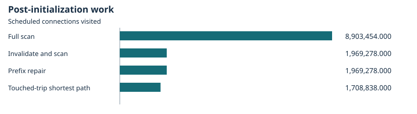

# 20 · Maintaining Earliest Arrival Routes Across Timetable Revisions

**Technical summary.** Across 10 timetable versions, all 300 route-query results matched a full scan. Revisions changed 4,223 destination arrival labels; checkpoint repair visited 1,969,278 connections versus 8,903,454 for full recomputation.

## Evidence products

- [Open the Evidence Intelligence Report](../projects/transit-timetable-repair/outputs/report.md)
- [Review the project design](../projects/transit-timetable-repair/PROJECT.md)
- [Inspect the source manifest](../projects/transit-timetable-repair/source-manifest.json)
- [Inspect the machine-readable results](../projects/transit-timetable-repair/outputs/results.json)

The figure is the representative visual for this case. Its interpretation is
limited by the evidence boundary stated below.

## Case route

| Field | Case-specific value |
|---|---|
| Domain | Computer Science Algorithms |
| Adaptive route | diagnostic → prescriptive |
| Analytical question | Can a router repair a revised timetable and still return exactly the same earliest arrivals as rebuilding? |
| Prepared rows | 86,658 |
| Valid terminal output | routing update review |

## Capability path

| Role | Capability |
|---|---|
| Primary | **Data systems and governance** — Make data contracts, semantics, lineage, privacy, human review, failure states, and reproducibility part of the analytical system. |
| Supporting | Spatial equity and planning, Analytics to action |

### Reviewer-visible signals

- exact timetable oracle
- query checkpoints
- off-path added connection
- transfer-aware replay

Capability labels help readers find a relevant precedent. They do not upgrade
the evidence, permitted use, or empirical result of this case.

## Evidence-backed findings

- **Version-query checks:** 300
- **Mismatched queries:** 0
- **Held service date:** 2024-11-22

## Methods selected for this case

- exact timetable oracle
- query checkpoints
- off-path added connection
- transfer-aware replay

These methods were selected from the question, data grain, and evidence
maturity. Other cases in this gallery use different fields, checks, figures,
and endpoints.

## Interpretation boundary

The archive assigns each download a non-overlapping archive interval. This is a comparison of overlapping planned calendar service inside those files. Results concern scheduled travel in a selected network, with a stated same-station transfer buffer and no street-walking links.

## Source identity

- **Dataset:** [MBTA archived GTFS timetables for common service date 22 November 2024](https://www.mbta.com/developers/gtfs)
- **Publisher:** Massachusetts Bay Transportation Authority
- **Version:** Oct–Nov 2024 archives, common service 2024-11-22
- **Accessed:** 2026-11-28
- **License:** MassDOT developers license
- **Analytical grain:** One changed scheduled connection or version marker in ordered MBTA archive copies

### Reviewed source-snapshot hashes

- `observations.csv.gz` — `2ef13fb50ca7252db948718cf4802da6768ed4ce6db6f7e99a88faa946e1b11a`

The reviewed raw source files are bundled inside the complete project directory.
The build script verifies each file against both this case index and the
project source manifest.

## Reuse boundary

Reuse the analytical pattern, not the empirical conclusion. A new population,
time window, source version, objective, or decision owner requires a new
evidence contract and validation path.
