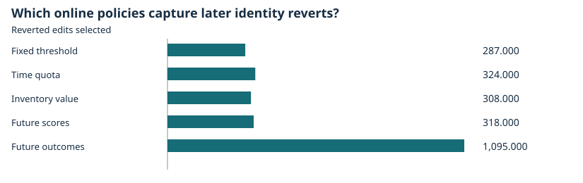

# 21 · The Last Review Slot in an Online Queue

**Technical summary.** Across 366 held-out publication days, the inventory-value policy captured 308 seven-day identity reverts, versus 287 with a fixed threshold and 1095 for an outcome-aware upper bound.

## Evidence products

- [Open the Evidence Intelligence Report](../projects/online-edit-review-capacity/outputs/report.md)
- [Review the project design](../projects/online-edit-review-capacity/PROJECT.md)
- [Inspect the source manifest](../projects/online-edit-review-capacity/source-manifest.json)
- [Inspect the machine-readable results](../projects/online-edit-review-capacity/outputs/results.json)
- [Open the Decision Intelligence Brief](../projects/online-edit-review-capacity/outputs/decision/report/decision-report.md)

The figure is the representative visual for this case. Its interpretation is
limited by the evidence boundary stated below.

## Case route

| Field | Case-specific value |
|---|---|
| Domain | Operations Research |
| Adaptive route | predictive → prescriptive |
| Analytical question | When should an online reviewer spend the last daily slot on the current edit? |
| Prepared rows | 541,009 |
| Valid terminal output | finite inventory policy |

## Capability path

| Role | Capability |
|---|---|
| Primary | **Risk and decision analysis** — Compare feasible choices under dependent uncertainty, tail risk, scenario stress, value judgments, and reversal conditions. |
| Supporting | Analytics to action, AI and model validation |

### Reviewer-visible signals

- finite-horizon slot value
- expiring daily inventory
- score-only oracle
- realized-event oracle

Capability labels help readers find a relevant precedent. They do not upgrade
the evidence, permitted use, or empirical result of this case.

## Evidence-backed findings

- **Daily slots:** 3
- **Held-out edits:** 165597
- **Training edits:** 371780

## Methods selected for this case

- finite-horizon slot value
- expiring daily inventory
- score-only oracle
- realized-event oracle

These methods were selected from the question, data grain, and evidence
maturity. Other cases in this gallery use different fields, checks, figures,
and endpoints.

## Interpretation boundary

An identity revert indicates that previously observed page content returned within seven days. It is a behavioral proxy. The replay assumes no effect of the simulated review on subsequent edits.

## Source identity

- **Dataset:** [Wikimedia MediaWiki history, English Wikivoyage](https://wikitech.wikimedia.org/wiki/Data_Platform/Data_Lake/Edits/MediaWiki_history_dumps)
- **Publisher:** Wikimedia Foundation
- **Version:** 2026-10 English Wikivoyage history; evaluation years 2022–2024
- **Accessed:** 2026-11-28
- **License:** Wikimedia historical dumps; attribution and terms of use
- **Analytical grain:** One timestamped main-namespace English Wikivoyage revision, with complete future label horizon

### Reviewed source-snapshot hashes

- `observations.csv.gz` — `42123cead88a69ccdd4f8d8aab4a08b34b9acd6469b39ff24035acb4ef6d7332`

The reviewed raw source files are bundled inside the complete project directory.
The build script verifies each file against both this case index and the
project source manifest.

## Reuse boundary

Reuse the analytical pattern, not the empirical conclusion. A new population,
time window, source version, objective, or decision owner requires a new
evidence contract and validation path.
