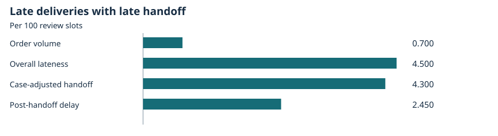

# 22 · Where Should a Marketplace Spend Its Delivery Improvement Budget?

**Technical summary.** Across 4 future quarters and 2,000 equal review slots per policy, adjusted seller targeting found 86 late deliveries following a missed handoff deadline. Carrier-focused targeting found 225 late deliveries after on-time handoff.

## Evidence products

- [Open the Evidence Intelligence Report](../projects/marketplace-delivery-intervention/outputs/report.md)
- [Review the project design](../projects/marketplace-delivery-intervention/PROJECT.md)
- [Inspect the source manifest](../projects/marketplace-delivery-intervention/source-manifest.json)
- [Inspect the machine-readable results](../projects/marketplace-delivery-intervention/outputs/results.json)
- [Open the Decision Intelligence Brief](../projects/marketplace-delivery-intervention/outputs/decision/report/decision-report.md)

The figure is the representative visual for this case. Its interpretation is
limited by the evidence boundary stated below.

## Case route

| Field | Case-specific value |
|---|---|
| Domain | Business Analytics |
| Adaptive route | diagnostic → prescriptive |
| Analytical question | Should a marketplace direct an equal number of review slots to seller handoffs or to post-handoff delivery? |
| Prepared rows | 88,863 |
| Valid terminal output | intervention budget review |

## Capability path

| Role | Capability |
|---|---|
| Primary | **Analytics to action** — Connect prediction or diagnosis to capacity, workflow, implementation, communication, and a bounded next step. |
| Supporting | Risk and decision analysis, Statistical research |

### Reviewer-visible signals

- handoff vs last-mile delay
- product and geography adjustment
- matured quarterly evaluations
- cost–effectiveness crossover

Capability labels help readers find a relevant precedent. They do not upgrade
the evidence, permitted use, or empirical result of this case.

## Evidence-backed findings

- **Single-item orders:** 88863
- **Complete handoff and delivery:** 86839
- **Policy slots:** 2000

## Methods selected for this case

- handoff vs last-mile delay
- product and geography adjustment
- matured quarterly evaluations
- cost–effectiveness crossover

These methods were selected from the question, data grain, and evidence
maturity. Other cases in this gallery use different fields, checks, figures,
and endpoints.

## Interpretation boundary

An on-time handoff followed by a late delivery locates delay in the observed sequence. It does not establish fault or show that an intervention prevented lateness.

## Source identity

- **Dataset:** [Olist Brazilian E-Commerce Public Dataset](https://www.kaggle.com/datasets/olistbr/brazilian-ecommerce)
- **Publisher:** Olist
- **Version:** Publisher version 2
- **Accessed:** 2026-11-28
- **License:** CC BY-NC-SA 4.0
- **Analytical grain:** One order with exactly one recorded item from one seller; incomplete outcomes are retained

### Reviewed source-snapshot hashes

- `observations.csv.gz` — `5e3c79530f605961e4c56c33747d353ae1f1d08f33547686e8e8cad1ef366c68`

The reviewed raw source files are bundled inside the complete project directory.
The build script verifies each file against both this case index and the
project source manifest.

## Reuse boundary

Reuse the analytical pattern, not the empirical conclusion. A new population,
time window, source version, objective, or decision owner requires a new
evidence contract and validation path.
