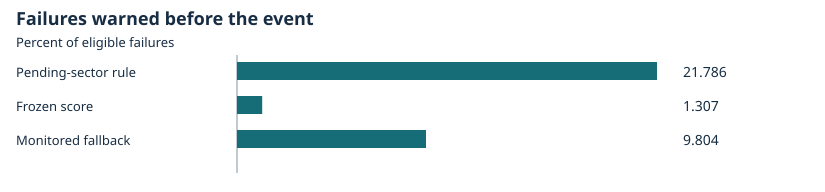

# 23 · Knowing When to Fall Back After a Drive Fleet Changes

**Technical summary.** With 15 daily review slots across 139 held-out dates, event recall was 21.8% for the pending-sector rule and 9.8% for monitored fallback across 459 observable failures.

## Evidence products

- [Open the Evidence Intelligence Report](../projects/drive-failure-policy-fallback/outputs/report.md)
- [Review the project design](../projects/drive-failure-policy-fallback/PROJECT.md)
- [Inspect the source manifest](../projects/drive-failure-policy-fallback/source-manifest.json)
- [Inspect the machine-readable results](../projects/drive-failure-policy-fallback/outputs/results.json)

The figure is the representative visual for this case. Its interpretation is
limited by the evidence boundary stated below.

## Case route

| Field | Case-specific value |
|---|---|
| Domain | Machine Learning Engineering |
| Adaptive route | predictive → prescriptive |
| Analytical question | When monitoring signals disappear after a fleet change, is switching to an interpretable rule worth the lost warnings? |
| Prepared rows | 100,501 |
| Valid terminal output | reliability handoff |

## Capability path

| Role | Capability |
|---|---|
| Primary | **AI and model validation** — Use leakage-safe validation, baselines, calibration, drift and subgroup checks, including a legitimate non-deployment result. |
| Supporting | Data systems and governance, Risk and decision analysis |

### Reviewer-visible signals

- serial and hardware-family holdout
- right-censored device days
- episode-level false alerts
- delayed-label fallback

Capability labels help readers find a relevant precedent. They do not upgrade
the evidence, permitted use, or empirical result of this case.

## Evidence-backed findings

- **Distinct drives:** 81158
- **Held-out at-risk device-days:** 6337141
- **Review slots per day:** 15

## Methods selected for this case

- serial and hardware-family holdout
- right-censored device days
- episode-level false alerts
- delayed-label fallback

These methods were selected from the question, data grain, and evidence
maturity. Other cases in this gallery use different fields, checks, figures,
and endpoints.

## Interpretation boundary

A recorded hardware failure is a proxy for replacement need. A late and an absent failure are distinguishable only while the drive remains observed. Alternative dispatch rules are replayed on logged outcomes.

## Source identity

- **Dataset:** [Backblaze Hard Drive Daily Statistics, 2016](https://www.backblaze.com/cloud-storage/resources/hard-drive-test-data)
- **Publisher:** Backblaze
- **Version:** 2016 calendar quarters 1–4
- **Accessed:** 2026-11-28
- **License:** Backblaze Drive Stats terms and attribution
- **Analytical grain:** One maximal consecutive run of equal binned SMART indicators for a pseudonymous drive

### Reviewed source-snapshot hashes

- `observations.csv.gz` — `d7ffa8cd1787cbddc10507e9ce1e8b3a836870310a8c0b0965524211355d90e1`

The reviewed raw source files are bundled inside the complete project directory.
The build script verifies each file against both this case index and the
project source manifest.

## Reuse boundary

Reuse the analytical pattern, not the empirical conclusion. A new population,
time window, source version, objective, or decision owner requires a new
evidence contract and validation path.
