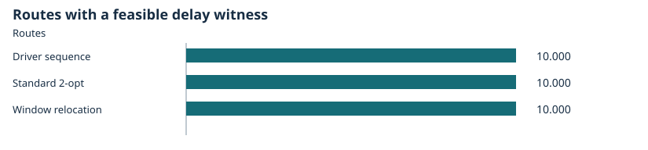

# 24 · How Much Departure Delay Can a Last-Mile Route Absorb?

**Technical summary.** On 24 complete published routes, window-focused relocation produced 10 nonnegative departure-delay witnesses; the recorded sequences produced 10. 14 routes remained inconclusive under the search budget.

## Evidence products

- [Open the Evidence Intelligence Report](../projects/last-mile-departure-slack/outputs/report.md)
- [Review the project design](../projects/last-mile-departure-slack/PROJECT.md)
- [Inspect the source manifest](../projects/last-mile-departure-slack/source-manifest.json)
- [Inspect the machine-readable results](../projects/last-mile-departure-slack/outputs/results.json)
- [Open the Decision Intelligence Brief](../projects/last-mile-departure-slack/outputs/decision/report/decision-report.md)

The figure is the representative visual for this case. Its interpretation is
limited by the evidence boundary stated below.

## Case route

| Field | Case-specific value |
|---|---|
| Domain | Freight Transportation |
| Adaptive route | diagnostic → prescriptive |
| Analytical question | How late can a dispatcher release a route while still honoring its published windows and a stated end of shift? |
| Prepared rows | 3,072 |
| Valid terminal output | dispatch feasibility review |

## Capability path

| Role | Capability |
|---|---|
| Primary | **Risk and decision analysis** — Compare feasible choices under dependent uncertainty, tail risk, scenario stress, value judgments, and reversal conditions. |
| Supporting | Analytics to action, Spatial equity and planning |

### Reviewer-visible signals

- package time windows
- verified departure witnesses
- independent upper bounds
- depot holdout

Capability labels help readers find a relevant precedent. They do not upgrade
the evidence, permitted use, or empirical result of this case.

## Evidence-backed findings

- **Complete routes:** 24
- **Held-out depot routes:** 6
- **Evaluated moves per optimized tour:** 650

## Methods selected for this case

- package time windows
- verified departure witnesses
- independent upper bounds
- depot holdout

These methods were selected from the question, data grain, and evidence
maturity. Other cases in this gallery use different fields, checks, figures,
and endpoints.

## Interpretation boundary

Package time windows and driver sequences are observed. Travel times are a provided static matrix, service durations are planned, and the depot-return deadline is an eight-hour scenario. Unsolved routes remain undetermined.

## Source identity

- **Dataset:** [Amazon Last Mile Routing Research Challenge, public model-build inputs](https://registry.opendata.aws/amazon-last-mile-challenges/)
- **Publisher:** Amazon / MIT Last Mile Routing Research Challenge
- **Version:** 2021 model-build inputs, observations from 2018
- **Accessed:** 2026-11-28
- **License:** CC BY-NC 4.0
- **Analytical grain:** One stop in a complete route, including its row of the fixed travel-time matrix

### Reviewed source-snapshot hashes

- `observations.csv.gz` — `b889cb157e210dc5965d10658f9fbd9eef29b9fbea80566420585c97e11d8d65`

The reviewed raw source files are bundled inside the complete project directory.
The build script verifies each file against both this case index and the
project source manifest.

## Reuse boundary

Reuse the analytical pattern, not the empirical conclusion. A new population,
time window, source version, objective, or decision owner requires a new
evidence contract and validation path.
