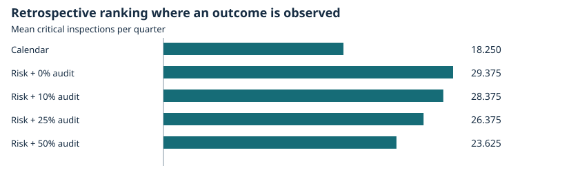

# 25 · How Much Inspection Capacity Should a City Reserve for Random Audits?

**Technical summary.** The 25% exploration policy allocated 960 slots over 8 quarters. Historical results were observable for 197 selections, giving full-roster critical-finding bounds of 4.9% to 84.4%.

## Evidence products

- [Open the Evidence Intelligence Report](../projects/food-inspection-exploration/outputs/report.md)
- [Review the project design](../projects/food-inspection-exploration/PROJECT.md)
- [Inspect the source manifest](../projects/food-inspection-exploration/source-manifest.json)
- [Inspect the machine-readable results](../projects/food-inspection-exploration/outputs/results.json)
- [Open the Decision Intelligence Brief](../projects/food-inspection-exploration/outputs/decision/report/decision-report.md)

The figure is the representative visual for this case. Its interpretation is
limited by the evidence boundary stated below.

## Case route

| Field | Case-specific value |
|---|---|
| Domain | Technology Policy |
| Adaptive route | diagnostic → prescriptive |
| Analytical question | How much of a city's finite inspection capacity should be reserved for random exploration? |
| Prepared rows | 55,823 |
| Valid terminal output | inspection audit design |

## Capability path

| Role | Capability |
|---|---|
| Primary | **Behavior and policy evidence** — Separate observed behavior, randomized or associational evidence, mechanisms, intervention claims, ethics, and implementation authority. |
| Supporting | Statistical research, Analytics to action |

### Reviewer-visible signals

- licensed eligibility roster
- selective outcomes
- stratified exploration
- design probabilities

Capability labels help readers find a relevant precedent. They do not upgrade
the evidence, permitted use, or empirical result of this case.

## Evidence-backed findings

- **Eligible restaurant-quarters:** 55823
- **Exploration-policy reviews:** 960
- **Unobserved selected outcomes:** 763

## Methods selected for this case

- licensed eligibility roster
- selective outcomes
- stratified exploration
- design probabilities

These methods were selected from the question, data grain, and evidence
maturity. Other cases in this gallery use different fields, checks, figures,
and endpoints.

## Interpretation boundary

In the archival data only inspected restaurants reveal violations. The roster requires a known prior restaurant classification; never-classified premises are outside the target. Later inspections do not identify the causal effect of scheduling earlier.

## Source identity

- **Dataset:** [Chicago Food Inspection Forecasting, historical permits and canvass inspections](https://chicago.github.io/food-inspections-evaluation/)
- **Publisher:** City of Chicago
- **Version:** City archive ending December 2014
- **Accessed:** 2026-11-28
- **License:** City of Chicago open data and repository license
- **Analytical grain:** One active retail-food license with a previously identified restaurant at the start of a quarter

### Reviewed source-snapshot hashes

- `observations.csv.gz` — `2bd55b80faaee367f7dae730514a56c8c816f892bbe2fd6fce73e306a3eb1287`

The reviewed raw source files are bundled inside the complete project directory.
The build script verifies each file against both this case index and the
project source manifest.

## Reuse boundary

Reuse the analytical pattern, not the empirical conclusion. A new population,
time window, source version, objective, or decision owner requires a new
evidence contract and validation path.
