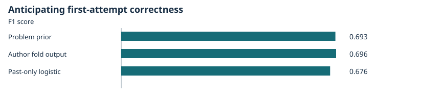

# 26 · Counterexamples or Direct Corrections for Novice Programmers?

**Technical summary.** The authors' public file contained 729 learner–problem records. On 584 matched out-of-time learner-held-out observations, first-correct F1 was 0.676 for the past-only model. In the independent code archive, 27 incorrect programs removed from the list being traversed.

## Evidence products

- [Open the Evidence Intelligence Report](../projects/programming-hint-design/outputs/report.md)
- [Review the project design](../projects/programming-hint-design/PROJECT.md)
- [Inspect the source manifest](../projects/programming-hint-design/source-manifest.json)
- [Inspect the machine-readable results](../projects/programming-hint-design/outputs/results.json)

The figure is the representative visual for this case. Its interpretation is
limited by the evidence boundary stated below.

## Case route

| Field | Case-specific value |
|---|---|
| Domain | Learning Design |
| Adaptive route | diagnostic → predictive |
| Analytical question | Should a beginner receive an elicited counterexample or a direct correction after a repeatable misconception? |
| Prepared rows | 1,583 |
| Valid terminal output | prospective experiment |

## Capability path

| Role | Capability |
|---|---|
| Primary | **Behavior and policy evidence** — Separate observed behavior, randomized or associational evidence, mechanisms, intervention claims, ethics, and implementation authority. |
| Supporting | AI and model validation, Statistical research |

### Reviewer-visible signals

- learner-held-out prediction
- observed misconception
- two runnable feedback designs
- independently scored transfer

Capability labels help readers find a relevant precedent. They do not upgrade
the evidence, permitted use, or empirical result of this case.

## Evidence-backed findings

- **Observed learner–problem records:** 729
- **Observed students:** 86
- **Prospective learners per arm:** 170

## Methods selected for this case

- learner-held-out prediction
- observed misconception
- two runnable feedback designs
- independently scored transfer

These methods were selected from the question, data grain, and evidence
maturity. Other cases in this gallery use different fields, checks, figures,
and endpoints.

## Interpretation boundary

The public CSEDM example describes a subset of the 89-learner, 38-task source cohort. It contains aggregated learner/problem outcomes. Actual code examples are from the independent Refactory study. No newly delivered hint or transfer improvement is attributed to either cohort.

## Source identity

- **Dataset:** [CSEDM 2019 published ITAP cross-validation rows and the Refactory novice programming corpus](https://github.com/thomaswp/CSEDM2019-Data-Challenge)
- **Publisher:** Thomas Price and CSEDM 2019 organizers and Yang Hu and coauthors
- **Version:** Public challenge demonstration and predictions, revision 6e7a1f6463d6343bd0c063fdeacf9cf9147e5073 / ASE 2019 public artifact, f05583a56c2e3c50aa8cc0327645283f27df3a68
- **Accessed:** 2026-11-28
- **License:** Publicly released example; full DataShop records have separate terms
- **Analytical grain:** Either an author-published learner/problem summary or an independently published anonymized source-code attempt

### Reviewed source-snapshot hashes

- `observations.csv.gz` — `531c8b2eaae6d03f22c5ccd678dfeeac12f9405427ca8dca81ac514b5a08e4a5`

The reviewed raw source files are bundled inside the complete project directory.
The build script verifies each file against both this case index and the
project source manifest.

## Reuse boundary

Reuse the analytical pattern, not the empirical conclusion. A new population,
time window, source version, objective, or decision owner requires a new
evidence contract and validation path.
