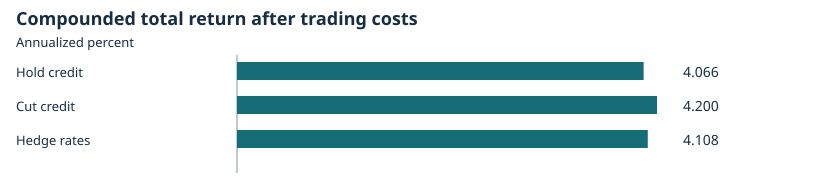

# 27 · Cut Credit Exposure or Hedge Rates During a Corporate Bond Drawdown?

**Technical summary.** Over 1097 held-out weeks, the rule triggered 143 times. The modeled net maximum drawdown was -17.02% after cutting credit and -19.21% under the matched-rate hedge.

## Evidence products

- [Open the Evidence Intelligence Report](../projects/credit-drawdown-rates-hedge/outputs/report.md)
- [Review the project design](../projects/credit-drawdown-rates-hedge/PROJECT.md)
- [Inspect the source manifest](../projects/credit-drawdown-rates-hedge/source-manifest.json)
- [Inspect the machine-readable results](../projects/credit-drawdown-rates-hedge/outputs/results.json)
- [Open the Decision Intelligence Brief](../projects/credit-drawdown-rates-hedge/outputs/decision/report/decision-report.md)

The figure is the representative visual for this case. Its interpretation is
limited by the evidence boundary stated below.

## Case route

| Field | Case-specific value |
|---|---|
| Domain | Investment Risk |
| Adaptive route | diagnostic → prescriptive |
| Analytical question | During a credit drawdown, how does reducing corporate exposure compare with matching its expected rate sensitivity using a Treasury hedge? |
| Prepared rows | 1,149 |
| Valid terminal output | investment risk review |

## Capability path

| Role | Capability |
|---|---|
| Primary | **Risk and decision analysis** — Compare feasible choices under dependent uncertainty, tail risk, scenario stress, value judgments, and reversal conditions. |
| Supporting | Statistical research, Analytics to action |

### Reviewer-visible signals

- lagged Treasury beta match
- self-financing overlay
- distribution-adjusted NAV
- turnover break-even

Capability labels help readers find a relevant precedent. They do not upgrade
the evidence, permitted use, or empirical result of this case.

## Evidence-backed findings

- **Backtest weeks:** 1097
- **Triggered weeks:** 143
- **One-way costs:** 5 bp

## Methods selected for this case

- lagged Treasury beta match
- self-financing overlay
- distribution-adjusted NAV
- turnover break-even

These methods were selected from the question, data grain, and evidence
maturity. Other cases in this gallery use different fields, checks, figures,
and endpoints.

## Interpretation boundary

A backtest using fund NAVs is a modeled portfolio. Shorting and funding spreads beyond the stated transaction cost can change the comparison. The non-rate residual includes liquidity and issuer-specific risk.

## Source identity

- **Dataset:** [Issuer historical NAV and ex-dividend distribution records for LQD, IEF, SHY and TLT](https://www.ishares.com/us/products/239566/ishares-iboxx-investment-grade-corporate-bond-etf)
- **Publisher:** BlackRock iShares and the Federal Reserve
- **Version:** Aligned calendar years 2004–2025 / Board GZ spread and H.15 10-year yield
- **Accessed:** 2026-11-28
- **License:** Copyright BlackRock; issuer terms of use
- **Analytical grain:** One common trading week for four iShares funds

### Reviewed source-snapshot hashes

- `observations.csv.gz` — `de8453acb76924b9e94d35cd425798d9c4c3eb040ac23b324f8cbe0487ef5701`

The reviewed raw source files are bundled inside the complete project directory.
The build script verifies each file against both this case index and the
project source manifest.

## Reuse boundary

Reuse the analytical pattern, not the empirical conclusion. A new population,
time window, source version, objective, or decision owner requires a new
evidence contract and validation path.
