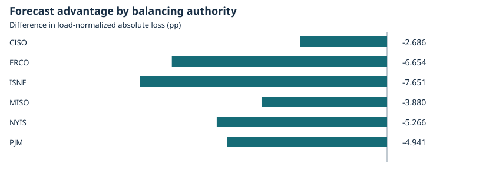

# 28 · How Reliable Are Model Comparisons With Overlapping Evaluation Windows?

**Technical summary.** Across 1,520 shared dates after the source-quality screen and 6 balancing authorities, the day-ahead minus seasonal-naive score averaged -5.14 percentage points. The 95% HAC interval spanned 0.943 points versus 0.304 under independence.

## Evidence products

- [Open the Evidence Intelligence Report](../projects/overlapping-forecast-comparisons/outputs/report.md)
- [Review the project design](../projects/overlapping-forecast-comparisons/PROJECT.md)
- [Inspect the source manifest](../projects/overlapping-forecast-comparisons/source-manifest.json)
- [Inspect the machine-readable results](../projects/overlapping-forecast-comparisons/outputs/results.json)

The figure is the representative visual for this case. Its interpretation is
limited by the evidence boundary stated below.

## Case route

| Field | Case-specific value |
|---|---|
| Domain | Applied Statistics |
| Adaptive route | diagnostic → predictive |
| Analytical question | How wide should a forecast-comparison interval be when adjacent scores reuse six days of observations? |
| Prepared rows | 10,833 |
| Valid terminal output | dependence aware comparison |

## Capability path

| Role | Capability |
|---|---|
| Primary | **Statistical research** — Define the estimand, preserve the data-generating structure, quantify uncertainty, test robustness, and state the transport boundary. |
| Supporting | AI and model validation, Risk and decision analysis |

### Reviewer-visible signals

- paired calendar dates
- overlapping forecast losses
- HAC and moving blocks
- known-truth coverage

Capability labels help readers find a relevant precedent. They do not upgrade
the evidence, permitted use, or empirical result of this case.

## Evidence-backed findings

- **Shared dates:** 1520
- **Actual BA-days:** 10833
- **Width ratio:** 3.10×

## Methods selected for this case

- paired calendar dates
- overlapping forecast losses
- HAC and moving blocks
- known-truth coverage

These methods were selected from the question, data grain, and evidence
maturity. Other cases in this gallery use different fields, checks, figures,
and endpoints.

## Interpretation boundary

The public extract contains historical reported observations, including revisions. Known-truth coverage is a simulation estimate with Monte Carlo uncertainty. Estimates concern the six reported balancing areas.

## Source identity

- **Dataset:** [EIA-930 hourly balancing authority electricity load](https://www.eia.gov/electricity/930-content/about.html)
- **Publisher:** US Energy Information Administration
- **Version:** 2020–2024; ten half-years
- **Accessed:** 2026-11-28
- **License:** US government open data
- **Analytical grain:** One balancing authority and UTC date with 24 observed, forecast and lagged observations

### Reviewed source-snapshot hashes

- `observations.csv.gz` — `479a4167a706c14016364bdefe593bf478a99744bb5d1c94a924487fc72b9271`

The reviewed raw source files are bundled inside the complete project directory.
The build script verifies each file against both this case index and the
project source manifest.

## Reuse boundary

Reuse the analytical pattern, not the empirical conclusion. A new population,
time window, source version, objective, or decision owner requires a new
evidence contract and validation path.
