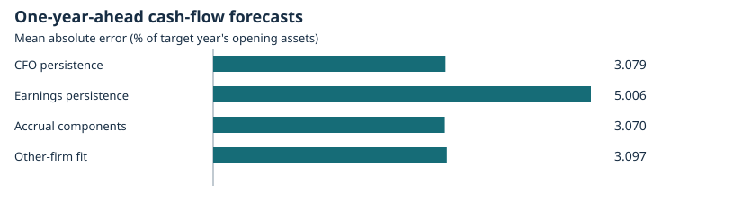

# 29 · When Reported Earnings Outrun Cash Collections

**Technical summary.** Across 89 out-of-time company-year forecasts, next-year operating-cash-flow MAE was 3.08% of opening assets for cash persistence and 3.07% for the accrual model.

## Evidence products

- [Open the Evidence Intelligence Report](../projects/earnings-cash-collection/outputs/report.md)
- [Review the project design](../projects/earnings-cash-collection/PROJECT.md)
- [Inspect the source manifest](../projects/earnings-cash-collection/source-manifest.json)
- [Inspect the machine-readable results](../projects/earnings-cash-collection/outputs/results.json)

The figure is the representative visual for this case. Its interpretation is
limited by the evidence boundary stated below.

## Case route

| Field | Case-specific value |
|---|---|
| Domain | Fundamental Analysis |
| Adaptive route | diagnostic → predictive |
| Analytical question | When earnings outrun collections, do receivables and inventory changes improve next-year cash-flow forecasts? |
| Prepared rows | 902 |
| Valid terminal output | valuation review |

## Capability path

| Role | Capability |
|---|---|
| Primary | **Risk and decision analysis** — Compare feasible choices under dependent uncertainty, tail risk, scenario stress, value judgments, and reversal conditions. |
| Supporting | Data systems and governance, Statistical research |

### Reviewer-visible signals

- as-filed accessions
- mature competing forecasts
- issuer footnote
- cash-collection valuation sensitivity

Capability labels help readers find a relevant precedent. They do not upgrade
the evidence, permitted use, or empirical result of this case.

## Evidence-backed findings

- **Issuers with evaluated forecasts:** 14
- **Forecasts:** 89
- **Later comparative earnings changes:** 25

## Methods selected for this case

- as-filed accessions
- mature competing forecasts
- issuer footnote
- cash-collection valuation sensitivity

These methods were selected from the question, data grain, and evidence
maturity. Other cases in this gallery use different fields, checks, figures,
and endpoints.

## Interpretation boundary

Predictive associations in a selected panel do not establish manipulation or causality. Vendor non-trade receivables are distinct from customer trade balances. Scenario valuations depend on payout, opening book, abnormal-return persistence and cost of equity.

## Source identity

- **Dataset:** [US SEC EDGAR as-filed US-GAAP facts with an Apple audited-note cross-check](https://www.sec.gov/search-filings/edgar-application-programming-interfaces)
- **Publisher:** US SEC EDGAR; fixed public mirror by DenyTranDFW and Apple Inc.
- **Version:** Point-in-time accession facts, mirror revision e4088db1b10363c29719508935991a851587d17c / 2023 Form 10-K, accession 0000320193-23-000106
- **Accessed:** 2026-11-28
- **License:** Public filings; mirror metadata and terms linked
- **Analytical grain:** One issuer, accession and fiscal period in an original or comparative annual filing

### Reviewed source-snapshot hashes

- `observations.csv.gz` — `3133841cf09a4acd70637c643e92d7f6a5a00567a163438fa39996fa34ad904c`

The reviewed raw source files are bundled inside the complete project directory.
The build script verifies each file against both this case index and the
project source manifest.

## Reuse boundary

Reuse the analytical pattern, not the empirical conclusion. A new population,
time window, source version, objective, or decision owner requires a new
evidence contract and validation path.
