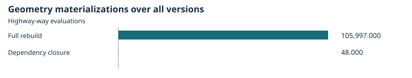

# 30 · Consistent Road Geometry During Interrupted Map Updates

**Technical summary.** Across 29 consecutive real map releases, dependency-aware repair matched every full rebuild and the next independent snapshot (3,655 highway geometries). Updating only revised ways missed 1 geometry-version discrepancy.

## Evidence products

- [Open the Evidence Intelligence Report](../projects/versioned-road-geometry/outputs/report.md)
- [Review the project design](../projects/versioned-road-geometry/PROJECT.md)
- [Inspect the source manifest](../projects/versioned-road-geometry/source-manifest.json)
- [Inspect the machine-readable results](../projects/versioned-road-geometry/outputs/results.json)

The figure is the representative visual for this case. Its interpretation is
limited by the evidence boundary stated below.

## Case route

| Field | Case-specific value |
|---|---|
| Domain | Computer Systems |
| Adaptive route | diagnostic → prescriptive |
| Analytical question | Can an interrupted map update publish mutually consistent node positions and road geometry? |
| Prepared rows | 96,081 |
| Valid terminal output | transactional release |

## Capability path

| Role | Capability |
|---|---|
| Primary | **Data systems and governance** — Make data contracts, semantics, lineage, privacy, human review, failure states, and reproducibility part of the analytical system. |
| Supporting | AI and model validation, Spatial equity and planning |

### Reviewer-visible signals

- node-to-road reverse dependencies
- SQLite WAL snapshot
- replay after rollback
- independent source oracle

Capability labels help readers find a relevant precedent. They do not upgrade
the evidence, permitted use, or empirical result of this case.

## Evidence-backed findings

- **Checked sequences:** 29
- **Final highway geometries:** 3655
- **Interrupted transaction reopens:** 2

## Methods selected for this case

- node-to-road reverse dependencies
- SQLite WAL snapshot
- replay after rollback
- independent source oracle

These methods were selected from the question, data grain, and evidence
maturity. Other cases in this gallery use different fields, checks, figures,
and endpoints.

## Interpretation boundary

This is a reproducible experiment on a single regional OSM extract and a local SQLite store. Work counts measure recomputation. System latency and production availability require separate measurement.

## Source identity

- **Dataset:** [Geofabrik OpenStreetMap Monaco extracts and regional daily replication diffs](https://download.geofabrik.de/europe/monaco.html)
- **Publisher:** OpenStreetMap contributors / Geofabrik
- **Version:** September 2026, sequences 4897–4926
- **Accessed:** 2026-11-28
- **License:** Open Database License 1.0
- **Analytical grain:** One base/oracle OSM element or one ordered node/way edit or sequence marker

### Reviewed source-snapshot hashes

- `observations.csv.gz` — `629703c7cee57c1173c2050278df08e58f6abeb597a4f7b794cb33d19f5b1589`

The reviewed raw source files are bundled inside the complete project directory.
The build script verifies each file against both this case index and the
project source manifest.

## Reuse boundary

Reuse the analytical pattern, not the empirical conclusion. A new population,
time window, source version, objective, or decision owner requires a new
evidence contract and validation path.
