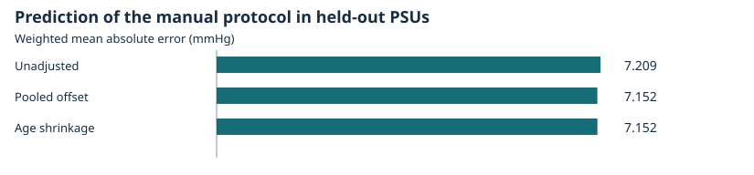
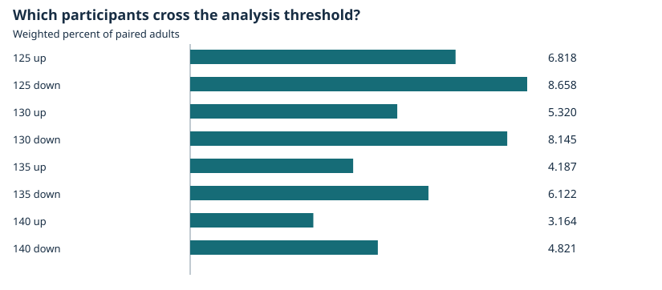
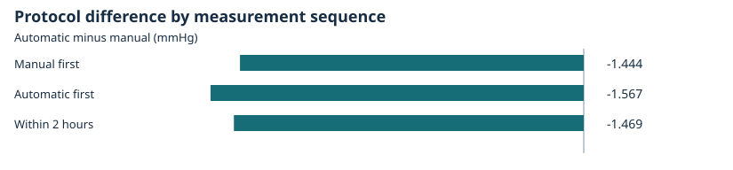

# When a Blood Pressure Survey Changes Its Measurement Protocol

## Executive Summary

Across 4,614 paired adults, the survey-weighted automatic-minus-manual mean was -1.50 mmHg. At 130 mmHg, 5.32% moved above and 8.15% moved below the cutoff.

## Decision and evaluation design

**Decision owner.** Population health surveillance team.

How much does replacing a blood-pressure measurement protocol change a survey threshold count?

Pair each adult's first three available-position readings (at least two per protocol). Compare the signed differences and both threshold directions using MEC weights and stratified PSU linearization. Fit pooled and partially pooled age-band offsets on other PSUs only.

**Data.** 4,614 rows. One examined adult with at least two valid systolic readings in each protocol. [NHANES 2017–2018 blood pressure methodology study and demographics](https://wwwn.cdc.gov/Nchs/Data/Nhanes/Public/2017/DataFiles/BPXO_J.htm).

## Evidence

### Prediction of the manual protocol in held-out PSUs

Every calibration excludes the complete test sampling unit.

| Comparison | Weighted mean absolute error (mmHg) |
|---|---:|
| Unadjusted | 7.209 |
| Pooled offset | 7.152 |
| Age shrinkage | 7.152 |

### Which participants cross the analysis threshold?

Movement up and down can cancel in a prevalence difference.

| Comparison | Weighted percent of paired adults |
|---|---:|
| 125 up | 6.818 |
| 125 down | 8.658 |
| 130 up | 5.320 |
| 130 down | 8.145 |
| 135 up | 4.187 |
| 135 down | 6.122 |
| 140 up | 3.164 |
| 140 down | 4.821 |

### Protocol difference by measurement sequence

Signed elapsed time orders examinations. The within-two-hour subset tests time separation.

| Comparison | Automatic minus manual (mmHg) |
|---|---:|
| Manual first | -1.444 |
| Automatic first | -1.567 |
| Within 2 hours | -1.469 |

## Reading the underlying evidence

At 130 mmHg, the following percentages use each age group as its own denominator. Design-based intervals preserve all strata and sampling units.

| Age | Direction | Weighted % | 95% lower | 95% upper |
|---|---|---|---|---|
| 18–39 | up | 3.660 | 2.323 | 4.997 |
| 18–39 | down | 5.234 | 4.001 | 6.466 |
| 40–59 | up | 5.290 | 3.355 | 7.226 |
| 40–59 | down | 10.509 | 7.632 | 13.387 |
| 60+ | up | 7.483 | 5.760 | 9.206 |
| 60+ | down | 9.090 | 7.525 | 10.655 |

## Next decision

For a surveillance trend crossing the protocol change, publish weighted directional switches and uncertainty alongside the series; use held-out error to choose any bridge.

## What this study cannot establish

The device and examiner change together. Weighted results describe adults with paired examination records; threshold crossings are survey classifications, not new clinical diagnoses.

The [machine-readable audit](results.json) contains denominators, subgroup results and additional diagnostics.

Result SHA-256: `8e184b38fe38e90639dea636ff1092c2218fb34d2cff790c2ac38a6154757784`
