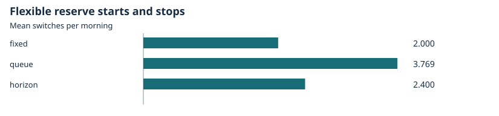
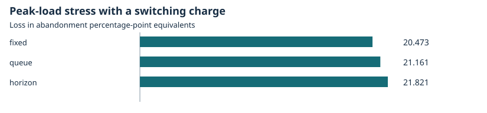

# When Should a Call Centre Reallocate Staff After a Demand Shock?

## Decision brief

**For the call-centre operations planner.** Review out-of-time discrepancies in waiting and abandonment before staffing a live shift. The forecast and flexibility costs can be varied independently.

Across 65 held-out mornings, mean simulated abandonment was 17.23% with a fixed reserve and 18.48% under receding-horizon dispatch. Observed abandonment averaged 13.91%.

## Flexible reserve starts and stops

Each policy pays for the same reserve time. Frequent changes carry additional organizational cost.

| Comparison | Mean switches per morning |
|---|---|
| fixed | 2 |
| queue | 3.769 |
| horizon | 2.400 |

## Peak-load stress with a switching charge

30% more arrivals in each sampled day's busiest period; each switch costs 0.25 percentage-point equivalents.

| Comparison | Loss in abandonment percentage-point equivalents |
|---|---|
| fixed | 20.473 |
| queue | 21.161 |
| horizon | 21.821 |

Historical outcomes describe observed calls. Staffing schedules, patience past the censoring point, operator flexibility and policy-dependent waits are simulated. The five-hour morning replay begins with an empty queue.

[Evaluation report](../../report.md) · [Decision record](decision-results.json)
