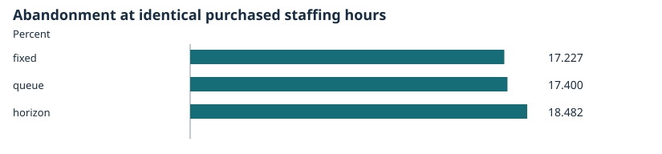
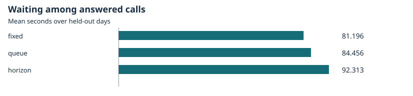
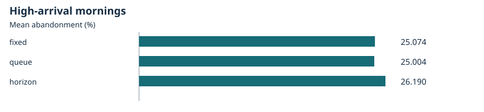

# When Should a Call Centre Reallocate Staff After a Demand Shock?

## Executive Summary

Across 65 held-out mornings, mean simulated abandonment was 17.23% with a fixed reserve and 18.48% under receding-horizon dispatch. Observed abandonment averaged 13.91%.

## Decision and evaluation design

**Decision owner.** Call-centre operations planner.

When, within a fixed staffing budget, should a manager release temporary service capacity?

Estimate censored patience and service by call type from January–July. Select base staffing against both waiting and abandonment in August–September. Replay October–December arrivals under fixed, queue-triggered and receding-horizon dispatch. Calls already in service continue after a flexible staffing interval ends.

**Data.** 144,382 rows. One queued telephone call between 08:00 and 13:00 on a Sunday–Thursday business day. [Technion Service Engineering Israeli bank call-centre logs](https://ie.technion.ac.il/serveng/callcenterdata/).

## Evidence

### Abandonment at identical purchased staffing hours

The three policies receive the same two-hour flexible reserve.

| Comparison | Percent |
|---|---:|
| fixed | 17.227 |
| queue | 17.400 |
| horizon | 18.482 |

### Waiting among answered calls

The simulation runs common arrivals, latent patience draws and service durations.

| Comparison | Mean seconds over held-out days |
|---|---:|
| fixed | 81.196 |
| queue | 84.456 |
| horizon | 92.313 |

### High-arrival mornings

Days above the holdout 75th percentile expose the cost of spending the reserve early.

| Comparison | Mean abandonment (%) |
|---|---:|
| fixed | 25.074 |
| queue | 25.004 |
| horizon | 26.190 |

## Reading the underlying evidence

The validation period selects a staffing scale using waiting and abandonment jointly. Time from the largest observed half-hour backlog to the first empty boundary is observable only on the days shown.

| Dispatch | Two-minute waits among answered (%) | Median minutes from peak to empty | Days observed |
|---|---|---|---|
| fixed | 25.870 | 30 | 49 |
| queue | 26.497 | 30 | 53 |
| horizon | 29.287 | 60.000 | 50 |

[Read the decision brief](decision/report/decision-report.md)

## Next decision

Review out-of-time discrepancies in waiting and abandonment before staffing a live shift. The forecast and flexibility costs can be varied independently.

## What this study cannot establish

Historical outcomes describe observed calls. Staffing schedules, patience past the censoring point, operator flexibility and policy-dependent waits are simulated. The five-hour morning replay begins with an empty queue.

The [machine-readable audit](results.json) contains denominators, subgroup results and additional diagnostics.

Result SHA-256: `56b16e67f9a2e6e4128a287235303dec65e96c001549b0d74f6a070b2d9c1133`
