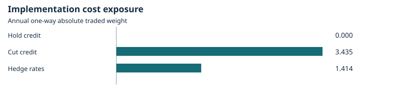
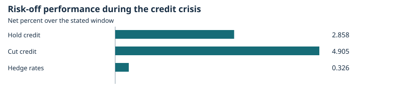

# Cut Credit Exposure or Hedge Rates During a Corporate Bond Drawdown?

## Decision brief

**For the fixed-income portfolio risk analyst.** Use the matched-rate comparison and stress-period outcomes to distinguish spread/liquidity exposure from rate sensitivity. The turnover threshold identifies when modeled trading costs reverse the gross comparison.

Over 1097 held-out weeks, the rule triggered 143 times. The modeled net maximum drawdown was -17.02% after cutting credit and -19.21% under the matched-rate hedge.

## Implementation cost exposure

The explicit one-way trading cost is applied to the absolute change in each leg.

| Comparison | Annual one-way absolute traded weight |
|---|---|
| Hold credit | 0.000 |
| Cut credit | 3.435 |
| Hedge rates | 1.414 |

## Risk-off performance during the credit crisis

Reported on the common historical calendar for all three portfolios.

| Comparison | Net percent over the stated window |
|---|---|
| Hold credit | 2.858 |
| Cut credit | 4.905 |
| Hedge rates | 0.326 |

A backtest using fund NAVs is a modeled portfolio. Shorting and funding spreads beyond the stated transaction cost can change the comparison. The non-rate residual includes liquidity and issuer-specific risk.

[Evaluation report](../../report.md) · [Decision record](decision-results.json)
