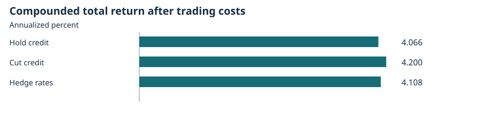
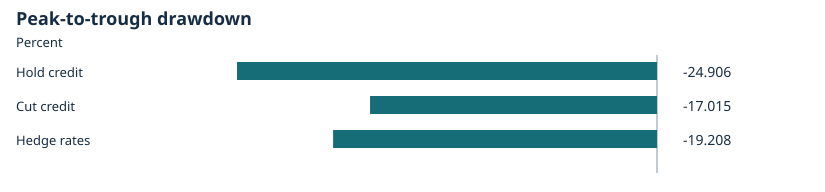
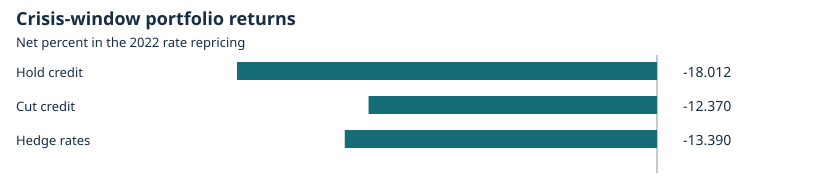

# Cut Credit Exposure or Hedge Rates During a Corporate Bond Drawdown?

## Executive Summary

Over 1097 held-out weeks, the rule triggered 143 times. The modeled net maximum drawdown was -17.02% after cutting credit and -19.21% under the matched-rate hedge.

## Decision and evaluation design

**Decision owner.** Fixed-income portfolio risk analyst.

During a credit drawdown, how does reducing corporate exposure compare with matching its expected rate sensitivity using a Treasury hedge?

Form weekly total returns from NAV plus distributions on ex-dates. At each week, use prior returns to estimate rate-factor betas and a lagged drawdown trigger. Compare static credit, a partial move to bills, and a self-financing Treasury overlay at similar expected rate sensitivity. Include costs, turnover, peak-to-trough loss and crisis subperiods.

**Data.** 1,149 rows. One common trading week for four iShares funds. [Issuer historical NAV and ex-dividend distribution records for LQD, IEF, SHY and TLT](https://www.ishares.com/us/products/239566/ishares-iboxx-investment-grade-corporate-bond-etf).

## Evidence

### Compounded total return after trading costs

Fund inputs are weekly NAV total returns with ex-date distributions reinvested.

| Comparison | Annualized percent |
|---|---:|
| Hold credit | 4.066 |
| Cut credit | 4.200 |
| Hedge rates | 4.108 |

### Peak-to-trough drawdown

The same lagged signal and transaction cost convention apply to every strategy.

| Comparison | Percent |
|---|---:|
| Hold credit | -24.906 |
| Cut credit | -17.015 |
| Hedge rates | -19.208 |

### Crisis-window portfolio returns

Named historical windows are descriptive stress checks.

| Comparison | Net percent in the 2022 rate repricing |
|---|---:|
| Hold credit | -18.012 |
| Cut credit | -12.370 |
| Hedge rates | -13.390 |

## Reading the underlying evidence

Gilchrist–Zakrajšek monthly corporate spreads and H.15 Treasury yields classify historical stress months after the fact. Trades use only lagged prices.

| Observed monthly stress | Weeks | Cut-credit return (bp/week) | Hedge return (bp/week) |
|---|---|---|---|
| Spread widens at least 25 bp | 82 | -16.404 | -26.252 |
| Treasury rises at least 25 bp | 104 | -34.208 | -34.449 |
| Both widen/rise by 25 bp | 4 | -59.842 | -59.842 |

[Read the decision brief](decision/report/decision-report.md)

## Next decision

Use the matched-rate comparison and stress-period outcomes to distinguish spread/liquidity exposure from rate sensitivity. The turnover threshold identifies when modeled trading costs reverse the gross comparison.

## What this study cannot establish

A backtest using fund NAVs is a modeled portfolio. Shorting and funding spreads beyond the stated transaction cost can change the comparison. The non-rate residual includes liquidity and issuer-specific risk.

The [machine-readable audit](results.json) contains denominators, subgroup results and additional diagnostics.

Result SHA-256: `40d648eea1a9fb7524dd0849d4c4306913d1ee804e4556c0c8b4f04528b792d9`
