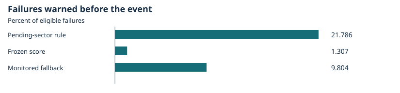
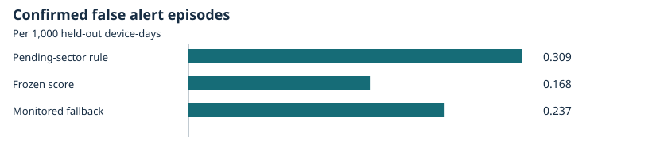
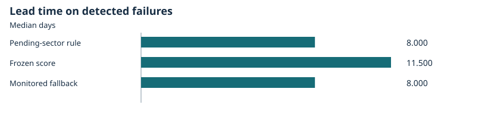

# Knowing When to Fall Back After a Drive Fleet Changes

## Executive Summary

With 15 daily review slots across 139 held-out dates, event recall was 21.8% for the pending-sector rule and 9.8% for monitored fallback across 459 observable failures.

## Decision and evaluation design

**Decision owner.** ML reliability lead.

When monitoring signals disappear after a fleet change, is switching to an interpretable rule worth the lost warnings?

Keep the complete fleet's observation calendar. Train on earlier, disjoint serials and exclude one entire model. Evaluate fifteen daily alerts on unseen serials or the excluded model. Keep every observed candidate at allocation, then report unobservable follow-up separately; differentiate missing from zero. Compare a fixed pending-sector rule, a frozen empirical score and a fallback triggered by unavailable indicators or matured poor precision.

**Data.** 100,501 rows. One maximal consecutive run of equal binned SMART indicators for a pseudonymous drive. [Backblaze Hard Drive Daily Statistics, 2016](https://www.backblaze.com/cloud-storage/resources/hard-drive-test-data).

## Evidence

### Failures warned before the event

Each drive and failure date counts once even with repeat warnings.

| Comparison | Percent of eligible failures |
|---|---:|
| Pending-sector rule | 21.786 |
| Frozen score | 1.307 |
| Monitored fallback | 9.804 |

### Confirmed false alert episodes

A consecutive episode with incomplete follow-up is reported as unresolved unless a failure is observed.

| Comparison | Per 1,000 held-out device-days |
|---|---:|
| Pending-sector rule | 0.309 |
| Frozen score | 0.168 |
| Monitored fallback | 0.237 |

### Lead time on detected failures

Lead time uses the earliest eligible warning in the fourteen-day horizon.

| Comparison | Median days |
|---|---:|
| Pending-sector rule | 8.000 |
| Frozen score | 11.500 |
| Monitored fallback | 8.000 |

## Reading the underlying evidence

The model-family holdout was ST4000DM000. The delayed performance gate was active on 61 dates. The row-level missing-feature fallback was applied on 0 selected alerts.

| Hardware model | Failure events | Slots used | Recall % | False episodes / 1,000 days | Median warning days |
|---|---|---|---|---|---|
| ST4000DM000 | 410 | 1775 | 10.732 | 0.286 | 8.000 |
| HGST HMS5C4040BLE640 | 4 | 84 | 0.000 | 0.025 | Not observed |
| HGST HMS5C4040ALE640 | 6 | 4 | 0.000 | 0.013 | Not observed |
| ST8000DM002 | 12 | 25 | 0.000 | 0.064 | Not observed |
| Hitachi HDS5C3030ALA630 | 5 | 12 | 20.000 | 0.058 | 12 |
| Hitachi HDS5C4040ALE630 | 1 | 82 | 0.000 | 0.067 | Not observed |

## Next decision

Use the per-model alert counts, false investigations and warning time to set a review budget. Record whether missing measurements or delayed precision caused each fallback.

## What this study cannot establish

A recorded hardware failure is a proxy for replacement need. A late and an absent failure are distinguishable only while the drive remains observed. Alternative dispatch rules are replayed on logged outcomes.

The [machine-readable audit](results.json) contains denominators, subgroup results and additional diagnostics.

Result SHA-256: `2f604e6f666575b7942f06a7ec77124bca57a39373d9a7825ef27bce75c04b78`
