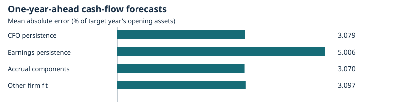
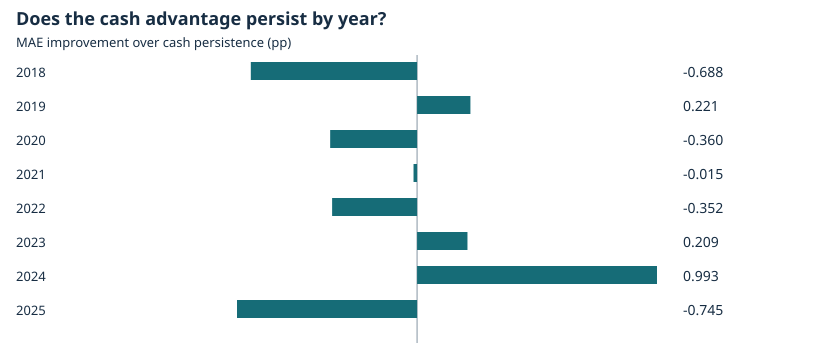
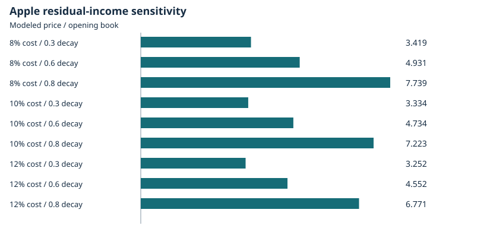

# When Reported Earnings Outrun Cash Collections

## Executive Summary

Across 89 out-of-time company-year forecasts, next-year operating-cash-flow MAE was 3.08% of opening assets for cash persistence and 3.07% for the accrual model.

## Decision and evaluation design

**Decision owner.** Fundamental research and accounting analyst.

When earnings outrun collections, do receivables and inventory changes improve next-year cash-flow forecasts?

Use a preselected set of 24 nonfinancial issuers. Retain filing dates and accessions, identify first original 10-K observations, and preserve later comparisons and amendments separately. Align annual income and CFO with point-in-time balances. Compare earnings/CFO persistence and a regularized working-capital decomposition using only matured prior labels. Include an issuer-held-out fit, annual falsification and a residual-income valuation sensitivity anchored to book value.

**Data.** 902 rows. One issuer, accession and fiscal period in an original or comparative annual filing. [US SEC EDGAR as-filed US-GAAP facts with an Apple audited-note cross-check](https://www.sec.gov/search-filings/edgar-application-programming-interfaces).

## Evidence

### One-year-ahead cash-flow forecasts

Each fitted model sees only labels publicly filed before the forecast.

| Comparison | Mean absolute error (% of target year's opening assets) |
|---|---:|
| CFO persistence | 3.079 |
| Earnings persistence | 5.006 |
| Accrual components | 3.070 |
| Other-firm fit | 3.097 |

### Does the cash advantage persist by year?

Negative values mean the accrual model lost to cash persistence.

| Comparison | MAE improvement over cash persistence (pp) |
|---|---:|
| 2018 | -0.688 |
| 2019 | 0.221 |
| 2020 | -0.360 |
| 2021 | -0.015 |
| 2022 | -0.352 |
| 2023 | 0.209 |
| 2024 | 0.993 |
| 2025 | -0.745 |

### Apple residual-income sensitivity

Scenario valuation holds book fixed under full payout. The cost of equity and persistence are assumptions.

| Comparison | Modeled price / opening book |
|---|---:|
| 8% cost / 0.3 decay | 3.419 |
| 8% cost / 0.6 decay | 4.931 |
| 8% cost / 0.8 decay | 7.739 |
| 10% cost / 0.3 decay | 3.334 |
| 10% cost / 0.6 decay | 4.734 |
| 10% cost / 0.8 decay | 7.223 |
| 12% cost / 0.3 decay | 3.252 |
| 12% cost / 0.6 decay | 4.552 |
| 12% cost / 0.8 decay | 6.771 |

## Reading the underlying evidence

Apple FY2023 Form 10-K, printed page 38: vendor non-trade receivables arise from components supplied to manufacturing vendors. The two largest counterparties accounted for 48% and 23%. Audit trade and vendor receivables separately before interpreting collections.

| Next-year earnings model | MAE (% of opening assets) |
|---|---|
| CFO persistence | 5.405 |
| Earnings persistence | 3.552 |
| Accrual components | 3.569 |

The Apple valuation uses filing 0000320193-25-000079. A one-time trade-receivable loss is charged in year one and discounted at 10%. The baseline fixes book value under full payout with residual-income persistence of 0.6.

| Uncollected fraction | Scenario equity value (USD millions) |
|---|---|
| 0 | 349,024.445 |
| 0.05 | 347,216.399 |
| 0.1 | 345,408.354 |
| 0.2 | 341,792.263 |

## Next decision

Investigate persistent cash-collection gaps alongside the audited note, industry and fiscal period. Use issuer-specific balance-sheet classifications before applying a valuation haircut.

## What this study cannot establish

Predictive associations in a selected panel do not establish manipulation or causality. Vendor non-trade receivables are distinct from customer trade balances. Scenario valuations depend on payout, opening book, abnormal-return persistence and cost of equity.

The [machine-readable audit](results.json) contains denominators, subgroup results and additional diagnostics.

Result SHA-256: `11b1041eecae6731d64863c43946241876e7a4376f05db8a96740804b2660975`
