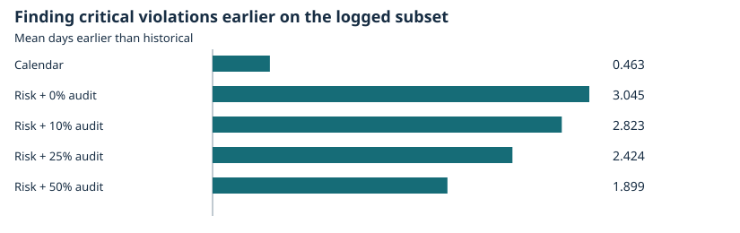
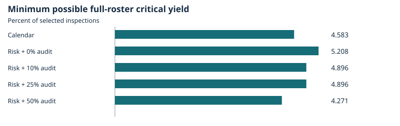

# How Much Inspection Capacity Should a City Reserve for Random Audits?

## Decision brief

**For the city public-health inspection and oversight team.** Implement exploration as a recorded randomized sample of the non-targeted eligible roster, retaining each stratum's probability. Evaluate future yield with design weights and geographic coverage.

The 25% exploration policy allocated 960 slots over 8 quarters. Historical results were observable for 197 selections, giving full-roster critical-finding bounds of 4.9% to 84.4%.

## Finding critical violations earlier on the logged subset

Historical time slots and outcomes are held fixed in this comparison.

| Comparison | Mean days earlier than historical |
|---|---|
| Calendar | 0.463 |
| Risk + 0% audit | 3.045 |
| Risk + 10% audit | 2.823 |
| Risk + 25% audit | 2.424 |
| Risk + 50% audit | 1.899 |

## Minimum possible full-roster critical yield

Treat all unobserved outcomes as negative for the lower bound. The accompanying evidence report provides upper bounds.

| Comparison | Percent of selected inspections |
|---|---|
| Calendar | 4.583 |
| Risk + 0% audit | 5.208 |
| Risk + 10% audit | 4.896 |
| Risk + 25% audit | 4.896 |
| Risk + 50% audit | 4.271 |

In the archival data only inspected restaurants reveal violations. The roster requires a known prior restaurant classification; never-classified premises are outside the target. Later inspections do not identify the causal effect of scheduling earlier.

[Evaluation report](../../report.md) · [Decision record](decision-results.json)
