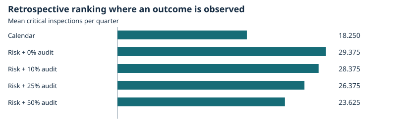
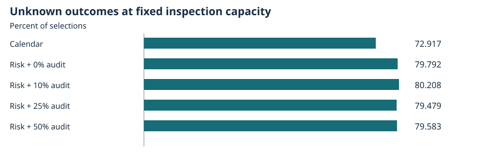
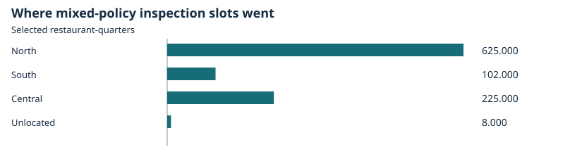

# How Much Inspection Capacity Should a City Reserve for Random Audits?

## Executive Summary

The 25% exploration policy allocated 960 slots over 8 quarters. Historical results were observable for 197 selections, giving full-roster critical-finding bounds of 4.9% to 84.4%.

## Decision and evaluation design

**Decision owner.** City public-health inspection and oversight team.

How much of a city's finite inspection capacity should be reserved for random exploration?

Reconstruct dated permit eligibility and use only earlier restaurant records for classification, risk and geography. Compare calendar ordering, risk prioritization and stratified random exploration under one slot budget. Evaluate reordering on historically inspected premises; report worst/best bounds for missing outcomes on the full eligible roster. Supply exact inclusion probabilities for a future audit.

**Data.** 55,823 rows. One active retail-food license with a previously identified restaurant at the start of a quarter. [Chicago Food Inspection Forecasting, historical permits and canvass inspections](https://chicago.github.io/food-inspections-evaluation/).

## Evidence

### Retrospective ranking where an outcome is observed

Only the historically inspected subset enters this conditional replay.

| Comparison | Mean critical inspections per quarter |
|---|---:|
| Calendar | 18.250 |
| Risk + 0% audit | 29.375 |
| Risk + 10% audit | 28.375 |
| Risk + 25% audit | 26.375 |
| Risk + 50% audit | 23.625 |

### Unknown outcomes at fixed inspection capacity

Wider bounds identify the cost of selective outcome observation.

| Comparison | Percent of selections |
|---|---:|
| Calendar | 72.917 |
| Risk + 0% audit | 79.792 |
| Risk + 10% audit | 80.208 |
| Risk + 25% audit | 79.479 |
| Risk + 50% audit | 79.583 |

### Where mixed-policy inspection slots went

The audit sample has known selection probabilities within each fixed geographic band.

| Comparison | Selected restaurant-quarters |
|---|---:|
| North | 625.000 |
| South | 102.000 |
| Central | 225.000 |
| Unlocated | 8.000 |

## Reading the underlying evidence

Logged-subset timing compares alternative visit orders on the same historical inspection dates with labels held fixed. The effect of carrying out a different visit schedule would need a prospective evaluation.

| Rule | Mean days earlier for critical results | Full-roster lower % | Full-roster upper % |
|---|---|---|---|
| Calendar | 0.463 | 4.583 | 77.500 |
| Risk + 0% audit | 3.045 | 5.208 | 85.000 |
| Risk + 10% audit | 2.823 | 4.896 | 85.104 |
| Risk + 25% audit | 2.424 | 4.896 | 84.375 |
| Risk + 50% audit | 1.899 | 4.271 | 83.854 |

[Read the decision brief](decision/report/decision-report.md)

## Next decision

Implement exploration as a recorded randomized sample of the non-targeted eligible roster, retaining each stratum's probability. Evaluate future yield with design weights and geographic coverage.

## What this study cannot establish

In the archival data only inspected restaurants reveal violations. The roster requires a known prior restaurant classification; never-classified premises are outside the target. Later inspections do not identify the causal effect of scheduling earlier.

The [machine-readable audit](results.json) contains denominators, subgroup results and additional diagnostics.

Result SHA-256: `3262da88a759b3fe1eb4b5b58135847ac6c5556cc6d45355a8f75127f90098f1`
