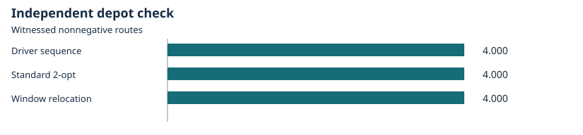
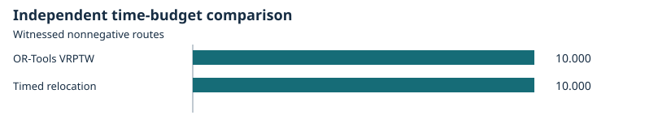

# How Much Departure Delay Can a Last-Mile Route Absorb?

## Decision brief

**For the freight and last-mile dispatch planner.** Offer delay only up to a recomputed feasible route witness. If the search and upper bounds disagree, retain the interval and use more solver time before making a dispatch promise.

On 24 complete published routes, window-focused relocation produced 10 nonnegative departure-delay witnesses; the recorded sequences produced 10. 14 routes remained inconclusive under the search budget.

## Independent depot check

The DBO3 depot is held out of design choices.

| Comparison | Witnessed nonnegative routes |
|---|---|
| Driver sequence | 4 |
| Standard 2-opt | 4 |
| Window relocation | 4 |

## Independent time-budget comparison

Wall-clock budget per method and route is fixed; each returned order is replayed offline.

| Comparison | Witnessed nonnegative routes |
|---|---|
| OR-Tools VRPTW | 10 |
| Timed relocation | 10 |

Package time windows and driver sequences are observed. Travel times are a provided static matrix, service durations are planned, and the depot-return deadline is an eight-hour scenario. Unsolved routes remain undetermined.

[Evaluation report](../../report.md) · [Decision record](decision-results.json)
