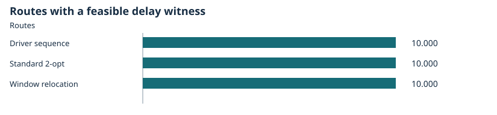
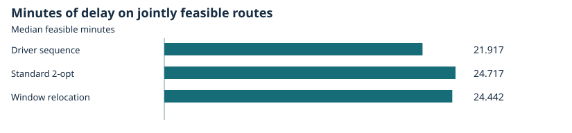
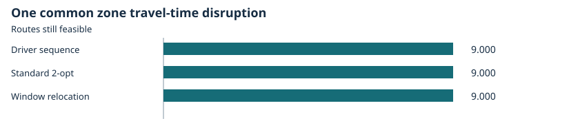

# How Much Departure Delay Can a Last-Mile Route Absorb?

## Executive Summary

On 24 complete published routes, window-focused relocation produced 10 nonnegative departure-delay witnesses; the recorded sequences produced 10. 14 routes remained inconclusive under the search budget.

## Decision and evaluation design

**Decision owner.** Freight and last-mile dispatch planner.

How late can a dispatcher release a route while still honoring its published windows and a stated end of shift?

Select six UUID-ordered high-rated routes of 45–145 stops from each of four depots before inspecting time windows. Evaluate the driver order and two classical route-improvement searches at the same move budget. Use backward time propagation for feasible witnesses and independent relaxation bounds for the largest possible delay. Report a station held out of design and a common zone disruption.

**Data.** 3,072 rows. One stop in a complete route, including its row of the fixed travel-time matrix. [Amazon Last Mile Routing Research Challenge, public model-build inputs](https://registry.opendata.aws/amazon-last-mile-challenges/).

## Evidence

### Routes with a feasible delay witness

Every reported delay supports a verified order and a return within the stated shift.

| Comparison | Routes |
|---|---:|
| Driver sequence | 10.000 |
| Standard 2-opt | 10.000 |
| Window relocation | 10.000 |

### Minutes of delay on jointly feasible routes

The paired denominator is recorded separately to expose feasibility selection.

| Comparison | Median feasible minutes |
|---|---:|
| Driver sequence | 21.917 |
| Standard 2-opt | 24.717 |
| Window relocation | 24.442 |

### One common zone travel-time disruption

Each evaluated order sees the same 25% travel-time increase into one zone.

| Comparison | Routes still feasible |
|---|---:|
| Driver sequence | 9.000 |
| Standard 2-opt | 9.000 |
| Window relocation | 9.000 |

## Reading the underlying evidence

An independent OR-Tools 9.15.6755 VRPTW baseline and a timed relocation search each received 0.5 seconds per route. The stored orders are checked against every stop, service time, window, and return requirement on each offline run.

| Timed method | Routes with verified nonnegative slack |
|---|---|
| OR-Tools VRPTW | 10 |
| Timed relocation | 10 |

The route audit also records the binding stop or depot return, the best witnessed lower bound, and a separate valid upper bound. An open interval is a candidate for more search. The deterministic comparison uses an equal number of candidate moves.

[Certified orders from the equal-wall-time solver comparison](../solver-witnesses.json)

[Read the decision brief](decision/report/decision-report.md)

## Next decision

Offer delay only up to a recomputed feasible route witness. If the search and upper bounds disagree, retain the interval and use more solver time before making a dispatch promise.

## What this study cannot establish

Package time windows and driver sequences are observed. Travel times are a provided static matrix, service durations are planned, and the depot-return deadline is an eight-hour scenario. Unsolved routes remain undetermined.

The [machine-readable audit](results.json) contains denominators, subgroup results and additional diagnostics.

Result SHA-256: `dadd0ecbcb78b0bdd83d30054f4fdbef6e0c812d8191f8277b3d6ebfee5c72c8`
