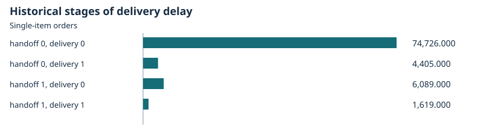
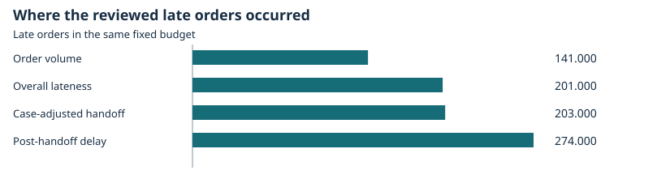

# Where Should a Marketplace Spend Its Delivery Improvement Budget?

## Decision brief

**For the marketplace strategy and logistics team.** Match proposed seller coaching or carrier service review to the observed stage. With equal per-order costs, choose carrier review only above the reported relative-effectiveness crossover; estimate effects prospectively.

Across 4 future quarters and 2,000 equal review slots per policy, adjusted seller targeting found 86 late deliveries following a missed handoff deadline. Carrier-focused targeting found 225 late deliveries after on-time handoff.

## Historical stages of delivery delay

Carrier handoff deadline and promised delivery date define the four cells.

| Comparison | Single-item orders |
|---|---|
| handoff 0, delivery 0 | 74726 |
| handoff 0, delivery 1 | 4405 |
| handoff 1, delivery 0 | 6089 |
| handoff 1, delivery 1 | 1619 |

## Where the reviewed late orders occurred

These are retrospectively covered late orders; intervention efficacy is a separate quantity.

| Comparison | Late orders in the same fixed budget |
|---|---|
| Order volume | 141 |
| Overall lateness | 201 |
| Case-adjusted handoff | 203 |
| Post-handoff delay | 274 |

An on-time handoff followed by a late delivery locates delay in the observed sequence. It does not establish fault or show that an intervention prevented lateness.

[Evaluation report](../../report.md) · [Decision record](decision-results.json)
