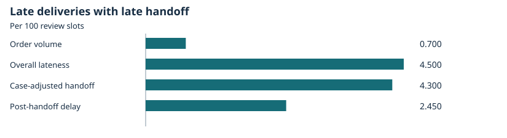
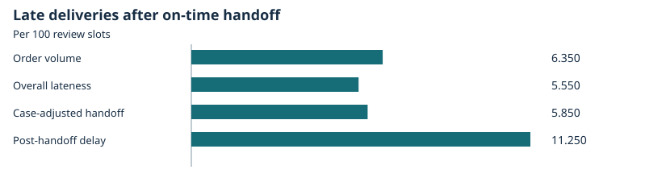
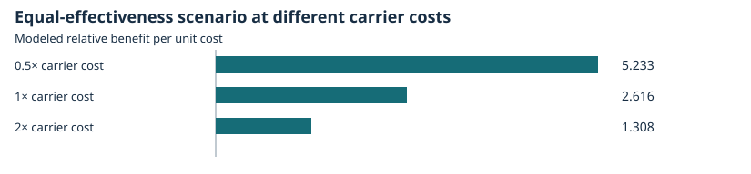

# Where Should a Marketplace Spend Its Delivery Improvement Budget?

## Executive Summary

Across 4 future quarters and 2,000 equal review slots per policy, adjusted seller targeting found 86 late deliveries following a missed handoff deadline. Carrier-focused targeting found 225 late deliveries after on-time handoff.

## Decision and evaluation design

**Decision owner.** Marketplace strategy and logistics team.

Should a marketplace direct an equal number of review slots to seller handoffs or to post-handoff delivery?

Separate final lateness by whether handoff met the seller timestamp. Adjust for destination and within-state delivery, shrink seller rates, and freeze priorities before each future quarter. Use only outcomes known at that decision date. Compare identical numbers of review slots, with explicit cost and effectiveness break-even.

**Data.** 88,863 rows. One order with exactly one recorded item from one seller; incomplete outcomes are retained. [Olist Brazilian E-Commerce Public Dataset](https://www.kaggle.com/datasets/olistbr/brazilian-ecommerce).

## Evidence

### Late deliveries with late handoff

Groups are prioritized using only matured prior-quarter outcomes.

| Comparison | Per 100 review slots |
|---|---:|
| Order volume | 0.700 |
| Overall lateness | 4.500 |
| Case-adjusted handoff | 4.300 |
| Post-handoff delay | 2.450 |

### Late deliveries after on-time handoff

This decomposition identifies the timing of a delay, not the responsible party.

| Comparison | Per 100 review slots |
|---|---:|
| Order volume | 6.350 |
| Overall lateness | 5.550 |
| Case-adjusted handoff | 5.850 |
| Post-handoff delay | 11.250 |

### Equal-effectiveness scenario at different carrier costs

Compare against 1.0. Relative intervention effectiveness and unit cost are assumptions.

| Comparison | Modeled relative benefit per unit cost |
|---|---:|
| 0.5× carrier cost | 5.233 |
| 1× carrier cost | 2.616 |
| 2× carrier cost | 1.308 |

## Reading the underlying evidence

The modeled carrier-to-seller effectiveness threshold at equal unit cost was 0.382. A trial can measure how often each intervention actually prevents a late delivery. Eligible training labels matured before each quarter.

| Quarter | Mature training orders | Eligible orders | Slots | Highest-priority carrier lane |
|---|---|---|---|---|
| 2017Q3 | 11834 | 10982 | 500 | SP → AL |
| 2017Q4 | 22397 | 15491 | 500 | SP → AL |
| 2018Q1 | 36765 | 18571 | 500 | SP → AL |
| 2018Q2 | 49684 | 17579 | 500 | SP → AL |

[Read the decision brief](decision/report/decision-report.md)

## Next decision

Match proposed seller coaching or carrier service review to the observed stage. With equal per-order costs, choose carrier review only above the reported relative-effectiveness crossover; estimate effects prospectively.

## What this study cannot establish

An on-time handoff followed by a late delivery locates delay in the observed sequence. It does not establish fault or show that an intervention prevented lateness.

The [machine-readable audit](results.json) contains denominators, subgroup results and additional diagnostics.

Result SHA-256: `a235902879b74307bd63cedfd66936f0796e6ddef0792af75978462931ca0e56`
