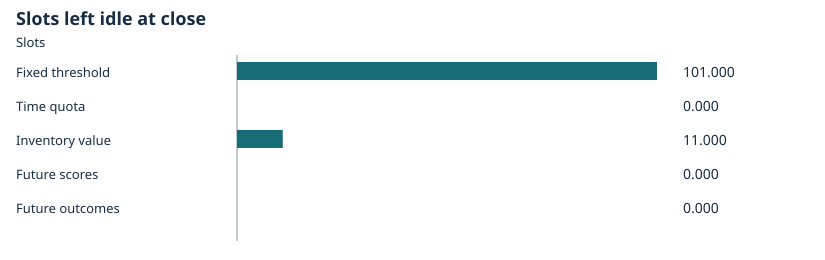
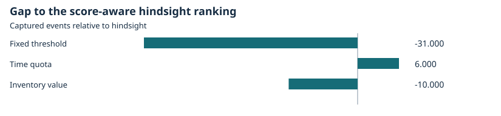

# The Last Review Slot in an Online Queue

## Decision brief

**For the operations research queue designer.** Use logged arrivals to price the next slot. Compare operational rules with both ceilings; knowing the best future scores and knowing the future outcomes are different advantages.

Across 366 held-out publication days, the inventory-value policy captured 308 seven-day identity reverts, versus 287 with a fixed threshold and 1095 for an outcome-aware upper bound.

## Slots left idle at close

The committed calendar offers the same daily ceiling to every rule.

| Comparison | Slots |
|---|---|
| Fixed threshold | 101 |
| Time quota | 0 |
| Inventory value | 11 |
| Future scores | 0 |
| Future outcomes | 0 |

## Gap to the score-aware hindsight ranking

Score hindsight knows future scores but has no access to realized labels when ranking.

| Comparison | Captured events relative to hindsight |
|---|---|
| Fixed threshold | -31 |
| Time quota | 6 |
| Inventory value | -10 |

An identity revert indicates that previously observed page content returned within seven days. It is a behavioral proxy. The replay assumes no effect of the simulated review on subsequent edits.

[Evaluation report](../../report.md) · [Decision record](decision-results.json)
