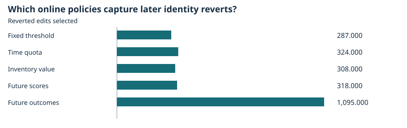
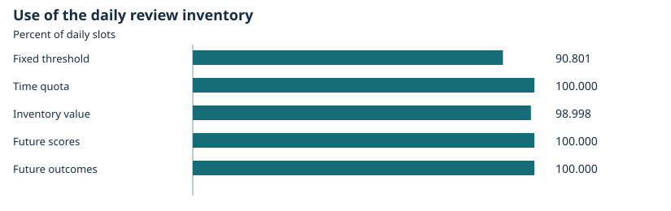
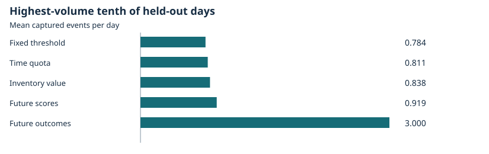

# The Last Review Slot in an Online Queue

## Executive Summary

Across 366 held-out publication days, the inventory-value policy captured 308 seven-day identity reverts, versus 287 with a fixed threshold and 1095 for an outcome-aware upper bound.

## Decision and evaluation design

**Decision owner.** Operations research queue designer.

When should an online reviewer spend the last daily slot on the current edit?

Replay real UTC arrivals in order. Use anonymized arrival-visible edit properties to estimate seven-day identity-revert risk on matured history. Compare a fixed threshold, time quota and marginal inventory-value policy with two hindsight bounds. Use the same finite daily capacity and examine burst days separately.

**Data.** 541,009 rows. One timestamped main-namespace English Wikivoyage revision, with complete future label horizon. [Wikimedia MediaWiki history, English Wikivoyage](https://wikitech.wikimedia.org/wiki/Data_Platform/Data_Lake/Edits/MediaWiki_history_dumps).

## Evidence

### Which online policies capture later identity reverts?

The two hindsight references see future scores or realized labels and are not deployable.

| Comparison | Reverted edits selected |
|---|---:|
| Fixed threshold | 287.000 |
| Time quota | 324.000 |
| Inventory value | 308.000 |
| Future scores | 318.000 |
| Future outcomes | 1,095.000 |

### Use of the daily review inventory

Unused slots expire at the end of each UTC day.

| Comparison | Percent of daily slots |
|---|---:|
| Fixed threshold | 90.801 |
| Time quota | 100.000 |
| Inventory value | 98.998 |
| Future scores | 100.000 |
| Future outcomes | 100.000 |

### Highest-volume tenth of held-out days

Traffic bursts expose the cost of spending the last slot too early.

| Comparison | Mean captured events per day |
|---|---:|
| Fixed threshold | 0.784 |
| Time quota | 0.811 |
| Inventory value | 0.838 |
| Future scores | 0.919 |
| Future outcomes | 3.000 |

## Reading the underlying evidence

For the first arrival of each chosen UTC hour, the table gives the estimated expected gain needed to spend one slot. The values are marginal inventory prices under the learned arrival and score distributions.

| Hour | One slot remaining | Two slots | Three slots |
|---|---|---|---|
| 0 | 0.238 | 0.238 | 0.237 |
| 6 | 0.238 | 0.237 | 0.236 |
| 12 | 0.237 | 0.235 | 0.230 |
| 18 | 0.232 | 0.224 | 0.219 |
| 23 | 0.189 | 0.129 | 0.072 |

[Read the decision brief](decision/report/decision-report.md)

## Next decision

Use logged arrivals to price the next slot. Compare operational rules with both ceilings; knowing the best future scores and knowing the future outcomes are different advantages.

## What this study cannot establish

An identity revert indicates that previously observed page content returned within seven days. It is a behavioral proxy. The replay assumes no effect of the simulated review on subsequent edits.

The [machine-readable audit](results.json) contains denominators, subgroup results and additional diagnostics.

Result SHA-256: `aab7b77bab08a96a7d66089d290449e49a5d3abbd7585f483b584c14d4b6bd72`
