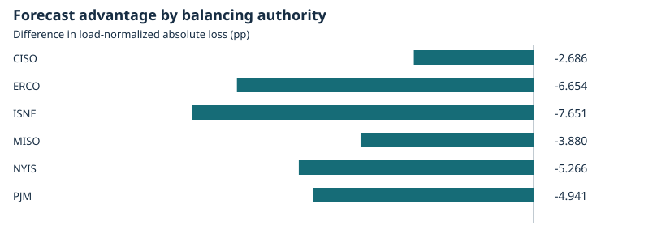
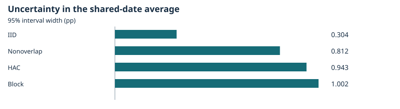
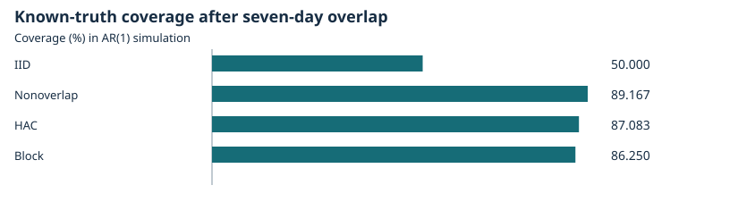

# How Reliable Are Model Comparisons With Overlapping Evaluation Windows?

## Executive Summary

Across 1,520 shared dates after the source-quality screen and 6 balancing authorities, the day-ahead minus seasonal-naive score averaged -5.14 percentage points. The 95% HAC interval spanned 0.943 points versus 0.304 under independence.

## Decision and evaluation design

**Decision owner.** Forecast evaluation lead.

How wide should a forecast-comparison interval be when adjacent scores reuse six days of observations?

For each full UTC date compute the paired difference in daily demand-normalized absolute errors. Average seven consecutive calendar dates; join six authorities by date. Compare independent, non-overlapping weekly, Bartlett HAC and moving-block intervals. In a separate controlled experiment run the identical procedures against a known population mean. Read both scores against a common reported-load screen; preserve the unfiltered replay and identify the influential dates.

**Data.** 10,833 rows. One balancing authority and UTC date with 24 observed, forecast and lagged observations. [EIA-930 hourly balancing authority electricity load](https://www.eia.gov/electricity/930-content/about.html).

## Evidence

### Forecast advantage by balancing authority

Negative values favor EIA's posted day-ahead forecasts over seven-day persistence.

| Comparison | Difference in load-normalized absolute loss (pp) |
|---|---:|
| CISO | -2.686 |
| ERCO | -6.654 |
| ISNE | -7.651 |
| MISO | -3.880 |
| NYIS | -5.266 |
| PJM | -4.941 |

### Uncertainty in the shared-date average

Blocking the cross-area mean resamples entire dates jointly across areas.

| Comparison | 95% interval width (pp) |
|---|---:|
| IID | 0.304 |
| Nonoverlap | 0.812 |
| HAC | 0.943 |
| Block | 1.002 |

### Known-truth coverage after seven-day overlap

Seeded experiments use a zero population mean; simulation coverage and historical intervals answer different questions.

| Comparison | Coverage (%) in AR(1) simulation |
|---|---:|
| IID | 50.000 |
| Nonoverlap | 89.167 |
| HAC | 87.083 |
| Block | 86.250 |

## Reading the underlying evidence

The raw historical mean was -28.44 pp on 1,534 windows. A common gross-error rule excludes an authority-day from both forecasts when any input exceeds 2,000,000 MW. There were 2 flagged records. The affected observed and lagged dates remain traceable.

| Authority | Date | Largest hourly MW | Unscreened paired loss (pp) |
|---|---|---|---|
| PJM | 2021-10-19 | 2,147,480,000.000 | -0.002 |
| PJM | 2021-10-26 | 2,147,480,000.000 | -214,403.150 |

| Interval method | Lower (pp) | Upper (pp) |
|---|---|---|
| IID | -5.295 | -4.991 |
| Nonoverlap | -5.582 | -4.770 |
| HAC | -5.615 | -4.672 |
| Block | -5.608 | -4.606 |

## Next decision

Publish uncertainty for paired calendar dates and sensitivity to block length. Treat published historical forecast errors as observations and the simulation as a coverage experiment.

## What this study cannot establish

The public extract contains historical reported observations, including revisions. Known-truth coverage is a simulation estimate with Monte Carlo uncertainty. Estimates concern the six reported balancing areas.

The [machine-readable audit](results.json) contains denominators, subgroup results and additional diagnostics.

Result SHA-256: `bbc62112b1f930c5cf3ef65c435a92bc02fae599e06fa608c15acca7473544aa`
