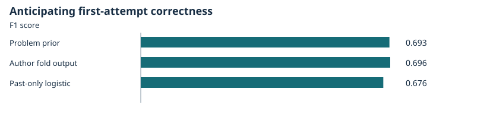
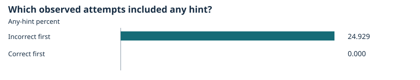
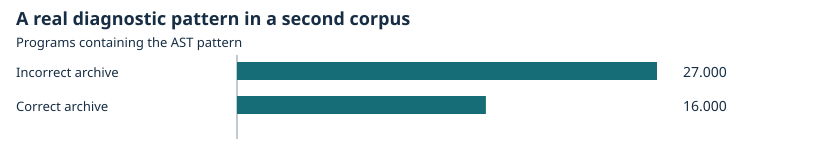

# Counterexamples or Direct Corrections for Novice Programmers?

## Executive Summary

The authors' public file contained 729 learner–problem records. On 584 matched out-of-time learner-held-out observations, first-correct F1 was 0.676 for the past-only model. In the independent code archive, 27 incorrect programs removed from the list being traversed.

## Decision and evaluation design

**Decision owner.** Learning designer and educational researcher.

Should a beginner receive an elicited counterexample or a direct correction after a repeatable misconception?

Use the 2019 challenge authors' public predictions and real first-correct, any-hint and attempt records. Hold out entire learners and mature earlier learners before fitting. Independently inspect real duplicate-removal attempts in the Refactory corpus. Build two runnable feedback designs and specify equal exposure, a new transfer item and a prospective learner-randomized evaluation.

**Data.** 1,583 rows. Either an author-published learner/problem summary or an independently published anonymized source-code attempt. [CSEDM 2019 published ITAP cross-validation rows and the Refactory novice programming corpus](https://github.com/thomaswp/CSEDM2019-Data-Challenge).

## Evidence

### Anticipating first-attempt correctness

Author predictions come from the published learner-fold analysis; the new fit imposes an additional historical cutoff.

| Comparison | F1 score |
|---|---:|
| Problem prior | 0.693 |
| Author fold output | 0.696 |
| Past-only logistic | 0.676 |

### Which observed attempts included any hint?

The released aggregate gives a binary hint indicator, not hint timestamps or treatment assignment.

| Comparison | Any-hint percent |
|---|---:|
| Incorrect first | 24.929 |
| Correct first | 0.000 |

### A real diagnostic pattern in a second corpus

Correct programs can share the pattern, so inspect a concrete trace before selecting feedback.

| Comparison | Programs containing the AST pattern |
|---|---:|
| Incorrect archive | 27.000 |
| Correct archive | 16.000 |

## Reading the underlying evidence

Refactory question 3, wrong_3_053.py: for [2,1,2], removing the first 2 leaves [1,2]; the intended order is [2,1].

The CSEDM rows cover 86 learners and 19 problems. A first correct attempt with no hint anywhere in the problem is an observable, conservative indicator. The corresponding F1 on the matched records was 0.676. The separate Refactory trace supplies the example used in the feedback prototypes.

The proposed trial randomizes learners within starting-skill strata. Both variants receive the same 60-second study period and unaided transfer item. The primary outcome is first-attempt transfer accuracy. The illustrative design requires 170 learners per arm under the specified baseline and target effect, before any recruitment allowance.

[Try the counterexample variant](https://limingrui679-design.github.io/high-stakes-analytics-decision-lab/demo/learning-feedback/#counterexample) · [Try the direct-correction variant](https://limingrui679-design.github.io/high-stakes-analytics-decision-lab/demo/learning-feedback/#correction) · [Download the offline prototype](../learning-prototype.html)

## Next decision

Use the two interactive feedback variants for a future learner-randomized study. Historical hint use is observational and cannot measure which prototype improves independent transfer.

## What this study cannot establish

The public CSEDM example describes a subset of the 89-learner, 38-task source cohort. It contains aggregated learner/problem outcomes. Actual code examples are from the independent Refactory study. No newly delivered hint or transfer improvement is attributed to either cohort.

The [machine-readable audit](results.json) contains denominators, subgroup results and additional diagnostics.

Result SHA-256: `0d2d5612aca526c7337adeb8a330f65473f772d0e869796c898a9afffdca1b58`
