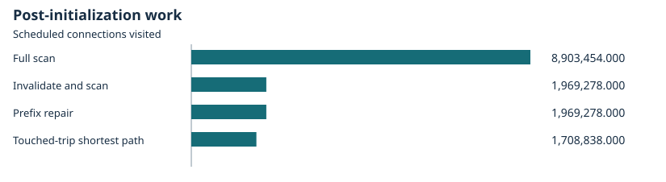
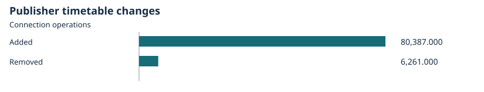
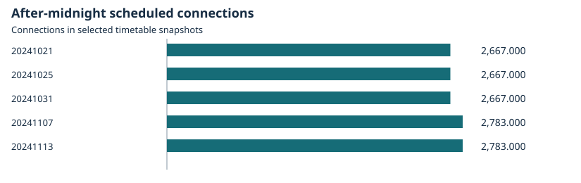

# Maintaining Earliest Arrival Routes Across Timetable Revisions

## Executive Summary

Across 10 timetable versions, all 300 route-query results matched a full scan. Revisions changed 4,223 destination arrival labels; checkpoint repair visited 1,969,278 connections versus 8,903,454 for full recomputation.

## Decision and evaluation design

**Decision owner.** Transit-routing systems engineer.

Can a router repair a revised timetable and still return exactly the same earliest arrivals as rebuilding?

Apply calendar and date exceptions for one Friday to ten consecutive archived feeds. Extract trunk rail, selected bus lines and shuttles. A timetable connection scan handles remaining on board, boarding restrictions, transfer waiting, and times beyond midnight. Retain unaltered time prefixes and compare with full invalidation and a fresh oracle for all reachable stops.

**Data.** 86,658 rows. One changed scheduled connection or version marker in ordered MBTA archive copies. [MBTA archived GTFS timetables for common service date 22 November 2024](https://www.mbta.com/developers/gtfs).

## Evidence

### Post-initialization work

All algorithms answer the same station/time queries to every reachable destination.

| Comparison | Scheduled connections visited |
|---|---:|
| Full scan | 8,903,454.000 |
| Invalidate and scan | 1,969,278.000 |
| Prefix repair | 1,969,278.000 |
| Touched-trip shortest path | 1,708,838.000 |

### Publisher timetable changes

A changed departure time is compared within the same published trip and stop sequence.

| Comparison | Connection operations |
|---|---:|
| Added | 80,387.000 |
| Removed | 6,261.000 |

### After-midnight scheduled connections

GTFS times beyond 24:00 stay attached to the preceding service date.

| Comparison | Connections in selected timetable snapshots |
|---|---:|
| 20241021 | 2,667.000 |
| 20241025 | 2,667.000 |
| 20241031 | 2,667.000 |
| 20241107 | 2,783.000 |
| 20241113 | 2,783.000 |

## Reading the underlying evidence

Every cached result was checked against a full connection scan and a separately implemented time-dependent label-setting search. A newly boardable connection outside the cached route can improve an arrival. An edited connection invalidates the time prefix from the earliest affected departure.

| Feed | Changed labels | Earliest changed second | Checkpoint visits |
|---|---|---|---|
| 20241021 | 0 | 15900 | 0 |
| 20241024 | 0 | Not observed | 0 |
| 20241025 | 0 | Not observed | 0 |
| 20241027 | 0 | Not observed | 0 |
| 20241031 | 0 | 18720 | 942936 |
| 20241101 | 4223 | 18300 | 1026342 |
| 20241107 | 0 | Not observed | 0 |
| 20241112 | 0 | Not observed | 0 |
| 20241113 | 0 | Not observed | 0 |
| 20241115 | 0 | Not observed | 0 |

[Measured routing latency and cache size](benchmark-host.json)

## Next decision

Retain prefix checkpoints only while their input prefix is unchanged. Early-in-day edits can erase the savings; invariance against full routing remains the release criterion.

## What this study cannot establish

The archive assigns each download a non-overlapping archive interval. This is a comparison of overlapping planned calendar service inside those files. Results concern scheduled travel in a selected network, with a stated same-station transfer buffer and no street-walking links.

The [machine-readable audit](results.json) contains denominators, subgroup results and additional diagnostics.

Result SHA-256: `7d89c9576f4d4809c6c8e37d4e043028d893ecc4e062cfedb83fad0df28d18d8`
