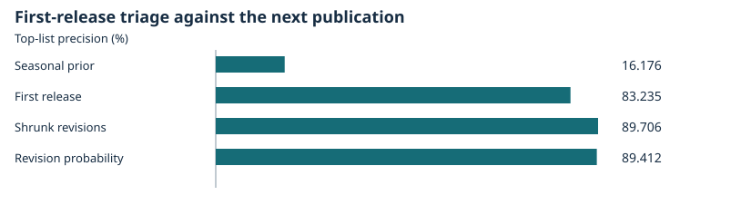
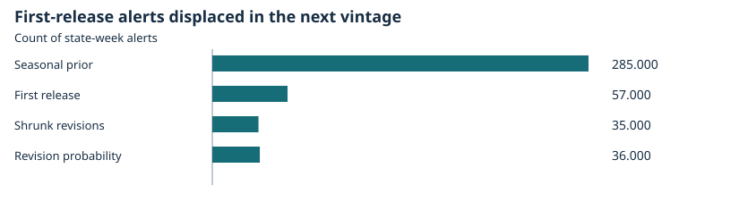
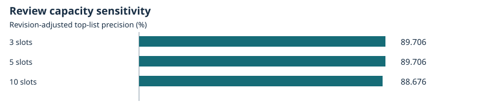

# Which State Unemployment Claims Alerts Survive the Next Release?

## Executive Summary

Across 68 held-out weekly releases at 5 review slots, 83.2% of first-release alerts and 89.7% of revision-adjusted alerts appeared in the next release's residence-based list.

## Decision and evaluation design

**Decision owner.** Labor-market monitoring analyst.

Which state-level claims alerts survive the switch from first publication to claimant-residence reporting?

Extract consecutive dated weekly releases and verify each printed state change. Rank anomalies after state-specific scale and seasonality adjustment. Compare a seasonal prior, the raw release and a shrunk historical revision adjustment against the residence-based top-K in the next publication. Hold out late dates and respect label publication.

**Data.** 7,579 rows. One US state or covered territory and initial-claims week, with two actual release dates. [Unemployment Insurance Weekly Claims, advance state tables](https://oui.doleta.gov/unemploy/claims_arch.asp).

## Evidence

### First-release triage against the next publication

All methods spend the same number of weekly review slots.

| Comparison | Top-list precision (%) |
|---|---:|
| Seasonal prior | 16.176 |
| First release | 83.235 |
| Shrunk revisions | 89.706 |
| Revision probability | 89.412 |

### First-release alerts displaced in the next vintage

An alert is displaced if its state falls outside the later top list.

| Comparison | Count of state-week alerts |
|---|---:|
| Seasonal prior | 285.000 |
| First release | 57.000 |
| Shrunk revisions | 35.000 |
| Revision probability | 36.000 |

### Review capacity sensitivity

Target ranking and capacity are recalculated at every budget.

| Comparison | Revision-adjusted top-list precision (%) |
|---|---:|
| 3 slots | 89.706 |
| 5 slots | 89.706 |
| 10 slots | 88.676 |

## Reading the underlying evidence

The target is membership in the next published list. The two official columns use different state reporting conventions. Each missed state is charged the actual number of calendar days to the next publication.

| State/territory | First-release alerts | First-release displaced | Adjusted displaced | Adjusted missed |
|---|---|---|---|---|
| Alaska | 17 | 17 | 2 | 0 |
| Massachusetts | 14 | 4 | 1 | 1 |
| Hawaii | 6 | 3 | 0 | 0 |
| Oregon | 7 | 3 | 1 | 1 |
| Rhode Island | 10 | 3 | 1 | 0 |
| Colorado | 11 | 2 | 1 | 2 |
| Illinois | 9 | 2 | 3 | 0 |
| Iowa | 7 | 2 | 0 | 1 |

## Next decision

Keep first-publication alerts provisional. Actual review budgets and the observed cost of a one-release delay determine whether an adjusted list is useful.

## What this study cannot establish

The advance column is reported by liable state and includes a workshare proxy. The next release uses state of residence. The ranked target is a later published measure, not a directly observed employment shock.

The [machine-readable audit](results.json) contains denominators, subgroup results and additional diagnostics.

Result SHA-256: `0e3b6712e861f829cc8d28d0358e993f8d80d07545eb07e644f31898060f0a46`
