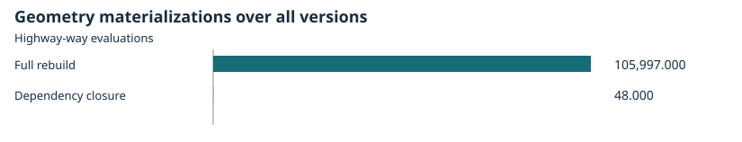
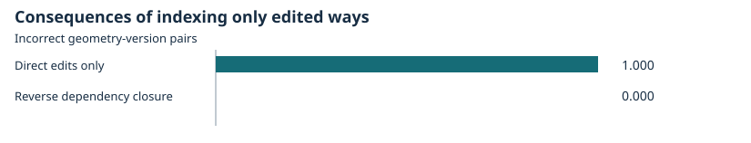
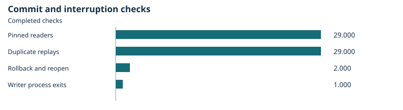

# Consistent Road Geometry During Interrupted Map Updates

## Executive Summary

Across 29 consecutive real map releases, dependency-aware repair matched every full rebuild and the next independent snapshot (3,655 highway geometries). Updating only revised ways missed 1 geometry-version discrepancy.

## Decision and evaluation design

**Decision owner.** Spatial systems engineer.

Can an interrupted map update publish mutually consistent node positions and road geometry?

Start at snapshot sequence 4897, replay sequences 4898–4926, and compare geometry at every version with a full rebuild. Track backward node-to-way dependencies and publish versioned geometry through an atomic SQLite transaction. Independently verify the terminal state against the 1 October publisher extract. Exercise replay, skipped sequence, interrupted commit and reopening.

**Data.** 96,081 rows. One base/oracle OSM element or one ordered node/way edit or sequence marker. [Geofabrik OpenStreetMap Monaco extracts and regional daily replication diffs](https://download.geofabrik.de/europe/monaco.html).

## Evidence

### Geometry materializations over all versions

Counts use the same highway scope and oracle per version.

| Comparison | Highway-way evaluations |
|---|---:|
| Full rebuild | 105,997.000 |
| Dependency closure | 48.000 |

### Consequences of indexing only edited ways

A moved node can change its referencing road even without a new way version.

| Comparison | Incorrect geometry-version pairs |
|---|---:|
| Direct edits only | 1.000 |
| Reverse dependency closure | 0.000 |

### Commit and interruption checks

Reader snapshot checks span the commit. The writer-exit trial deliberately leaves a transaction uncommitted.

| Comparison | Completed checks |
|---|---:|
| Pinned readers | 29.000 |
| Duplicate replays | 29.000 |
| Rollback and reopen | 2.000 |
| Writer process exits | 1.000 |

## Reading the underlying evidence

The reverse index required 48 geometry evaluations versus 105,997 under full reconstruction. 4 actual changed geometries were written to version history. A separate database reader held the previous version through 29 commits. A writer process was also terminated with its transaction open and the last committed sequence verified.

[Measured query latency, recovery time and storage](benchmark-host.json)

## Next decision

Publish a version after reverse dependencies, updated geometries and the sequence have committed together. Keep an indexed historical lookup and periodically verify the source snapshot.

## What this study cannot establish

This is a reproducible experiment on a single regional OSM extract and a local SQLite store. Work counts measure recomputation. System latency and production availability require separate measurement.

The [machine-readable audit](results.json) contains denominators, subgroup results and additional diagnostics.

Result SHA-256: `086d8605e56e7b9a2858b68a0c3bb86a412c7258ae85e8d594d6368deff6f105`
