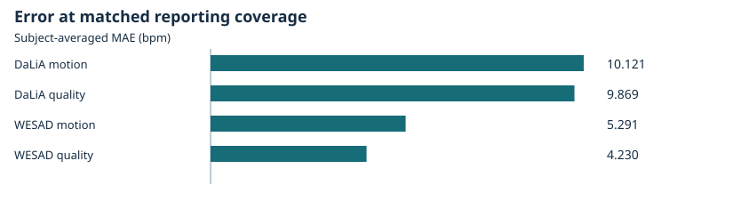
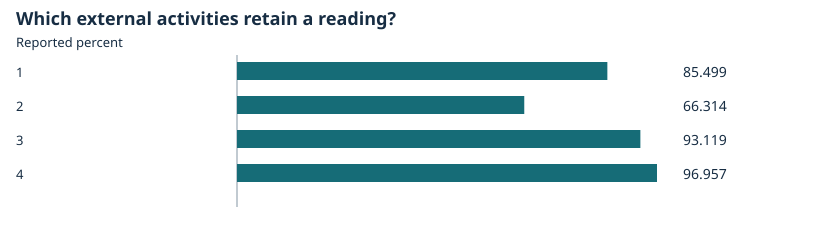
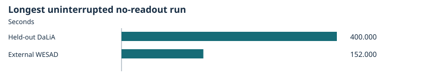

# When Should a Wrist Monitor Withhold a Heart Rate Reading?

## Executive Summary

With the DaLiA threshold frozen, WESAD retained 85.2% of 5,544 eligible windows. Subject-averaged absolute error among reported ECG-readable windows was 6.83 bpm.

## Decision and evaluation design

**Decision owner.** Biomedical signal-informatics researcher.

When can a wrist monitor's quality gate reduce error without leaving users without readings for too long?

Estimate wrist rate from the strongest physiological-frequency spectral peak. Compare movement-only gating to spectral concentration penalized by movement. Tune on complete DaLiA participants, freeze a threshold and test on unseen DaLiA people and the separate WESAD cohort. Check equivalent coverage, per-person and per-activity error, rejected ECG windows, and sustained gaps.

**Data.** 17,237 rows. One non-overlapping eight-second activity window from an anonymized participant. [PPG-DaLiA daily activities and WESAD laboratory sessions](https://archive.ics.uci.edu/dataset/495/ppg+dalia).

## Evidence

### Error at matched reporting coverage

At matched coverage, quality and motion policies report the same number of windows in each cohort.

| Comparison | Subject-averaged MAE (bpm) |
|---|---:|
| DaLiA motion | 10.121 |
| DaLiA quality | 9.869 |
| WESAD motion | 5.291 |
| WESAD quality | 4.230 |

### Which external activities retain a reading?

Frozen development threshold. The audit gives paired per-activity error, reference availability and large-error frequency.

| Comparison | Reported percent |
|---|---:|
| 1 | 85.499 |
| 2 | 66.314 |
| 3 | 93.119 |
| 4 | 96.957 |

### Longest uninterrupted no-readout run

Clock gaps and changes in study activity eligibility break no-readout runs.

| Comparison | Seconds |
|---|---:|
| Held-out DaLiA | 400.000 |
| External WESAD | 152.000 |

## Reading the underlying evidence

The external activity groups share one frozen development threshold. Error is subject-averaged among readable reference windows. Large-error rates count windows with error over 10 bpm.

| WESAD activity | Eligible | Reported % | MAE (bpm) | Large error % |
|---|---|---|---|---|
| 1 | 2186 | 85.499 | 4.371 | 9.256 |
| 2 | 1229 | 66.314 | 20.807 | 50.123 |
| 3 | 683 | 93.119 | 4.520 | 11.006 |
| 4 | 1446 | 96.957 | 3.654 | 6.522 |

## Next decision

Choose the reporting threshold using both per-person error and maximum no-readout time. Verify the policy in intended activities and hardware before relying on a new deployment.

## What this study cannot establish

The ECG reference is algorithm-derived. The external cohort changes the activity setting; both studies use Empatica wrist hardware. Reported accuracy applies only to the activity and ECG eligibility definitions.

The [machine-readable audit](results.json) contains denominators, subgroup results and additional diagnostics.

Result SHA-256: `1e06b8d32c35bcca4012f27132319819710bffdbe8fb0a61d934a59985735e2c`
